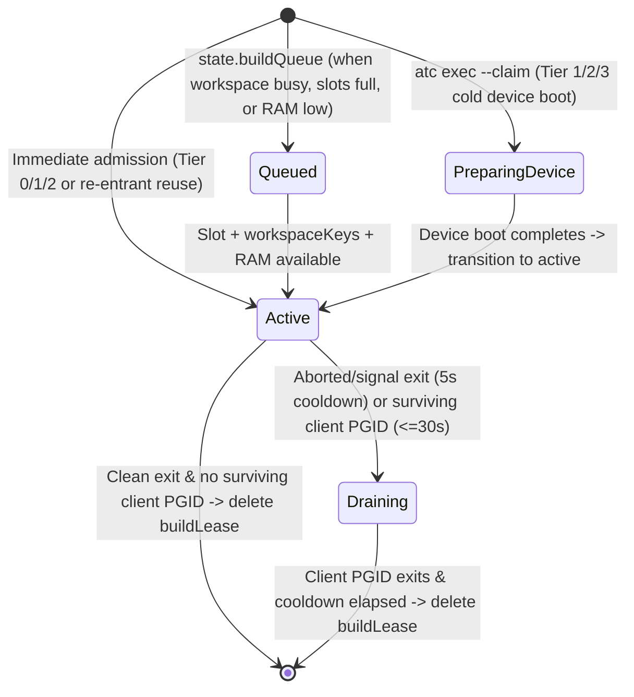

# Android Traffic Control (ATC) — 1.0 Design Specification

- **Status:** 1.0 Design Specification (v1.0.0)
- **Target Platforms:** macOS, Linux (Windows supported via `adb` and SDK `emulator` fallback; `android emulator` subcommands are macOS/Linux only per official Android CLI support)
- **Runtime Stack:** Node.js (>= 20 LTS, zero external runtime dependencies, ESM `.mjs`)
- **Integration Targets:** Official `android` CLI (`android emulator`, `android run`, `android layout`, `android screen`), `adb`, Codex, Pi, Cursor, Antigravity, Gemini CLI, Claude Code, and Stdio MCP.

---

## 1. Problem Statement & Scope

When multiple AI coding agents or developer terminal sessions work concurrently on the same host machine, they contend for Android Virtual Devices (AVDs) and connected physical USB/Wi-Fi test devices:

1. **Mid-task collision:** Agent A is inspecting a UI tree (`android layout`) or running instrumentation tests while Agent B installs a different APK, clears app data, navigates away, or stops the emulator.
2. **Multi-device ambiguity & personal-phone hazard:** When multiple emulators or a developer's personal USB phone are connected concurrently, `adb` and `android` commands without explicit device targeting (`ANDROID_SERIAL` or `--device=<serial>`) fail or hit the wrong device.
3. **Host resource exhaustion & cold-boot thrashing:** Launching every offline AVD concurrently exhausts host RAM/CPU/disk, while strict FIFO ordering between different device profiles repeatedly kills and cold-boots emulators back-to-back.
4. **Orphaned locks:** An agent session crashes, hits a turn limit, or forgets to release its device, blocking subsequent sessions.

### Design Goal ("It Has One Job")
ATC provides **exclusive, TTL-bounded device leases matched by hardware/OS profile, a daemonless bounded-window affinity wait queue, snapshot/wipe state preparation, device-scoped command execution, and cooperative agent-hook guardrails** around the official `android` CLI.

### Non-Goals
- Replicating `android` CLI features (SDK management, layout inspection, screenshot capture, APK installation).
- Remote/distributed device farms across multiple physical hosts.
- Multi-instance booting of the same AVD simultaneously (Android AVDs lock their `.avd` directory via `hardware-qemu.ini.lock`; ATC enforces a strict 1-lease-per-AVD invariant).
- OS-level mandatory access control against adversarial local users (hook guardrails are cooperative safety rails for coding agents, not a kernel sandbox).
- Persistent background daemon processes that require OS service managers, code signing, or notarization.

---

## 2. Stack & Portability Rationale

ATC is implemented as a **zero-dependency Node.js (>= 20) ESM package** (`atc.mjs`):

- **Why Node.js with zero native dependencies?**
  - Every target coding agent environment (Codex, Pi, Cursor, Antigravity, Gemini CLI, Claude Code) already runs on or alongside Node.js on macOS, Linux, and Windows.
  - Pure JavaScript (`.mjs`) using only Node built-in modules (`node:fs`, `node:path`, `node:os`, `node:child_process`, `node:crypto`, `node:readline`) requires **no binary compilation (`node-gyp`), no Apple Developer ID signing/notarization, and no Windows SmartScreen binary whitelisting**.
  - Works identically via `npx`, global `npm install -g`, or direct invocation from any agent plugin/extension directory (`node "<pluginRoot>/bin/atc.mjs"`).

---

## 3. Architecture Overview

ATC uses a **daemonless, lock-directory-serialized state file** architecture. Every CLI command (`claim`, `free`, `renew`, `snapshot`, `exec`, `guard`, `status`, `config`, `gc`, `hook`, `mcp`) coordinates through a local user-private runtime directory.

```
+-----------------------------------------------------------------------+
| Any Coding Agent or Shell (Codex / Pi / Cursor / Antigravity / Claude)|
|  - Skill:     skills/atc/SKILL.md (universal CLI workflow)            |
|  - Guardrail: Pi extension / PreToolUse hook / `atc guard`            |
|  - Cleanup:   Stop / SessionEnd hook + dead-ancestor-PID GC           |
+-----------------------------------+-----------------------------------+
                                    |
                                    v
+-----------------------------------------------------------------------+
| ATC CLI (`atc`) & Optional Stdio MCP (`atc mcp`)                      |
|  - Commands: claim | free | renew | snapshot | exec | status | gc ... |
|  - Scheduler: Warm-affinity batching within `reorderWindowSec`        |
|  - Mutex:    Atomic `mkdir <stateDir>/atc.lock` + nonce verification  |
|  - State:    Atomic temp-write + rename of `<stateDir>/state.json`    |
+-----------------------------------+-----------------------------------+
                                    |
                                    v
+-----------------------------------------------------------------------+
| Official Android Tooling & Local AVD Metadata (Outside Lock Only)     |
|  - `android emulator list --long` / `start` / `stop` / `create`       |
|  - `~/.android/avd/*.ini`, `*.avd/config.ini`, `*.avd/snapshots/*`    |
|  - `adb devices` / `adb -s <serial> emu avd snapshot <save|load>`     |
+-----------------------------------------------------------------------+
```

### 3.1 State Directory Location & Permissions
To prevent cross-user symlink/temp-file attacks, ATC stores state on a **local filesystem** (NFS/SMB network shares are unsupported) in a user-private directory created with mode `0700` (files `0600` on POSIX):

- **Override:** `ATC_STATE_DIR` (must be an absolute path on a local disk; verified via `fs.lstatSync` not to be a symlink and owned by `process.getuid()` on POSIX).
- **macOS:** `~/Library/Application Support/atc`
- **Linux:** `$XDG_RUNTIME_DIR/atc` (if set, local, and `0700`) or `~/.local/state/atc`
- **Windows:** `%LOCALAPPDATA%\atc`

### 3.2 Cross-Platform Mutual Exclusion (`atc.lock`) & Strict Lock Boundary

#### Invariant: Zero Subprocesses Under Lock
No external subprocess (`android`, `adb`, `ps`, `powershell`, etc.) may **ever** be spawned while holding `atc.lock`. Device inventory is gathered *before* acquiring `atc.lock`, and emulator boot/stop commands run *after* releasing `atc.lock` using persisted transitional lease states (`"starting"` and `"stopping"`).

What runs inside `atc.lock` is strictly bounded to <20ms of local in-memory and filesystem operations:
1. Read and parse `<stateDir>/state.json`.
2. Run in-memory Garbage Collection (timestamps + `process.kill(pid, 0)` syscalls).
3. Mutate state in memory.
4. Verify lock ownership nonce (`owner.json.nonce === myNonce`).
5. Write `<stateDir>/state.json.tmp.<pid>.<nonce>`, `fsyncSync`, and atomically `renameSync` over `<stateDir>/state.json`.
6. Release `atc.lock`.

#### Lock Protocol (`Acquire` / `Stale-Break` / `Release`)
1. **Acquire:**
   - Generate a random 12-byte hex `myNonce`.
   - Call `fs.mkdirSync("<stateDir>/atc.lock", { mode: 0o700 })`.
   - Immediately write `<stateDir>/atc.lock/owner.json` (`{ pid: process.pid, createdAtMs: Date.now(), nonce: myNonce }`) via atomic write-and-rename inside `atc.lock`.
2. **Contention & Stale Lock Recovery:**
   - If `mkdirSync` throws `EEXIST`, read `<stateDir>/atc.lock/owner.json`.
   - A lock is considered **stale** if:
     - `owner.json` has existed for > `10,000ms` (`Date.now() - owner.createdAtMs > 10000`), OR
     - `owner.json` is missing/unreadable for > `2,000ms` across retries (crashed mid-acquire or unlinked during release), OR
     - `owner.pid` is confirmed dead via `process.kill(owner.pid, 0)` throwing `ESRCH`.
   - To break a stale lock without racing other waiters, the waiter atomically renames `<stateDir>/atc.lock` to `<stateDir>/atc.lock.stale.<waiterNonce>`. (If `renameSync` fails with `ENOENT`/`EPERM`/`EACCES`, another waiter already broke it; sleep and retry normal acquisition.) Once renamed, the waiter deletes `atc.lock.stale.<waiterNonce>` recursively outside the critical path and retries `Acquire`.
   - Otherwise, sleep `20ms–60ms` (with random jitter) and retry up to `lockTimeoutMs` (`5,000ms`).
3. **Nonce-Verified Commit & Release:**
   - Before renaming `state.json.tmp.<pid>.<myNonce>` onto `state.json`, the holder re-reads `<stateDir>/atc.lock/owner.json` and checks `owner.nonce === myNonce`.
   - If `owner.json` is missing or `owner.nonce !== myNonce`, the holder was stale-broken: it **must abort** its write, unlink its temp file, and **must not** remove `atc.lock`. (Note: as with any userspace lock, a theoretical 2-syscall window exists if the kernel `SIGSTOP`s the process between nonce verification and `renameSync`; keeping critical sections <20ms against a 10s stale threshold makes this negligible in practice.)
   - If `owner.nonce === myNonce`, commit `state.json`, unlink `<stateDir>/atc.lock/owner.json`, and call `fs.rmdirSync("<stateDir>/atc.lock")`. On Windows, if `rmdirSync` throws `EBUSY`/`EPERM`/`ENOTEMPTY` due to transient antivirus handle retention after `owner.json` is already unlinked, ignore the `rmdirSync` error and treat release as successful (the empty lock dir self-heals via the >2s missing-`owner.json` stale-break rule).
4. **Windows Atomic Rename & Corruption Recovery:**
   - State writes open `<stateDir>/state.json.tmp.<pid>.<myNonce>` with flag `"wx"` (`O_CREAT | O_EXCL`, mode `0o600`), write JSON, call `fsyncSync`, close the descriptor, and call `fs.renameSync(tmpPath, statePath)`.
   - On Windows, if `renameSync` throws `EPERM` or `EACCES` (due to transient antivirus/indexer handles), retry up to 5 times with `15ms–45ms` backoff. If all 5 retries fail, unlink `tmpPath`, release `atc.lock`, and exit with code `1` (leaving previous `state.json` intact).
   - If `state.json` cannot be parsed (`SyntaxError`) or fails top-level schema validation, quarantine it by renaming to `state.json.corrupt.<timestamp>`, log a warning to `stderr`, and initialize a fresh default state.

---

## 4. Data Model (`state.json`)

To support both emulators/simulators and physical USB/Wi-Fi devices (in 1.0 and into 2.0 multiplatform mode — see §9) without a schema migration, `state.leases` is keyed by a canonical `deviceKey`:
- **`avd:<avdId>`** for Android Virtual Devices (enforcing at most one lease/instance per AVD, both before and after boot).
- **`sim:<udid>`** *(reserved for ATC 2.0 iOS Simulators, keyed by `CoreSimulator` UDID)*.
- **`serial:<serial>`** for physical devices (`kind: "physical"`, using `adb` serial on Android or hardware `UDID` on iOS).

Every lease has `state` in `"starting" | "active" | "stopping"` (`"starting"` covers AVD creation, cold/warm boot, live snapshot restore, and data wipe outside `atc.lock`; `"stopping"` covers post-lease actions on `atc free` — `--snapshot-save`, `--snapshot-load`, and/or `android emulator stop` — outside `atc.lock`).

#### Forward-Compatibility & Mixed-Version Coexistence Invariants (1.0 <-> 2.0)
Because multiple agents on the same machine may invoke different cached versions of `atc` (e.g., an older 1.0 binary alongside a 2.0 binary), 1.0 enforces three forward-compatibility rules from day one:
1. **Round-Trip Preservation of Unknown Fields:** When reading and re-serializing `state.json`, 1.0 preserves any unrecognized keys in `config`, `leases[*]`, and `queue[*]` verbatim.
2. **Platform-Scoped Offline Reconciliation & Matching:** 1.0's offline-grace reconciliation (§5.3 Step 2) and profile matching (§5.3 Step 4) only evaluate records where `(record.platform || "android") === "android"`. A 1.0 process will never reap an active `platform: "ios"` (`sim:<udid>`) lease simply because it is absent from `android emulator list` / `adb devices`.
3. **Cross-Platform RAM Budget Awareness:** 1.0's `projectedAvailableRamMb` calculation (§5.2.4) subtracts `requiredRamMb` for all `"starting"` or recently activated leases regardless of `platform`.

```json
{
  "version": 1,
  "config": {
    "maxRunningEmulators": 2,
    "minFreeRamMb": 2048,
    "minFreeDiskMb": 2048,
    "qemuOverheadRamMb": 1024,
    "defaultTtlSec": 600,
    "maxTtlSec": 3600,
    "defaultWaitSec": 300,
    "reorderWindowSec": 120,
    "queueHeartbeatTimeoutSec": 10,
    "bootTimeoutSec": 180,
    "stopTimeoutSec": 60,
    "offlineGraceMs": 45000,
    "physicalOfflineGraceMs": 15000,
    "autoStopIdleOnContention": true,
    "allowPhysicalDevices": "explicit"
  },
  "leases": {
    "avd:Pixel_9": {
      "leaseId": "lease_9f8a7b6c5d4e",
      "deviceKey": "avd:Pixel_9",
      "platform": "android",
      "kind": "emulator",
      "avd": "Pixel_9",
      "serial": "emulator-5554",
      "profile": {
        "platform": "android",
        "deviceType": "phone",
        "deviceName": "pixel_9",
        "apiLevel": "android-36",
        "osVersion": null,
        "services": "play",
        "playStore": true,
        "abi": "arm64-v8a"
      },
      "sessionId": "agent-eb12f8",
      "anchorPid": 48210,
      "state": "active",
      "workerPid": null,
      "replacingAvd": null,
      "requiredRamMb": 3072,
      "requiredDiskMb": 0,
      "loadedSnapshot": "clean_boot",
      "saveSnapshotOnFree": null,
      "claimedAtMs": 1791292800000,
      "activatedAtMs": 1791292804000,
      "renewedAtMs": 1791292860000,
      "expiresAtMs": 1791293460000,
      "deadlineMs": null,
      "firstSeenOfflineAtMs": null,
      "isRecovery": false,
      "reason": "UI test verification"
    }
  },
  "queue": [
    {
      "ticketId": "q_1a2b3c4d5e6f",
      "sessionId": "agent-77c09a",
      "waiterPid": 51092,
      "requestedPlatform": "android",
      "requestedKind": "emulator",
      "requestedAvd": null,
      "requestedSerial": null,
      "requestedProfile": {
        "platform": "android",
        "deviceType": "phone",
        "apiSpec": ">=35",
        "services": "play",
        "abi": null,
        "snapshotLoad": "clean_boot",
        "wipeData": false,
        "coldBoot": false
      },
      "enqueuedAtMs": 1791292810000,
      "starvationDeadlineMs": 1791292930000,
      "lastHeartbeatAtMs": 1791292862000,
      "waitExpiresAtMs": 1791293110000,
      "reason": "Screenshot check"
    }
  ],
  "hookSessions": {
    "48210": {
      "sessionId": "agent-eb12f8",
      "agentPid": 48210,
      "cwd": "/Users/dev/project",
      "updatedAtMs": 1791292860000
    }
  },
  "disconnectedPhysicalLeases": {}
}
```

### 4.1 Lease Lifecycle States & Physical Device Semantics (MVP -> 1.0)
| `lease.state` | Meaning | Counted in `usedSlots`? | Claimable by others? |
| :--- | :--- | :--- | :--- |
| `"starting"` | Device reserved by `workerPid` while boot, `--wipe-data`, `--snapshot-load`, or `--reset-app` runs outside lock | Emulators: Yes (unless `replacingAvd` is already counted as running or `"stopping"`, in which case the pair counts as 1 slot); Physical: No | No |
| `"active"` | Exclusively owned by `sessionId` until `expiresAtMs` (`emulator` or `physical`) | Emulators: Yes; Physical devices: **No** (zero host QEMU RAM/CPU cost) | Only idempotently by the same `sessionId` |
| `"stopping"` | Device reserved by `workerPid` while post-lease actions (`--snapshot-save`, `--snapshot-load`, or `android emulator stop <serial>`) run outside lock | Emulators: Yes; Physical: No | No |

#### Physical Devices (`kind: "physical"`): MVP Safety vs 1.0 Support
1. **No Accidental Personal-Phone Hijack:** Unfiltered `atc claim` defaults to `--kind emulator` so agents do not automatically install test APKs onto a developer's personal plugged-in phone.
2. **Explicit / 1.0 Physical Device Claims:** A physical device can be claimed when explicitly targeted (`atc claim --serial <usb_or_wifi_serial>` or `atc claim --kind physical|any`, or when allowlisted in `config.allowedPhysicalSerials` for 1.0).
3. **Lifecycle Guardrails for Physical Devices:** Physical devices cannot be booted or stopped (`--stop` on `atc free` is a no-op with a warning on physical leases, and Priority-3 idle eviction never targets `kind: "physical"`). They do not count toward `maxRunningEmulators`.

### 4.2 Host-Agnostic Session Identity & `anchorPid` Resolution
Agent tool calls execute in ephemeral subshells, so `process.pid` of `atc claim` exits immediately. Furthermore, ATC must work seamlessly across **Codex, Pi, Cursor, Antigravity, Gemini CLI, Claude Code, and plain terminals** — whether or not the host supports command-rewriting hooks, and even when multiple agents work in the **same repository directory (`cwd`)**:

1. **Explicit CLI Flag, Lease Token, or Env Var (Highest Priority, Universal):**
   - `--session <id>`, `ATC_SESSION_ID`, or `--lease <leaseId>` / `ATC_LEASE_ID` (with `anchorPid = parseEnvInt(ATC_ANCHOR_PID) || null`). Any agent or script can pass `--session` or `ATC_LEASE_ID` directly with zero hook dependencies.
2. **Extension / Hook Command Rewrite (Pi, Antigravity, Gemini CLI, Claude Code):**
   - On hosts whose tool-call extension or `PreToolUse` hook supports command rewriting (`event.input.command` in Pi's `tool_call` extension, `overwrite` in Antigravity/Gemini CLI, or `hookSpecificOutput.updatedInput` in Claude Code), calling `atc` without `--session` automatically prepends `ATC_SESSION_ID=<id> ATC_ANCHOR_PID=<agentPid>`. This provides **exact, collision-free session identity in 0ms** even when multiple sessions run concurrently in the same `cwd`.
3. **Ambient Agent Environment Variables:**
   - Checks standard session/conversation variables exported by agent runtimes: `CODEX_SESSION_ID`, `PI_SESSION_ID`, `CURSOR_TRACE_ID`, `CURSOR_SESSION_ID`, `ANTIGRAVITY_CONVERSATION_ID`, `GEMINI_SESSION_ID`, `CLAUDE_SESSION_ID`, `CONVERSATION_ID`.
4. **PID-Keyed Hook Breadcrumb (`state.hookSessions`, for non-rewriting hooks like Codex & Cursor):**
   - Every `PreToolUse` hook invocation also records `state.hookSessions[agentPid] = { sessionId, agentPid: process.ppid, cwd, updatedAtMs }` (retained for 60s and swept by in-memory GC).
   - When `atc` runs without `ATC_SESSION_ID`:
     - If `state.hookSessions[process.ppid]` exists and is fresh, use it directly (`0ms`).
     - Otherwise inspect fresh entries in `state.hookSessions` matching `process.cwd()`:
       - If **exactly one** active session exists for `cwd`, select it (`0ms`).
       - If **multiple** concurrent sessions exist in the same `cwd` on a host without command rewriting, release `atc.lock` (preserving the zero-subprocesses-under-lock invariant) and walk ancestor PIDs (`ps` on POSIX; on Windows fail closed without spawning a subprocess) to match `agentPid` in `state.hookSessions`; if still ambiguous, fail closed with exit code `1` instructing the agent to pass `--session <unique_id>`.
5. **Stdio MCP Server (`atc mcp` — Cursor, Windsurf, Zed, etc.):**
   - When invoked via `atc mcp`, the MCP server process stays alive for the duration of the agent session: `sessionId = "mcp-" + process.pid`, `anchorPid = process.pid`.
6. **Universal Parent-Process / Terminal Fallback (Zero-Hook Agents & Interactive Shells):**
   - Uses `TMUX_PANE`, `TERM_SESSION_ID`, or `ppid-${process.ppid}` with `anchorPid = process.ppid`. Because agent runtimes (Pi, Codex, Cursor, etc.) and interactive shells (`zsh`, `bash`, `pwsh`, `cmd`) are long-lived parent processes that spawn each tool command, `process.ppid` (or the nearest non-wrapper ancestor PID) provides automatic dead-agent lease reclamation via `process.kill(anchorPid, 0)` even when no hooks are installed. (`WT_SESSION` alone is not used because Windows Terminal shares `WT_SESSION` across tabs/panes.)

Session IDs are validated against `/^[A-Za-z0-9._:-]{1,128}$/`. Requested `--ttl` values on both `claim` and `renew` are clamped to `[10, config.maxTtlSec]`. `--api` values are normalized so `"36"` and `"android-36"` both become `"android-36"`. (Note on OS PID reuse: in the rare event the OS recycles a dead `anchorPid` to an unrelated process, dead-anchor reclamation is bounded by `expiresAtMs` and `config.maxTtlSec` = 1 hour.)

---

## 5. Core Workflows & State Machine

### 5.1 Garbage Collection (In-Memory inside `atc.lock`, + Orphan File Sweep)
At the start of every locked transaction:
1. **Expired or Clock-Skewed Active Leases:** Remove any lease with `state === "active"` where `now >= lease.expiresAtMs`, `now < lease.claimedAtMs` (backward NTP clock jump guard), or `now > lease.claimedAtMs + (config.maxTtlSec * 1000)`.
2. **Dead Anchor Reclamation:** Remove any `"active"` lease where `lease.anchorPid !== null` and `!isPidAlive(lease.anchorPid)` (`process.kill(anchorPid, 0)` throws `ESRCH`).
3. **Stuck `"starting"` / `"stopping"` Leases:** While a worker process is running a `"starting"` or `"stopping"` operation outside `atc.lock` (e.g. cold boot, data wipe, crash recovery boot, or a multi-GB `adb emu avd snapshot save`), it runs an in-process `setInterval` heartbeat every `15,000ms` (`unref()`'d) that acquires `atc.lock`, verifies `leaseId` and `workerPid === process.pid`, and extends `lease.deadlineMs = Date.now() + timeoutMs` (keeping worker-liveness `deadlineMs` strictly separate from ownership `expiresAtMs`). If `lease.isRecovery === true` and the heartbeat observes `Date.now() >= lease.expiresAtMs`, the worker aborts its in-flight recovery boot, stops the virtual device outside `atc.lock`, deletes the `"starting"` lease under `atc.lock`, and exits `1`. Consequently, GC removes a `"starting"` or `"stopping"` lease only when `!isPidAlive(lease.workerPid)`, `now < lease.claimedAtMs`, or `now >= lease.deadlineMs` (meaning the worker died or hung for a full timeout window), preventing a live boot or snapshot worker from ever having its reservation stolen mid-operation.
4. **Dead/Expired Queue Tickets:** Remove any ticket in `state.queue` where `now >= ticket.waitExpiresAtMs`, `now >= ticket.lastHeartbeatAtMs + (config.queueHeartbeatTimeoutSec * 1000)`, `now < ticket.enqueuedAtMs`, or `!isPidAlive(ticket.waiterPid)`.
5. **Expired Hook Breadcrumbs & Disconnect Tombstones:** Remove any entry in `state.hookSessions` where `now - entry.updatedAtMs > 60_000` or `!isPidAlive(entry.agentPid)`, and remove any entry in `state.disconnectedPhysicalLeases` where `now >= entry.expiresAtMs` or `now < entry.disconnectedAtMs`.
6. **Orphan Temp/Lock File Sweep (Best-Effort):** Periodically (at most once every 60s), unlink any `state.json.tmp.*` or `atc.lock.stale.*` entries in `<stateDir>` whose `mtimeMs` is older than `60,000ms`.

### 5.2 Fleet, Profile, Snapshot & Host Capacity Discovery (Always Outside `atc.lock`)
Before acquiring `atc.lock` for `claim` or `status`, ATC builds a three-tier fleet inventory (`running`, `offline`, `creatable`) and a live host resource snapshot:

1. **Base Device List (`android emulator list --long` + `adb devices`):**
   - `android emulator list --long` parses `AVD ID`, `AVD Name`, `API Level`, `Status` (`Online`/`Offline`), and `Serial` (`kind: "emulator"`).
   - `adb devices` classifies connected serials into:
     - **Emulators (`/^emulator-\d+$/`):** Any running `emulator-<port>` not yet mapped is resolved via `adb -s <serial> emu avd name`.
     - **Physical devices (non-`emulator-*` serials in `device` state):** Indexed as `deviceKey: "serial:<serial>"`, `kind: "physical"`. Excluded from default `--kind emulator` claims and lifecycle stops, but claimable via `--serial <serial>` or `--kind physical|any`.
2. **Zero-Subprocess Local AVD Profile, Resource & Snapshot Enrichment (`~/.android/avd`):**
   - For every discovered AVD, ATC reads `<ANDROID_AVD_HOME || ~/.android/avd>/<avdId>.ini` and `<avdPath>/config.ini` directly from the local filesystem (<1ms, zero subprocesses) to extract:
     - **`deviceType` (Form Factor):** Normalized into `"phone" | "tablet" | "foldable" | "desktop" | "watch" | "xr" | "tv" | "automotive" | "resizable"` (with `--type wear` accepted as a deprecated alias that normalizes to `"watch"`) from `hw.device.name` (e.g., `pixel_9` -> `"phone"`, `medium_tablet` -> `"tablet"`, `wearos_small_round` -> `"watch"`, `xr_glasses_device` / `ai_glasses_*` -> `"xr"`, `resizable` -> `"resizable"`, which also matches `"phone" | "foldable" | "tablet" | "desktop"` as a secondary match) and `image.sysdir.1` (if neither `hw.device.name` nor `image.sysdir.1` matches a specialized form factor, `deviceType` defaults to `"phone"`).
     - **`services` & `playStore`:** Parsed from `PlayStore.enabled` (`true`/`false`) and `image.sysdir.1` system-image tag:
       - `"play"`: `PlayStore.enabled=true` or tag contains `playstore` / `android-wear-signed`.
       - `"google_apis"`: `PlayStore.enabled=false` and tag contains `google_apis`.
       - `"aosp"`: `PlayStore.enabled=false` and tag is `default` or `aosp_*`.
     - **`abi`:** Parsed from `abi.type` (e.g., `arm64-v8a`, `x86_64`).
     - **Resource Footprint (`ramSizeMb`, `cpuCores`, `dataDiskMb`):** Parsed from `hw.ramSize` (default `2048` MB; plus `config.qemuOverheadRamMb = 1024` MB hypervisor/GPU overhead -> `requiredRamMb = hwRamMb + 1024`), `hw.cpu.ncore` (default `4`), and `disk.dataPartition.size` + `sdcard.size` (default `6144 + 512 = 6656` MB).
     - **`snapshots`:** Directory names listed via `fs.readdirSync("<avdPath>/snapshots")` (e.g., `["default_boot", "logged_in"]`).
3. **Creatable Capacity Discovery (`<sdk>/system-images` + `android emulator create --list-profiles`):**
   - Inspects `<sdk>/system-images/android-*/<tag>/<abi>/` on disk to report which `(deviceType, apiLevel, services, abi)` profiles do **not** yet have an AVD on disk:
     - `readyToCreate`: System image is already installed locally; an AVD can be created in ~2s via `android emulator create <profile>` (or automatically on `atc claim --create-if-missing`).
     - `requiresSdkInstall`: System image is not yet installed locally; outputs the exact `android sdk install "system-images/..."` command needed.
4. **Host Resource Telemetry & Common-Sense Concurrency Rules:**
   - Because ATC runs on everything from 8 GB laptops to 128 GB workstations, it combines a configurable slot ceiling with **hard pre-flight RAM and disk admission checks** (bypassable via `--force`):
   - **Effective Slot Limit (`effectiveMaxEmulators`):**
     - If `config.maxRunningEmulators` is an explicit integer (set via `atc config set maxRunningEmulators <N>` or `ATC_MAX_EMULATORS=<N>`), use `<N>`.
     - Default is `2` concurrent emulators; if set to `"auto"`, compute a common-sense machine ceiling from `os.totalmem()` and `os.availableParallelism()`:
       - Reserve `max(6 GB, 30% of totalRamGb)` for the host OS, IDE, Gradle daemons, and agent runtimes; allocate `3.5 GB` and `4` logical CPU cores per concurrent emulator:
         `effectiveMaxEmulators = clamp(Math.min(Math.floor((totalRamGb - 6) / 3.5), Math.floor(cpuCores / 4)), 1, 6)`
         *(e.g., 16 GB RAM -> `1` emulator; 24–32 GB -> `2` emulators; 48–64 GB -> `4` emulators; 96–128 GB -> `6` emulators).*
   - **Live Available Host RAM (`availableRamMb`):**
     - **Linux:** Reads `MemAvailable` from `/proc/meminfo` (`0.1ms`, includes reclaimable page cache).
     - **Windows:** Uses `os.freemem()` (`GlobalMemoryStatusEx.ullAvailPhys`, includes standby cache).
     - **macOS:** Parses `vm_stat` (`Pages free + Pages inactive + Pages speculative + Pages purgeable`) multiplied by page size, falling back to `totalRamMb - committedEmulatorRamMb - 6144`.
   - **Live Free Disk Space (`freeDiskMb`):**
     - Uses Node's built-in `fs.statfsSync(avdHomeDir)` (`Number(stat.bavail) * Number(stat.bsize)`), requiring zero subprocesses across macOS, Linux, and Windows.
   - **Hard Pre-Flight Admission Rules (Exit Code `5` `ERESOURCE_EXCEEDED`, Bypassable with `--force`):**
      - **Before Booting an Offline Emulator `C` (or Saving a Snapshot):**
        - Every virtual-device (`kind === "emulator"`) lease stores `requiredRamMb` (`hw.ramSize + config.qemuOverheadRamMb` on Android; `config.simOverheadRamMb` on iOS), `requiredDiskMb` (set to the in-flight disk reservation during `"starting"` / `"stopping"` operations and reset to `0` once `"active"`), and `activatedAtMs` (refreshed to `now` on every activation, including crash recovery).
        - Because a newly booted or recovered virtual device may take several seconds after `sys.boot_completed=1` / `bootstatus` to fault in its guest RAM in host `availableRamMb`, `projectedAvailableRamMb` conservatively subtracts all virtual-device (`kind === "emulator"`) leases across all platforms in `state === "starting"` **or** (`state === "active" && lease.firstSeenOfflineAtMs === null && now - lease.activatedAtMs < 30_000`) (excluding any `replacingAvd` / `replacingKey` currently being stopped by the caller):
          `projectedAvailableRamMb = availableRamMb + (replacingVictim ? replacingVictim.requiredRamMb : 0) - sum(startingOrRecentlyActivatedVirtualLeases.requiredRamMb)`
        - Likewise, to prevent concurrent boots, snapshot saves, data wipes, or AVD creations from collectively exhausting host storage while executing outside `atc.lock`, `projectedFreeDiskMb` subtracts `requiredDiskMb` across all in-flight `"starting"` and `"stopping"` leases on the target volume:
          `projectedFreeDiskMb = freeDiskMb - sum(inFlightTransitionalLeases.requiredDiskMb)`
        - **Rule R1 (RAM):** Require `projectedAvailableRamMb >= C.requiredRamMb + config.minFreeRamMb (2048 MB)`. If violated and an idle running virtual device `V` can be evicted (`Priority 3`), evict `V` first to reclaim its RAM (and re-verify live `availableRamMb` after `V` stops in Step 5.1 before booting `C`). If still insufficient and `--force` is not set, fail fast with exit code `5` (`ERESOURCE_EXCEEDED`).
        - **Rule D1 (Boot/Snapshot Disk):** Require `projectedFreeDiskMb >= C.ramSizeMb + config.minFreeDiskMb (2048 MB)` (reserving `lease.requiredDiskMb = C.ramSizeMb` while `"starting"` / `"stopping"` so concurrent QCOW2 overlay growth and snapshot writes cannot exhaust host disk and corrupt the AVD).
      - **Before Creating an AVD (`--create-if-missing`) or Wiping Data (`--wipe-data`):**
        - **Rule D2 (Creation/Wipe Disk):** Require `projectedFreeDiskMb >= C.dataDiskMb + config.minFreeDiskMb (2048 MB)` (typically `6.5 GB + 2.0 GB = 8.5 GB`, reserving `lease.requiredDiskMb = C.dataDiskMb` while `"starting"`). If violated and `--force` is not set, fail fast with exit code `5` (`ERESOURCE_EXCEEDED`).

### 5.3 Claiming a Device by Profile, Snapshot/Wipe State & Bounded-Window Affinity (`atc claim`)
Inputs:
- **Profile Filters:** `[--type <phone|tablet|foldable|desktop|watch|xr|tv|automotive|resizable>] [--api <36|>=34|34..36>] [--play | --no-play | --services <play|google_apis|aosp>] [--abi <abi>] [--avd <avdId>] [--serial <serial>] [--kind <emulator|physical|any>] [--create-if-missing]` *(note: `--type wear` is accepted as a deprecated alias for `--type watch`)*
- **State / Snapshot Preparation:** `[--snapshot-load <name>] [--snapshot-save-on-free <name>] [--wipe-data] [--cold] [--reset-app <pkg>] [--headless]`
- **Lease, Queue & Resource Controls:** `[--ttl <sec>] [--wait <sec>] [--reorder-window <sec>] [--force] [--reason <text>]`

#### Step 1: Gather Inventory & Host Resources Outside Lock
Run §5.2 to obtain the current snapshot of running devices, offline AVDs (with `.ini` profiles, RAM/disk requirements, and snapshot lists), creatable SDK profiles, and host RAM/disk capacity.

#### Step 2: Acquire `atc.lock` & Run GC (§5.1) + Offline Grace & Owner-Recovery Window
- Only evaluate `"active"` leases whose `lease.platform || "android"` was queried in Step 1's inventory snapshot (in 1.0, `"android"` only; in 2.0, any platform whose inventory was gathered in Step 1).
- Platform-specific offline predicates (using Step 1's discovered **AVD/device-to-serial mapping** rather than raw serial presence):
  - **Android emulator (`platform: "android"`, `kind: "emulator"`):** Confirmed offline when `android emulator list --long` reports `L.avd` as `Offline` **and** no running `emulator-*` serial in `adb devices` resolves to `L.avd` in Step 1's AVD-to-serial mapping (preventing a recycled `emulator-<port>` serial now running a different AVD from falsely keeping `L` online). Conversely, if `L.avd` is online in Step 1 with a different `emulator-<port>` serial, update `L.serial` to the resolved serial for `L.avd`.
  - **Android physical (`platform: "android"`, `kind: "physical"`):** Confirmed offline when `L.serial` is absent from `adb devices` (or not in `device` state).
  - **iOS Simulator (`platform: "ios"`, `kind: "emulator"` — 2.0, §9.3):** Confirmed offline when `xcrun simctl list --json` reports the simulator's `state !== "Booted"` (or its `udid` is absent).
  - **iOS physical (`platform: "ios"`, `kind: "physical"` — 2.0, §9.3):** Confirmed offline when `xcrun devicectl list devices --json-output` reports the device's hardware `udid` as absent or disconnected/unavailable.
- **Bounded Owner-Recovery Guard Window (Strictly Scoped to Confirmed-Offline Leases; Never Prolongs `expiresAtMs`):**
  - **Online leases (`L` confirmed online in Step 1):** Ensure `L.firstSeenOfflineAtMs = null` and leave `L` intact (online leases are **never** removed by Step 2 reconciliation).
  - **Confirmed-offline leases (`L` confirmed offline in Step 1):**
    - On the first inventory snapshot where `L` is confirmed offline, set `L.firstSeenOfflineAtMs = now` (if not already set), and if `L` is an Android emulator (`L.platform === "android" && L.kind === "emulator"`), clear `L.serial = null` so the stale `emulator-<port>` serial can never target another AVD that reuses that port. Any lease with `L.firstSeenOfflineAtMs !== null` acts strictly as a **non-executable offline reservation**: it holds `L.deviceKey` and its slot for Step 3 recovery, but cannot authorize `atc exec`, `atc snapshot`, `atc renew`, `atc guard`, or post-lease `adb`/`stop` commands in `atc free`.
    - Let `graceMs = L.kind === "physical" ? (config.physicalOfflineGraceMs ?? 15000) : (config.offlineGraceMs ?? 45000)` (`45,000ms` for virtual devices so a live agent has time to finish its LLM turn after a crash and request in-place recovery in Step 3; `15,000ms` for physical USB/Wi-Fi devices to tolerate transient wireless reconnects).
    - The offline guard window is strictly capped by the lease's existing expiration: `recoveryDeadlineMs = Math.min(L.expiresAtMs, L.firstSeenOfflineAtMs + graceMs)`. It **never** extends `L.expiresAtMs`.
    - **If `now >= recoveryDeadlineMs`:**
      - If `L.kind === "physical"`, record a bounded disconnect tombstone in `state.disconnectedPhysicalLeases[L.leaseId] = { leaseId: L.leaseId, sessionId: L.sessionId, serial: L.serial, platform: L.platform || "android", profile: L.profile, disconnectedAtMs: L.firstSeenOfflineAtMs, expiresAtMs: L.expiresAtMs }` (swept by §5.1 GC at `L.expiresAtMs` so that even if another waiter reaps `L` after 15s, the owner still receives the fast-fail disconnect diagnostic in Step 3 instead of silently queueing).
      - Delete the confirmed-offline lease `L` from `state.leases`.
    - **If `now < recoveryDeadlineMs`:** Retain the confirmed-offline lease `L` in `state.leases` for **Step 3 (In-Place Crash Recovery / Physical Disconnect Fail-Fast)** so a virtual-device owner does not lose its spot to queued waiters.

#### Step 3: Idempotent Re-Claim & In-Place Crash Recovery (Same Session)
Inspect any `"active"` lease `L` owned by `sessionId` matching the requested profile filters (`matchesProfile(L, req)`), as well as any disconnect tombstone `T` in `state.disconnectedPhysicalLeases` where `T.sessionId === sessionId` and `matchesProfile(T, req)`:
1. **Device is Online (`L.firstSeenOfflineAtMs === null`):**
   - If no state reset (`--wipe-data` / `--cold` / `--snapshot-load` / `--reset-app`, or `L.loadedSnapshot === req.snapshotLoad` and no `--reset-app`) is requested: renew `L.expiresAtMs = now + ttlMs` and return `L` immediately.
   - If a state reset *is* requested on the session's own online virtual device: transition `L` in-place to `state: "starting"`, `workerPid: process.pid`, `deadlineMs: now + bootTimeoutMs`, `requiredDiskMb: req.wipeData ? C.dataDiskMb : C.ramSizeMb`, `isRecovery: false`, commit, release `atc.lock`, and proceed to Step 5.
2. **Virtual Device Crashed / Closed (`L.kind === "emulator"` and `L.firstSeenOfflineAtMs !== null`):**
   - Because `L` remained in `state.leases` (`now < recoveryDeadlineMs`), `L` still holds its `deviceKey` and its slot in `occupiedVirtualKeys` ahead of queued waiters.
   - Check whether `L` can be recovered in-place right now:
     - Verify the underlying AVD/Simulator still exists in Step 1's offline inventory, target-platform `usedSlots <= effectiveMaxSlotLimit` (where `usedSlots` already includes `L.deviceKey`, so rebooting `L` adds `0` net slots unless an out-of-band virtual device was started outside ATC; if `usedSlots > effectiveMaxSlotLimit` or host RAM is short and an unreserved idle running virtual device `V` can be evicted per Priority 3, `V` is marked `"stopping"` via `replacingAvd: V.avd`), and `L` passes **Rule R1 (RAM)** and **Rule D1/D2 (Disk)** in §5.2.4 (or `--force` is set).
     - **If recovery headroom exists:** Transition `L` in-place to `state: "starting"`, `workerPid: process.pid`, `isRecovery: true`, `requiredDiskMb: req.wipeData ? C.dataDiskMb : C.ramSizeMb`, `deadlineMs: now + bootTimeoutMs` (keeping worker-liveness `deadlineMs` separate from ownership expiration `L.expiresAtMs`, which is **preserved unchanged without prolonging the claim duration**), remove any queue ticket for `sessionId`, commit, release `atc.lock`, and proceed to Step 5 to reboot `L`.
     - **If recovery is not possible** (e.g., another emulator started out-of-band or host RAM/disk no longer has headroom to relaunch `L`): Delete `L` from `state.leases`, log a warning to `stderr` that in-place crash recovery had insufficient headroom and the session is rejoining the queue, and fall through to Step 4 / Step 6 (Wait Queue Phase).
3. **Physical Device Disconnected (`L.kind === "physical"` with `L.firstSeenOfflineAtMs !== null`, OR a matching tombstone `T` in `state.disconnectedPhysicalLeases` for `sessionId`):**
   - Physical devices cannot be restarted from code. Delete `L` (if still in `state.leases`) and delete `T` (if present in `state.disconnectedPhysicalLeases` so a subsequent `atc claim` after the agent re-checks `atc status` can proceed cleanly), commit, release `atc.lock`, and **fail fast with exit code `1`** (do **not** place the caller into the wait queue):
     > *"Physical device `<serial>` disconnected while leased and cannot be restarted automatically. Your lease was released — run `atc status` to re-check what is available before claiming again."*

#### Step 4: Bounded-Window Warm-Affinity Scheduling & Candidate Selection (Under Lock)
To maximize throughput on already-spun-up emulators while guaranteeing that jobs with niche profiles (e.g. Wear OS, XR Glasses, older AOSP APIs) **never** starve, ATC schedules queued and incoming requests using **Bounded-Window Warm-Affinity Ordering**:

1. **Profile Matching (`matchesProfile(device, req)`):**
   - Checks `platform` (`(device.platform || "android") === (req.platform || "android")`), `kind`, `avd`, `serial`, `deviceType` (exact match preferred over `resizable` fallback), `apiSpec` (exact `36`, minimum `>=34`, or range `34..36`), `services` (`--play` requires `services === "play"`; `--no-play` requires `playStore === false`), `abi`, and (if `--snapshot-load <name>` is set) verifies `<name>` exists in `device.snapshots`.
2. **Affinity Tiers (Cost to Run Now):**
   - **Tier 0 (`WARM_IDLE_MATCH`):** Candidate device (whether an online emulator or a connected `kind: "physical"` device when `--kind physical|any` or `--serial` is requested) is **online, unleased**, matches `req`, and does **not** require a full QEMU process restart (`--wipe-data` and `--cold` are false; live `--snapshot-load <name>` via `adb emu avd snapshot load` and `--reset-app <pkg>` stay in Tier 0 because they keep the warm QEMU instance alive and require zero extra RAM). Physical devices are only ever matched in Tier 0 (boot/eviction Tiers 1 and 2 never apply to physical devices).
   - **Tier 1 (`FREE_SLOT_BOOT`):** Candidate AVD is **offline** (or requires reboot for `--wipe-data` / `--cold`), `usedSlots < effectiveMaxEmulators`, and host RAM/disk passes §5.2(4) without stopping a running emulator.
   - **Tier 2 (`COLD_EVICT_BOOT`):** `usedSlots >= effectiveMaxEmulators` (or free host RAM is insufficient without eviction) and running `req` requires stopping an idle running emulator (`Priority 3`) to cold-boot a different offline AVD.
3. **Bounded Reorder Window & Resource-Scoped Anti-Starvation Invariant (`reorderWindowSec`, default `120s`):**
   - Every queue ticket `T` records `enqueuedAtMs` and `starvationDeadlineMs = enqueuedAtMs + (config.reorderWindowSec * 1000)`.
   - An earlier ticket `E` in `state.queue` is **Starvation-Protected (Frozen at Priority 0)** relative to a later caller/ticket `C` if:
     - `now >= E.starvationDeadlineMs` (i.e., `E` has already waited `>= reorderWindowSec` since it was enqueued), **OR**
     - `C.enqueuedAtMs - E.enqueuedAtMs > config.reorderWindowSec * 1000` (`C` arrived outside `E`'s reorder window).
   - **Resource-Scoped Reservation Helper `isReservedForEarlierTicket(candidateDeviceOrSlot)` (No Unrelated Head-of-Line Blocking):**
     Starvation protection applies strictly to **competing devices, slots, RAM, and eviction victims** — never as a global head-of-line barrier across unrelated resources:
     1. **Direct Device Contention:** If an earlier ticket `E` matches `candidateDevice` (`matchesProfile(candidateDevice, E.req)`), then `candidateDevice` is reserved for `E` (unless `E` itself is still blocked on another condition).
     2. **Slot, RAM & Eviction Contention:** If an earlier ticket `E` is **Starvation-Protected** and needs a free virtual slot, host RAM, or an idle eviction victim `V` to boot its offline virtual device, then (a) no later caller `C` may consume a Tier 1 boot slot or host RAM that would leave `E` unable to boot, and (b) the eviction victim `V` needed by `E` is **reserved for `E`** — no later Tier 0 warm-hit job may re-lease `V` once `E` is Starvation-Protected.
     3. **Non-Competing Bypass:** Conversely, if `C` claims a Tier 0 warm device `D` (such as an already-online simulator/emulator or physical device that `E` does not match and that is not needed as an eviction victim `V` for `E` — e.g., `E` is waiting on a busy physical phone `--serial X` or has its own reserved victim `V1` while `D` is an unrelated warm device), `isReservedForEarlierTicket(D)` is `false` and `C` proceeds immediately even when `E` is Starvation-Protected.
4. **Candidate Selection & Resource Admission Order:**
   - Compute occupied virtual-device capacity `usedSlots` (for the target platform's slot pool) without double-counting, where `occupiedVirtualKeys` is the set union of canonical `deviceKey`s for all running virtual devices on that platform observed in the pre-lock inventory snapshot (whether leased or unleased/idle) **and** all virtual-device (`kind === "emulator"`) leases for that platform with `state === "active" | "stopping"` (closing the window where another caller activated a lease after this caller's pre-lock inventory was taken):
     `usedSlots = count(occupiedVirtualKeys) + count(startingVirtualLeases for platform where lease.deviceKey not in occupiedVirtualKeys and (lease.replacingAvd === null or ("avd:" + lease.replacingAvd) not in occupiedVirtualKeys))`
     *(Note: a `"starting"` lease's `replacingAvd` / `replacingKey` only offsets `usedSlots` when the `"stopping"` eviction victim `V` belongs to the **same** platform pool.)*
   - **Priority 1 — Tier 0 Warm Idle Match:** Select an online, unleased device matching `req` where `isReservedForEarlierTicket(candidate)` is `false` (and `--wipe-data` / `--cold` are not set).
     - If **neither** `--snapshot-load` nor `--reset-app` is requested: transition immediately to `state: "active"`, remove caller's queue ticket, commit, release lock, and return in <5ms.
     - If `--snapshot-load <name>` or `--reset-app <pkg>` **is** requested: write lease with `state: "starting"`, `workerPid: process.pid`, `deadlineMs: now + bootTimeoutMs`, remove caller's queue ticket, commit, release lock, and proceed to Step 5 (Warm State Preparation outside lock).
   - **Priority 2 — Tier 1 Boot Into Free Slot (or Reboot Running Match for `--wipe-data` / `--cold`):** If `usedSlots < effectiveMaxEmulators` (or the candidate itself is an already-running unleased AVD that needs a `--wipe-data`/`--cold` restart), `isReservedForEarlierTicket(candidate)` is `false`, and candidate passes the **Pre-Flight RAM & Disk Admission Check (§5.2.4)** (or `--force` is set):
     - Write lease with `state: "starting"`, `workerPid: process.pid`, `requiredDiskMb: req.wipeData ? C.dataDiskMb : C.ramSizeMb`, `deadlineMs: now + bootTimeoutMs`, remove caller's queue ticket, commit, and release lock. Proceed to Step 5.
   - **Priority 3 — Tier 2 Evict Idle Running Virtual Device (Slot or RAM Contention):** If (`usedSlots >= effectiveMaxEmulators` OR host free RAM is insufficient for Priority 2 without stopping an idle virtual device) and `config.autoStopIdleOnContention` is `true`, look for a running **unleased** virtual device `V` where `isReservedForEarlierTicket(V)` is `false` (preferring the longest-idle virtual device with zero matching queued tickets; when `usedSlots >= effectiveMaxEmulators`, `V` **must** belong to the **same platform** as `req` so stopping `V` frees a target-platform slot, whereas when `usedSlots < effectiveMaxEmulators` and eviction is needed solely for shared host RAM under `Rule R1`, `V` may belong to either platform), and an offline unleased AVD `C` matching `req` where `isReservedForEarlierTicket(C)` is `false` and `C` passes both target-platform slot admission and §5.2(4) after reclaiming `V.requiredRamMb`:
     - Atomically write two records in `state.leases`:
       1. `state.leases[V.deviceKey] = { state: "stopping", serial: V.serial, workerPid: process.pid, deadlineMs: now + stopTimeoutMs, ... }`
       2. `state.leases[C.deviceKey] = { state: "starting", replacingAvd: V.avd, requiredDiskMb: req.wipeData ? C.dataDiskMb : C.ramSizeMb, workerPid: process.pid, deadlineMs: now + bootTimeoutMs, ... }`
     - Remove caller's queue ticket, commit, and release lock. Proceed to Step 5.
   - **Priority 4 — Auto-Create Missing AVD (`--create-if-missing`):** If no existing AVD on disk or in `state.leases` matches `req` and `--create-if-missing` is passed, verify a `readyToCreate` profile exists in §5.2(3), passes **Rule D2 (Creation Disk Check)** and **Rule R1 (RAM Check)**, and satisfies the same **slot, starvation (`!isReservedForEarlierTicket`), and Priority-3 idle-eviction admission** as booting an offline AVD (either `usedSlots < effectiveMaxEmulators` or an unreserved idle running emulator `V` is simultaneously marked `"stopping"` via `replacingAvd: V.avd`). Reserve a synthetic `"starting"` record `state.leases["avd:creating:" + ticketId] = { state: "starting", avd: avdId, replacingAvd: V?.avd || null, requiredDiskMb: C.dataDiskMb, workerPid: process.pid, claimedAtMs: now, deadlineMs: now + bootTimeoutMs, ... }`, commit, and release `atc.lock`. Outside `atc.lock`, create the AVD via `android emulator create <profile>`, immediately acquire `atc.lock` **before booting** to atomically migrate the `"starting"` lease key from `"avd:creating:" + ticketId` to `"avd:" + actualAvdId`, release `atc.lock`, and proceed to Step 5.
   - **Hard Resource Failure vs Queue Wait:** If an offline candidate `C` exists and **no virtual devices are running or starting on any platform** (`usedSlots === 0` and zero active/starting virtual-device RAM leases), yet `C` still fails **Rule R1 (RAM)** or **Rule D1/D2 (Disk)** (and `--force` is not set), waiting in the queue cannot free virtual-device RAM/disk: release `atc.lock` and fail immediately with exit code `5` (`ERESOURCE_EXCEEDED`) and an actionable diagnostic message.

#### Step 5: Evict, Boot & Snapshot/Wipe Preparation Phase (Outside Lock)
All external commands run strictly outside `atc.lock` while the device is protected by `state: "starting"`:
1. **Evict Victim (if `replacingAvd` set):** Run `android emulator stop <V.serial>` (or `xcrun simctl shutdown <V.serial>` if `V` is an iOS Simulator), refresh host `availableRamMb` outside `atc.lock`, then acquire `atc.lock`, delete `state.leases[V.deviceKey]` (verifying `leaseId`), clear `replacingAvd = null` on `C`'s `"starting"` lease, and re-verify **Rule R1 (RAM)** against the live post-eviction `availableRamMb` and current `"starting"` / recently-activated leases (excluding `C` itself) before releasing `atc.lock` to boot `C` (if post-eviction RAM is still insufficient and `--force` is not set, delete `state.leases[C.deviceKey]`, commit, and exit with code `5` `ERESOURCE_EXCEEDED`).
2. **Warm State Preparation (if device was already online and `--wipe-data` / `--cold` are false):**
   - If `--snapshot-load <name>` is requested: run `adb -s <serial> emu avd snapshot load <name>`.
   - If `--reset-app <pkg>` is requested: run `adb -s <serial> shell pm clear <pkg>`.
3. **Cold / Snapshot / Wipe Boot (if device was offline, or needed restart for `--wipe-data` / `--cold`):**
   - If device was online and needed `--wipe-data` or `--cold`, run `android emulator stop <serial>` first.
   - If `--wipe-data` is specified, delete user-data/cache images and default quickboot snapshot in the AVD directory before starting with `--cold`.
   - Run `android emulator start <C.avd> [--headless] [--cold]` bounded by `bootTimeoutSec` and resolve the resulting `emulator-<port>` serial.
   - If `--snapshot-load <name>` is requested, run `adb -s <serial> emu avd snapshot load <name>` after boot.
   - If `--reset-app <pkg>` is also requested, run `adb -s <serial> shell pm clear <pkg>`.
4. **Activate Lease:** Acquire `atc.lock`, verify `state.leases[C.deviceKey]` still matches our `leaseId`. If `lease.isRecovery === true` and `now >= lease.expiresAtMs` (the original lease TTL expired while recovery was booting), release `atc.lock`, best-effort stop the newly booted virtual device, re-acquire `atc.lock`, delete `state.leases[C.deviceKey]`, commit, and exit with code `1`. Otherwise, transition `state` to `"active"` with `serial`, `loadedSnapshot`, `saveSnapshotOnFree`, `requiredDiskMb: 0`, `activatedAtMs: now` (always refreshed on activation, including recovery, so §5.2.4's 30s RAM fault-in guard applies), `firstSeenOfflineAtMs: null`, `isRecovery: false`, and `expiresAtMs = lease.isRecovery ? lease.expiresAtMs : (now + ttlMs)` (preserving the original `expiresAtMs` on crash recovery so recovery never prolongs the claim duration), commit, and return.
5. **Rollback on Failure / Timeout / Signal:** Best-effort stop any newly booted emulator, acquire `atc.lock`, delete `state.leases[C.deviceKey]` (and `state.leases[V.deviceKey]` if still `"stopping"`), and exit with code `1`.

#### Step 6: Wait Queue Phase (If No Candidate Available)
- If `--wait 0` (non-blocking), release `atc.lock` and exit with code `2` (`EBUSY`).
- Under `atc.lock`, if caller has no ticket in `state.queue`, append `{ ticketId, sessionId, waiterPid: process.pid, requestedKind, requestedAvd, requestedSerial, requestedProfile, enqueuedAtMs: now, starvationDeadlineMs: now + reorderWindowMs, lastHeartbeatAtMs: now, waitExpiresAtMs: now + waitMs }`. (If re-inserting after an OS sleep while `now < waitExpiresAtMs`, the waiter process retains its original `enqueuedAtMs` and `starvationDeadlineMs` in local process memory and restores them on re-insert. Note: if a laptop sleeps longer than a lease TTL or `waitExpiresAtMs`, in-flight waits/leases time out and self-heal on the next command.)
- Release `atc.lock` and enter the **Two-Stage Poll Loop** (every `1,000ms` ± `200ms` jitter):
  1. **Stage A (In-Memory Heartbeat & Fast Check Under `atc.lock`, 0 Subprocesses):** Acquire `atc.lock`, run GC, update `ticket.lastHeartbeatAtMs = now`, and check whether a lease was freed or if the caller is now eligible to run. Release `atc.lock`.
  2. **Stage B (External Inventory Refresh Outside `atc.lock`):** Run §5.2 (`android emulator list --long`, `adb devices`, and host RAM/disk telemetry) only when Stage A indicates a slot/device opened up, **or** every 5th poll tick (~5s) as a fallback to detect out-of-band device changes (e.g., an emulator closed manually by the user), then re-enter Step 2.

### 5.4 Releasing a Device & Post-Lease Snapshot Actions (`atc free`)
Inputs: `[<target>] [--session <id>] [--snapshot-save <name>] [--snapshot-load <name>] [--stop] [--force]`
1. Target resolution precedence: match `<target>` against `leaseId` first, then `serial`, then `avd`. If `<target>` is omitted, select all `"active"` leases owned by `sessionId`.
2. Verify ownership and state under `atc.lock`:
   - Require `lease.sessionId === callerSessionId || lease.leaseId === target || flags.force`; otherwise exit with code `3` (`EPERM`).
   - Require `lease.state === "active" || flags.force`. If an explicitly targeted lease is currently in a transitional state (`"starting"` during boot/snapshot or `"stopping"`) and `--force` is not set, reject with exit code `2` (`EBUSY`: transition in progress by `workerPid`), preventing `atc free <target>` from racing an in-flight snapshot or boot. (When `--force` is set on a transitional lease, terminate `workerPid` if alive before cleanup.)
3. Determine post-lease actions: let `saveSnap = flags.snapshotSave || lease.saveSnapshotOnFree`.
4. **If the lease is confirmed offline (`lease.firstSeenOfflineAtMs !== null` or `lease.serial === null`), or if no `--stop`, no `saveSnap`, and no `--snapshot-load`:** Delete the lease from `state.leases`, commit, release `atc.lock`, and exit `0` (never running `adb` or `stop` commands against a dead or recycled serial).
5. **If the lease is online (`lease.firstSeenOfflineAtMs === null && lease.serial !== null`) and `saveSnap`, `--snapshot-load`, or `--stop` IS set (Race-Free Post-Lease Transition):**
   - If `saveSnap` is set, gather a host disk/AVD footprint snapshot outside `atc.lock` (`fs.statfsSync(avdHomeDir)` + `<avdPath>/config.ini`) and verify **Rule D1 (Disk Check against `projectedFreeDiskMb`)** under `atc.lock` (unless `--force` is set).
   - Under `atc.lock`, transition the lease to `state: "stopping"`, `workerPid: process.pid`, `requiredDiskMb: saveSnap ? C.ramSizeMb : 0`, `deadlineMs: now + stopTimeoutMs`, commit, and release `atc.lock` (preventing any concurrent `atc claim` from claiming the emulator mid-snapshot or mid-shutdown).
   - Outside `atc.lock` (while maintaining the 15s `workerPid` `deadlineMs` heartbeat timer per §5.1 rule 3):
     - If `saveSnap` is set (and `lease.kind === "emulator"`): run `adb -s <lease.serial> emu avd snapshot save <saveSnap>`.
     - If `--snapshot-load <name>` is set (and `--stop` is not set and `lease.kind === "emulator"`): run `adb -s <lease.serial> emu avd snapshot load <name>` so the emulator is left clean and warm for the next waiter.
     - If `--stop` is set (and `lease.kind === "emulator"`): run `android emulator stop <lease.serial || lease.avd>`.
   - Re-acquire `atc.lock`, delete the `"stopping"` entry (if `leaseId` matches, regardless of whether the post-lease command succeeded or failed so the lease is always released), commit, and exit `0` (or `1` if a post-lease snapshot/stop command failed).

### 5.5 Live Snapshot Management During an Active Lease (`atc snapshot`)
Usage: `atc snapshot <list|save|load|delete> [<name>] [--serial <serial> | --avd <avdId>] [--force]`
- `atc snapshot list`: Lists available snapshots for an online or offline AVD (by reading `<avdPath>/snapshots/` and/or `adb -s <serial> emu avd snapshot list`). Requires no lease.
- `atc snapshot <save|load|delete> <name>`:
  1. Validates `<name>` against `/^[A-Za-z0-9._-]{1,64}$/`.
  2. For `save`, gathers host disk telemetry outside `atc.lock` and checks **Rule D1 (`projectedFreeDiskMb`)** under `atc.lock` unless `--force` is set (exit code `5` if insufficient).
  3. Under `atc.lock`, verifies that `sessionId` holds an **online** `"active"` virtual-device lease (`lease.firstSeenOfflineAtMs === null && lease.serial !== null`) for the target device (if the lease is in its offline recovery window, reject with exit code `1` instructing the agent to run `atc claim` to recover the crashed device first). For `save` or `load`, transitions the lease to `state: "starting"`, `workerPid: process.pid`, `requiredDiskMb: action === "save" ? C.ramSizeMb : 0`, `deadlineMs: now + bootTimeoutMs` (protecting the lease with the 15s worker heartbeat per §5.1 Rule 3 so neither offline-grace reconciliation in §5.3 Step 2 nor a concurrent `atc free` can race while the snapshot is being saved/restored).
  4. Outside `atc.lock`, executes `adb -s <lease.serial> emu avd snapshot <save|load|delete> <name>` (and for `load`, waits until `sys.boot_completed == 1`), then re-acquires `atc.lock`, verifies `leaseId`, transitions `state` back to `"active"` with `requiredDiskMb: 0`, `expiresAtMs = now + ttlMs` (and updated `loadedSnapshot` on `load`), and commits.

### 5.6 Executing Scoped Commands (`atc exec`) with In-Process Heartbeat
Usage: `atc exec [--serial <serial>] [--session <id>] -- <command> [args...]`
1. Under `atc.lock`, verify that `sessionId` holds an **online** `"active"` lease (`lease.firstSeenOfflineAtMs === null && lease.serial !== null`; if the session holds one online lease, select it; if multiple, require `--serial`; if the session's lease is in its offline recovery window, exit `1` instructing the agent to run `atc claim` to recover the crashed device or `atc status` if physical).
2. Extend `expiresAtMs = Math.max(lease.expiresAtMs, now + defaultTtlMs)` and `renewedAtMs = now`.
3. Release `atc.lock`.
4. **Start In-Process Lease Heartbeat Timer:**
   - Start a `setInterval` timer firing every `Math.min(60_000, Math.floor(ttlMs / 3))` (`unref()`'d) that acquires `atc.lock`, verifies `leaseId` is still owned by `sessionId` and `firstSeenOfflineAtMs === null`, and updates `renewedAtMs = Date.now()` and `expiresAtMs = Date.now() + ttlMs`. This guarantees that long-running commands (e.g., a 20-minute `./gradlew connectedAndroidTest` suite) **never** expire mid-run.
5. **Spawn Child Process:**
   - Resolve `<command>` via the Cross-Platform Executable Resolver (§8.1).
   - Set child environment variables `ANDROID_SERIAL=<lease.serial>`, `ATC_LEASE_ID=<lease.leaseId>`, and `ATC_SESSION_ID=<sessionId>`.
   - If `<command>` resolves to `android` and the subcommand is `install`, `run`, `layout`, or `screen`, inject `--device=<lease.serial>` if `--device` is not already present.
6. When the child exits, `clearInterval` the heartbeat timer, touch `renewedAtMs` one final time under `atc.lock`, and exit with the child's exit code.

---

## 6. CLI & Optional MCP Interface

### 6.1 Unified CLI Subcommands
| Command | Purpose | Exit Codes |
| :--- | :--- | :--- |
| `atc guide [topic] [--json]` | Print built-in workflow, profile, snapshot, multi-agent, or troubleshooting guides (`workflow`, `profiles`, `snapshots`, `multi-agent`, `traps`) | `0` ok, `1` unknown topic |
| `atc claim [options]` | Claim by profile (`--type`, `--api`, `--play`/`--no-play`, `--avd`), prepare state (`--snapshot-load`, `--wipe-data`, `--cold`, `--reset-app`), or wait in bounded-window affinity queue | `0` ok, `2` busy/timeout, `5` insufficient RAM/disk (`--force` to bypass), `1` error |
| `atc free [target] [options]` | Release lease(s) (`leaseId` > `serial` > `avd`); optional `--snapshot-save`, `--snapshot-load`, `--stop`, `--force` | `0` ok, `2` transition in progress, `3` not owner, `5` disk full on snapshot save, `1` error |
| `atc renew [target] [--ttl <sec>]` | Extend lease expiration time on an online active lease (clamped to `maxTtlSec`) | `0` ok, `3` not owner, `1` error/offline |
| `atc snapshot <list\|save\|load\|delete> [name]` | Inspect or save/load/delete QEMU snapshots on leased emulator | `0` ok, `3` not owner, `5` disk full, `1` error |
| `atc exec -- <cmd> [args...]` | Run command with `ANDROID_SERIAL` & periodic lease heartbeat | Child exit code, or `3` no lease |
| `atc status [--type ...] [--api ...] [--json]` | Show 3-tier fleet (`running`, `offline` spin-up candidates, `creatable` profiles), host RAM/disk capacity, active leases, and affinity wait queue | `0` ok |
| `atc config <get\|set> [key] [val]` | View or configure `maxRunningEmulators`, `maxRunningSimulators`, `reorderWindowSec`, `minFreeRamMb`, `minFreeDiskMb`, `offlineGraceMs`, `physicalOfflineGraceMs` | `0` ok, `1` invalid value |
| `atc gc` | Run garbage collection immediately and print pruned entries | `0` ok |
| `atc hook <pre-tool-use\|stop>` | Read host hook JSON from `stdin` and enforce/cleanup leases | `0` allow, `2` block (stderr + JSON) |
| `atc mcp` | Start zero-dep JSON-RPC 2.0 Stdio MCP server | `0` on EOF |

### 6.2 Stdio MCP Server (`atc mcp`)
For MCP-centric agent hosts, `atc mcp` implements the MCP stdio transport exposing six tools:
- `atc_claim({ type?, api?, services?, play?, abi?, avd?, serial?, kind?, createIfMissing?, snapshotLoad?, snapshotSaveOnFree?, wipeData?, cold?, resetApp?, headless?, force?, ttlSec?, waitSec?, reorderWindowSec?, reason? })`
- `atc_free({ target?, snapshotSave?, snapshotLoad?, stop?, force? })`
- `atc_renew({ target?, ttlSec? })`
- `atc_snapshot({ action: "list" | "save" | "load" | "delete", name?, target?, force? })`
- `atc_status({ type?, api?, services?, play? })` — returns `{ hostCapacity, fleet: { running, offline, creatable }, leases, queue }`
- `atc_guide({ topic?: "workflow" | "profiles" | "snapshots" | "multi-agent" | "traps" })` — returns `{ topic, topics, text }`

---

## 7. Multi-Agent Plugin, Extension & Hook Guardrails

All command classification and lease validation logic lives in `atc` itself (`atc guard <cmd>` and `atc hook <pre-tool-use|stop>`), so every agent ecosystem uses a thin, native adapter without duplicating parsing rules (following the same multi-agent architecture as `build-brief`):

```text
atc/
├── bin/
│   └── atc.mjs                        # Cross-platform CLI + Guard + Hook + MCP entrypoint
├── src/                               # Modular zero-dep ESM implementation
│   ├── cli.mjs
│   ├── guide.mjs                      # Built-in guide command & topic loader
│   ├── guides/                        # Embedded Markdown guides (workflow, profiles, snapshots, multi-agent, traps)
│   ├── lock.mjs
│   ├── state.mjs
│   ├── build.mjs                      # 3-tier build + device co-scheduler, workspace locks & daemon draining
│   ├── logger.mjs                     # OS-native structured JSONL audit logger & log rotator
│   ├── android.mjs
│   ├── ios.mjs
│   ├── heartbeat.mjs
│   ├── spawn.mjs
│   ├── guard.mjs                      # Host-agnostic shell command classifier & rewriter
│   ├── hook.mjs                       # Stdin JSON adapter for PreToolUse / Stop hooks
│   └── mcp.mjs                        # Zero-dep JSON-RPC 2.0 Stdio MCP server
├── docs/
│   └── user-guide.md                  # End-to-end user & agent guide
├── skills/
│   └── atc/
│       ├── SKILL.md                   # Universal agent skill (Codex, Pi, Cursor, Antigravity, Claude)
│       └── references/
│           └── install.md             # CLI & multi-host plugin installation reference
├── extensions/
│   └── atc/
│       └── index.ts                   # Pi extension (`pi.on("tool_call")` -> `atc guard`)
├── hooks/
│   └── hooks.json                     # Shared PreToolUse / Stop hook definitions
├── .codex-plugin/
│   └── plugin.json                    # Codex plugin manifest
├── .cursor/
│   └── hooks.json                     # Cursor agent hook & MCP config template
├── .claude-plugin/
│   ├── plugin.json                    # Claude Code plugin manifest
│   └── marketplace.json               # Local plugin marketplace registration
├── hooks.json                         # Antigravity / Gemini CLI root hook config
├── plugin.json                        # Antigravity / Gemini CLI root plugin manifest
└── package.json                       # npm package ("bin": { "atc": "./bin/atc.mjs" })
```

### 7.1 Universal Command Guard (`atc guard` & `atc hook pre-tool-use`)
> **Scope Note:** Guardrail enforcement is a **cooperative safety net** designed to catch agents that forget to run `atc claim` or forget `--device` / `ANDROID_SERIAL`. It inspects shell command strings and is not an OS security boundary against deliberate obfuscation.

1. **Multi-Host Input Plumbing (Zero Shell Interpolation):**
   - **Pi Extension (`extensions/atc/index.ts`):** Intercepts `tool_call` events where `event.toolName === "bash"`, invokes `pi.exec("atc", ["guard", "--format=json", event.input.command])`, and either updates `event.input.command` in place or throws/blocks when a device command lacks a lease.
   - **Stdin JSON Hooks (`atc hook pre-tool-use`):** Reads the JSON hook event from `stdin` (never `argv`), normalizing across agent hosts:
     - **Codex / Cursor / Claude Code:** `{ session_id, tool_name: "Bash" | "Shell", tool_input: { command } }`
     - **Antigravity / Gemini CLI:** `{ conversationId, toolCall: { name: "run_command", args: { CommandLine } } }`
   - If the tool is not a shell/command execution tool, exit `0` immediately.
2. **Fast Path (<2ms, Zero Lock):**
   - If the command string contains no whole-word token matching `/\b(android|adb|emulator|gradlew|gradle|atc)\b/`, exit `0`.
3. **Compound Command Segment Analysis:**
   - Split the shell string into segments across `;`, `&&`, `||`, `|`, `&`, `$()`, and newlines; strip leading environment variable assignments (`VAR=val`) and transparent wrappers (`env`, `command`, `nohup`, `timeout`, `build-brief`).
   - Record `state.hookSessions[process.ppid] = { sessionId, agentPid: process.ppid, cwd: process.cwd(), updatedAtMs: now }` under `atc.lock`.
   - Classify each segment in strict precedence order (most-specific rules first):
     1. **ATC commands (`atc ...`)**: Allowed. If `ATC_SESSION_ID` / `--session` is not present in the command, emit a rewritten command (`event.input.command` in Pi, `overwrite` in Antigravity/Gemini CLI, `updatedInput` in Claude Code) prepending `ATC_SESSION_ID=<sessionId> ATC_ANCHOR_PID=<process.ppid>` so the `atc` CLI invocation receives the exact session identity even when multiple agents share the same `cwd`.
     2. **Direct lifecycle bypass (evaluated before generic `android` subcommands)**: `android emulator (start|stop|remove|create)` or `emulator @<avd>` or `adb ... emu kill` -> **Denied** (`Use "atc claim --type <type> --api <api>" or "atc free --stop" instead of starting/stopping emulators directly.`).
     3. **Read-only Android/ADB commands**: `android emulator list`, `android (docs|sdk|info|help|skills|studio|describe|create|init|update)` (where top-level `android create` is project creation, distinct from `android emulator create`), `adb (devices|version|help|start-server)` -> Allowed.
     4. **Device-interacting commands**: `android (run|install|layout|screen)`, `adb ... (shell|install|uninstall|push|pull|logcat|forward|reverse|bugreport)`, `(./gradlew|gradle) ... connected*`, or any unparseable segment containing `android`/`adb`/`emulator` (fail-closed toward requiring a lease):
       - Check active leases in `state.json` for `sessionId`:
       - Require an **online** `"active"` lease (`lease.firstSeenOfflineAtMs === null && lease.serial !== null`). If `sessionId` holds no active lease (or its lease is currently in its offline recovery window with `firstSeenOfflineAtMs !== null`), deny the tool call: write an actionable error message to `stderr` (if `firstSeenOfflineAtMs !== null`, instructing the agent to run `atc claim` to recover its crashed device in-place or `atc status` if physical), emit the structured deny JSON on `stdout`, and exit with code `2` (which blocks execution in Codex, Cursor, Antigravity, Gemini CLI, and Claude Code).
       - If the command specifies `--device=<serial>` or `-s <serial>` (or `ANDROID_SERIAL=<serial>`) that does not belong to `sessionId`'s online active lease(s), deny the tool call.
       - If `sessionId` holds multiple online active leases, or if multiple emulators are running and the command is not wrapped in `atc exec` and lacks `ANDROID_SERIAL` / `--device` / `-s`, deny with instructions to use `atc exec -- <cmd>` or specify `ANDROID_SERIAL=<serial>`.
       - Otherwise, **auto-renew** `sessionId`'s online active lease (`expiresAtMs = now + ttlMs`) and allow (`exit 0`).

### 7.2 `Stop` / `SessionEnd` Hook (`atc hook stop`)
When the agent turn or session terminates (`Stop` / `SessionEnd` event where `fullyIdle !== false`), `atc hook stop` reads `session_id` / `conversationId` from `stdin` JSON and frees all `"active"` leases owned by that session (`atc free --session <sessionId>`), executing any configured `saveSnapshotOnFree` action before releasing the device to queued waiters.

---

## 8. Security & Cross-Platform Hardening

### 8.1 Cross-Platform Executable Resolution & `shell: false`
Node.js >= 20.12 throws `EINVAL` when spawning `.bat` or `.cmd` files on Windows with `shell: false` (CVE-2024-27980). To maintain safety across macOS, Linux, and Windows:
1. **Executable Discovery (`resolveExecutable`):**
   - On POSIX, spawn executables directly with `shell: false`.
   - On Windows, resolve the target binary against `PATH` (plus `%LOCALAPPDATA%\Android\Sdk\platform-tools` and `%USERPROFILE%\.local\bin` for `adb`/`android`) checking extensions `.exe`, `.cmd`, `.bat` in order.
2. **Direct `.exe` Execution:** If the resolved file ends in `.exe` (e.g., `adb.exe` or `android.exe`), spawn it directly with `shell: false`.
3. **Safe `.cmd` / `.bat` Execution on Windows:**
   - When the resolved file is a `.cmd` or `.bat` batch file (e.g., `android.cmd` or `gradlew.bat` inside `atc exec`), first validate that no argument contains `\0`, `\r`, `\n`, or unescaped `%` environment expansion tokens when invoked internally by ATC.
   - For internal `android` CLI calls, all arguments (`avd`, `serial`, flags) are strictly validated against `/^[A-Za-z0-9._:-]+$/` before invocation, and positional arguments are preceded by `--` where supported, making command injection impossible even when routed through `[process.env.ComSpec || "cmd.exe", ["/d", "/s", "/c", ...]]` with `windowsVerbatimArguments: true`.

### 8.2 State Directory & Symlink Protection
- On POSIX, `stateDir` is created with `0o700`, checked via `fs.lstatSync` to reject symlinks, and verified to match `process.getuid()`.
- All temporary files (`state.json.tmp.<pid>.<nonce>`) are opened with `fs.openSync(path, "wx", 0o600)` (`O_CREAT | O_EXCL`) and cryptographic random nonces (`crypto.randomBytes(12).toString("hex")`).

---

## 9. ATC 2.0 Roadmap: Agent Traffic Control (Multiplatform iOS & Android)

While **1.0** ships as **Android Traffic Control**, the `state.json` schema (§4), lock boundary (§3.2), session identity ladder (§4.2), bounded-window scheduler (§5.3), and hook architecture (§7) are intentionally designed so that **2.0 evolves into Agent Traffic Control (ATC)** — adding macOS iOS Simulator (`xcrun simctl`) and physical iOS device (`xcrun devicectl`) support via a sibling `src/ios.mjs` backend with **zero breaking changes to `state.json` or the 1.0 CLI**.

> **Strict Agnosticism Boundary ("Not Our Business"):** Just as on Android, ATC 2.0 only coordinates **who owns which device, lifecycle/snapshot preparation, and target-pinning guardrails**. What an agent actually builds, signs, or runs on the leased device — including Apple code-signing certificates, provisioning profiles, Developer Mode toggles, or locked physical screens — is strictly the agent's responsibility, not ATC's.

### 9.1 Smart Platform Resolution & Unified Profile Schema
1. **Implicit vs. Explicit Platform Selection (`--platform <android|ios>`):**
   - Calling `atc claim` without `--platform` resolves the target platform in order:
     1. **Explicit Flag:** `--platform ios` (or shorthand `--ios`) vs. `--platform android` (`--android`).
     2. **Flag Inference:** Passing `--udid <udid>`, `--type iphone|ipad`, or `--os ios-*` infers `platform: "ios"`; passing `--avd <name>`, `--play`, `--no-play`, or `--services` infers `platform: "android"`.
     3. **Workspace Inference (`cwd`):** If `cwd` contains an Xcode workspace/project (`*.xcworkspace`, `*.xcodeproj`, or `Package.swift` with iOS targets) and no Android build files (`build.gradle*`, `settings.gradle*`, `AndroidManifest.xml`), infer `platform: "ios"`.
     4. **Default:** Otherwise default to `platform: "android"` (preserving 100% backward compatibility with 1.0 callers).
2. **Canonical `deviceKey` & Shared Form-Factor Taxonomy:**
   - **`avd:<avdId>`** — Android Virtual Device (`platform: "android"`, `kind: "emulator"`).
   - **`sim:<udid>`** — iOS Simulator (`platform: "ios"`, `kind: "emulator"`, keyed by `CoreSimulator` UDID since multiple simulators can share a display name like `"iPhone 16 Pro"` across OS runtimes).
   - **`serial:<serial>`** — Physical device (`kind: "physical"`, keyed by `adb` serial on Android or hardware `UDID` on iOS).
   - **Form Factors (`--type`):** The hardware-noun taxonomy (`phone`, `tablet`, `watch`, `tv`, `xr`) maps 1:1 across both platforms (`iPhone` -> `phone`, `iPad` -> `tablet`, `Apple Watch` / `Wear OS` -> `watch`, `Apple TV` -> `tv`, `Apple Vision` -> `xr`), with convenience aliases `iphone` (`ios` + `phone`), `ipad` (`ios` + `tablet`), and `wear` (deprecated alias for `watch`).
   - **OS / API Version (`--api` / `--os`):** Accepts integer API specs (`36`, `>=34`) for Android `apiLevel` and semver specs (`18.2`, `>=17.5`) for iOS `osVersion`.

### 9.2 Unified Queue, Per-Platform Slot Ceilings & Cross-Platform Resource Accounting
Android emulators and iOS Simulators share **one `state.queue` and one host RAM/disk budget**, with per-platform virtual slot ceilings tailored to their hypervisor vs. process-tree architecture:
- **Separate Virtual Slot Ceilings + Shared Host RAM/Disk Budget (`Rule R1` / `Rule D1`):**
  - Unlike Android emulators (which run a full guest kernel in QEMU and fault in `hw.ramSize + 1024 MB` ≈ `3.0–4.5 GB`, governed by `config.maxRunningEmulators`, default `2`), an iOS Simulator is a native macOS process tree (`launchd_sim` + `SpringBoard`) with dynamic memory allocation (`requiredRamMb: config.simOverheadRamMb` = `1280 MB`).
  - To avoid throttling lightweight iOS Simulators with a QEMU-sized slot cap, 2.0 adds `config.maxRunningSimulators` (default `4`; when `"auto"`, computed at `1.5 GB` RAM and `2` logical CPU cores per simulator, clamped to `[1, 8]`), while **both** platforms enforce the shared host `projectedAvailableRamMb` (`Rule R1`) and `projectedFreeDiskMb` (`Rule D1`/`D2`) checks in §5.2.4.
- **Resource-Scoped Starvation Protection & Cross-Platform Idle Eviction (`Priority 3`):**
  - Per §5.3 Step 4(3), `isReservedForEarlierTicket(candidateDeviceOrSlot)` is strictly **resource-scoped**: an earlier Starvation-Protected ticket `E` only blocks a later caller `C` if `C` competes for a device `E` matches, `E`'s platform slot pool, shared host RAM needed by `E`, or the idle eviction victim `V` reserved for `E`. A Tier 0 claim for an already-warm iOS Simulator (or physical device) never experiences head-of-line blocking behind a Starvation-Protected Android ticket waiting on a busy physical phone or an Android slot.
  - When host RAM (`Rule R1`) is exhausted and a ticket on *either* platform needs RAM to boot its virtual device while the target platform already has a free slot (`usedSlots < effectiveMaxSlotLimit`), Priority 3 can evict the longest-idle unleased virtual device across **either** platform (`android` or `ios`) for **RAM credit (`V.requiredRamMb`)**, followed by live post-eviction `availableRamMb` re-verification in Step 5.1 before booting. When the target platform's own slot pool is full (`usedSlots >= effectiveMaxSlotLimit`), the eviction victim `V` must belong to the **same platform** so stopping `V` frees both a target-platform slot and `V.requiredRamMb`.

### 9.3 iOS Fleet Discovery, Lifecycle & Protected APFS Copy-on-Write Snapshots (Outside `atc.lock`)
1. **Single-Call JSON Fleet Discovery (~40ms):**
   - **Simulators (`xcrun simctl list --json`):** Invoked with `--json` (and no category filter so a single subprocess returns `{ devicetypes, runtimes, devices, pairs }`). Parses `Booted` (`running`), `Shutdown` (`offline`), and available `SimRuntime` + `SimDeviceType` combinations (`creatable` in ~150ms via `xcrun simctl create`).
   - **Physical iOS Devices (`xcrun devicectl list devices --json-output <tmp>`):** Extracts connected USB/Wi-Fi devices in Xcode 15+ / iOS 17+. Stores `hardwareProperties.udid` (the classic hardware UDID rather than the `CoreDevice` UUID) as `lease.serial` so a single ID works across `xcrun devicectl`, `xcodebuild -destination "id=<udid>"`, and third-party runners.
2. **Headless Boot, Creation, Erase & App Reset:**
   - **Boot:** `xcrun simctl boot <udid>` boots the simulator headlessly in the background in ~2–5s without launching the `Simulator.app` GUI window (`xcrun simctl bootstatus <udid> -b` waits until boot completes).
   - **Stop:** `xcrun simctl shutdown <udid>`.
   - **Auto-Create (`--create-if-missing`):** Enforces the same slot (`usedSimSlots < effectiveMaxSimulators`), starvation (`!isReservedForEarlierTicket`), RAM/disk, and Priority-3 idle-eviction admission as booting an offline simulator. Because a new simulator's `UDID` is generated by `simctl create`, Priority 4 reserves a synthetic `"starting"` record `state.leases["sim:creating:" + ticketId]` under `atc.lock` with pending name `atc_creating_<ticketId>` (which fleet discovery excludes from unleased candidates). Outside `atc.lock`, the worker runs `xcrun simctl create "atc_creating_<ticketId>" <deviceTypeId> <runtimeId>` (~150ms) to obtain `<newUdid>`, **immediately acquires `atc.lock` before booting** to atomically migrate the `"starting"` key from `"sim:creating:" + ticketId` to `"sim:" + newUdid`, releases `atc.lock`, renames the simulator (`xcrun simctl rename <newUdid> "<displayName>"`), and boots `<newUdid>` before activating the lease.
   - **Factory Wipe (`--wipe-data`):** `xcrun simctl erase <udid>` (~1s).
   - **App Reset (`--reset-app <bundleId>`):** Runs `xcrun simctl terminate <udid> <bundleId>`, `xcrun simctl privacy <udid> reset all <bundleId>`, and clears the data container returned by `xcrun simctl get_app_container <udid> <bundleId> data` (or `xcrun devicectl device uninstall app --device <udid> <bundleId>` on physical devices).
3. **Race-Free APFS Copy-on-Write (`clonefile`) Snapshots (`atc snapshot`):**
   - Because iOS Simulators are host process trees rather than hypervisor VMs, they do not have QEMU live RAM snapshots. Instead, ATC uses macOS **APFS Copy-on-Write (`cp -cR` / `clonefile(2)`)** between `~/Library/Developer/CoreSimulator/Devices/<UDID>/data` and `<stateDir>/ios-snapshots/<UDID>/<name>/data` (stored under `<stateDir>` on the same local APFS volume so snapshots survive `simctl delete` or Xcode cache sweeps, alongside a `meta.json` recording `runtimeId` to verify `SimRuntime` compatibility on restore).
   - **Protected Transitional Lease (`state: "starting"` During Shutdown Window):** Because `save` and `load` temporarily shut down the simulator (`Shutdown` for ~2–4s), leaving the lease in `state: "active"` would allow concurrent `atc claim` offline-grace reconciliation (§5.3 Step 2) or a concurrent `atc free` to reap/release the simulator mid-snapshot. Therefore, per §5.5:
     1. Under `atc.lock`, `atc snapshot save|load` verifies ownership and transitions the lease from `"active"` to `state: "starting"`, `workerPid: process.pid`, `deadlineMs: now + bootTimeoutMs` (activating the 15s worker heartbeat per §5.1 Rule 3).
     2. Outside `atc.lock`, runs `xcrun simctl shutdown <udid>`, executes the APFS `cp -cR` clone (completing in ~100–200ms with 0 MB of initial disk overhead), and re-boots via `xcrun simctl boot <udid>` + `bootstatus <udid> -b`.
     3. Under `atc.lock`, verifies `leaseId` and transitions the lease back to `state: "active"` with `expiresAtMs = now + ttlMs` (or on failure/timeout, attempts best-effort reboot to restore online state before exiting `1`).

### 9.4 iOS `atc exec` & `atc guard` (Fast-Path, Explicit Target Validation & `"booted"` Protection)
Unlike Android's universal `ANDROID_SERIAL` environment variable, Apple's `simctl`, `devicectl`, and `xcodebuild` require explicit UDID arguments — and agents habitually invoke `xcrun simctl ... booted`, which **silently targets an arbitrary booted simulator** when multiple simulators are running:
1. **`atc exec` Environment & Injection:**
   - Sets `ATC_DEVICE_SERIAL=<lease.serial>`, `ATC_PLATFORM=ios`, and `SIMULATOR_UDID=<lease.serial>`.
   - When executing `xcrun simctl ...`, automatically rewrites any positional `booted` target token to `<lease.serial>`.
2. **`atc guard` & `PreToolUse` Hook Rules for iOS (§7.1 Extension):**
   - **Fast-Path Token Expansion (§7.1.2):** Expands the fast-path regex to `/\b(android|adb|emulator|gradlew|gradle|xcrun|simctl|devicectl|xcodebuild|atc)\b/` so non-mobile commands still exit `0` in `<2ms` while all iOS CLI invocations enter segment classification.
   - **Direct lifecycle bypass denied:** `xcrun simctl (boot|shutdown|erase|delete|clone|create)` -> **Denied** (instructs the agent to use `atc claim` / `atc free --stop` / `atc snapshot`).
   - **Read-only & SDK/runtime setup commands allowed without lease:** `xcrun simctl (list|help|runtime)`, `xcrun devicectl (list|help)`, `xcodebuild (-version|-showsdks|-list|-downloadPlatform|-checkFirstLaunchStatus)` -> **Allowed** (`exit 0`).
   - **Device-interacting iOS commands (explicit-target & missing-target validation):**
     Applies to `xcrun simctl (install|uninstall|launch|terminate|io|openurl|push|pbcopy|pbpaste|privacy|spawn|keychain|addmedia|status_bar|ui|get_app_container) <target> ...`, `xcrun devicectl device (install|uninstall|process|info|copy|reboot) ...`, `xcodebuild (test|build-for-testing|test-without-building) ...`, or any unparseable `simctl`/`devicectl` segment:
     1. Require `sessionId` to hold an **online** `"active"` lease with `platform === "ios"` and `firstSeenOfflineAtMs === null` (otherwise deny with exit code `2`, instructing the agent to run `atc claim` to recover in-place if its simulator crashed).
     2. **Explicit target ownership check:** If the command specifies an explicit simulator/device `<udid>`, `--device <id>`, or `-destination "...id=<id>..."` that does **not** match `sessionId`'s active iOS lease(s), **deny** the tool call (`exit 2`) to prevent cross-session interference with another agent's device.
     3. **`simctl ... booted` protection:** If a `simctl` command targets `booted`, rewrite `booted` -> `<lease.serial>` on hosts supporting command rewriting (assuming a single active iOS simulator lease); on non-rewriting hosts, deny when multiple simulators are booted or when `<lease.serial>` is not the sole booted simulator.
     4. **Missing target / destination check:** If `devicectl device ...` omits `--device <id>`, or if `xcodebuild (test|test-without-building|build-for-testing)` omits `-destination` or supplies any `-destination` without an explicit `id=<lease.serial>` belonging to `sessionId`'s active iOS lease(s) (e.g., passing only `name=iPhone 16`), deny with the exact `--device <lease.serial>` or `-destination "platform=iOS Simulator,id=<lease.serial>"` flag to pass.
     5. Otherwise, auto-renew `sessionId`'s active iOS lease (`expiresAtMs = now + ttlMs`) and allow (`exit 0`).

### 9.5 Platform- & Kind-Scoped Tooling Pre-Flight Diagnostics (Xcode & Android CLI Setup Bullshit)
ATC is **not** an SDK installer or privilege escalation tool (it never runs `sudo` or downloads multi-GB SDKs behind the scenes). However, both Xcode and the Android SDK frequently fail with environment setup roadblocks after OS/IDE updates.

If ATC treated a failing discovery command (`xcrun simctl list` or `android emulator list`) as simply "0 devices found", `atc claim` would mistakenly place the agent into the 300-second wait queue waiting for a device that can never appear. Instead, ATC enforces three rules:

1. **Zero-`sudo` `DEVELOPER_DIR` Auto-Fallback (macOS / Xcode):**
   - A common macOS trap occurs when `xcode-select -p` points to `/Library/Developer/CommandLineTools` (which lacks `simctl` and `devicectl`) even though `Xcode.app` is installed.
   - If `xcrun simctl` fails with `unable to find utility "simctl"` and `/Applications/Xcode.app/Contents/Developer` exists on disk, ATC automatically retries and spawns `xcrun` with `DEVELOPER_DIR=/Applications/Xcode.app/Contents/Developer` in its child environment — fixing the issue in 0ms without requiring `sudo xcode-select -s`.
2. **Platform- & Kind-Scoped Fail-Fast Classification (Never Queue on Broken Tooling, Never Block Unrelated Claims):**
   - Pre-flight errors are strictly scoped to the **requested `platform` and `requestedKind`**:
     - An Xcode/iOS toolchain failure never blocks an Android claim (and vice versa; in `atc status`, errors on an unrequested platform are surfaced as non-fatal `diagnostics` warnings).
     - A missing iOS Simulator runtime only fails claims that require a simulator (`platform === "ios"` and `requestedKind !== "physical"` when no matching physical device satisfies `--kind any`) — it **never** rejects a valid physical iPhone claim (`--kind physical` or `--serial <udid>` via `devicectl`).
   - When the requested platform/kind itself is blocked by a toolchain setup error, `atc claim` **aborts immediately with exit code `1`** (never entering `state.queue`) with an actionable remediation message:
     | Scope | Condition Detected (`stderr` / exit code) | ATC Action & Remediation Output |
     | :--- | :--- | :--- |
     | **iOS (`sim` & `physical`)** | `xcrun` exits with code `69` (`Agreeing to the Xcode/iOS license requires admin privileges`) | Fail fast: *"Xcode license not accepted. Ask the user to run `sudo xcodebuild -license accept`."* |
     | **iOS (`sim` & `physical`)** | `xcrun` / `simctl` reports missing first-launch components (`xcodebuild -runFirstLaunch`) | Fail fast: *"Xcode components need initialization. Ask the user to run `sudo xcodebuild -runFirstLaunch`."* |
     | **iOS (`sim` only)** | `simctl list --json` has 0 available `runtimes` matching the requested `--type` (`phone`/`tablet` -> `iOS`, `watch` -> `watchOS`, `tv` -> `tvOS`, `xr` -> `visionOS`) | Fail fast / report in `creatable.requiresSdkInstall`: *"No `<iOS\|watchOS\|tvOS\|visionOS>` Simulator runtime installed. Run `xcodebuild -downloadPlatform <iOS\|watchOS\|tvOS\|visionOS>`."* |
     | **Android (`emu` & `physical`)** | `android` / `adb` missing from `PATH` and standard SDK locations (`ANDROID_HOME`) | Fail fast: *"Android CLI / platform-tools not found. Install the `android` CLI or set `ANDROID_HOME`."* |
     | **Android (`emu` only)** | Requested profile has no local AVD and system image is not installed | Fail fast / report in `creatable.requiresSdkInstall`: *"Run `android sdk install \"system-images/...\"` (or `yes | sdkmanager --licenses` if prompted for SDK licenses)."* |
     | **Android (Linux `emu`)** | `/dev/kvm` missing or `EACCES` when attempting to boot an x86_64 emulator | Fail fast: *"Linux KVM acceleration unavailable (`/dev/kvm` permission denied). Add user to the `kvm` group."* |
3. **Allowlisting SDK / Setup Commands in `atc guard` (§7.1 & §9.4):**
   - Non-device setup and inspection commands — `android sdk ...`, `sdkmanager ...`, `xcodebuild (-version|-showsdks|-list|-downloadPlatform|-checkFirstLaunchStatus)`, `xcrun simctl (list|help|runtime)`, and `xcrun devicectl (list|help)` — are classified as **Allowed without a device lease** so agents can install user-space SDK packages/runtimes or inspect toolchains unimpeded.

---

## 10. Build + Device Co-Scheduling & System Audit Logging

### 10.1 Cross-Starvation Hazards & Co-Scheduling Model
When multiple coding agents run heavy builds (`./gradlew`, `bazel`/`bazelisk`/`./bazelw`, `xcodebuild`) alongside mobile emulators and devices, independent queues cause two cross-starvation deadlocks:
1. **Forward Starvation (Device-Wait-While-Holding-Build):** A device-coupled build (`./gradlew connectedDebugAndroidTest`, `xcodebuild test`) acquires a compiler slot and 4+ GB of daemon RAM before checking whether a target device is free, stalling the build pool while waiting for a device.
2. **Reverse Starvation (Build-Wait-While-Holding-Device):** An interactive agent claims a scarce emulator first (`atc claim`), then invokes `./gradlew installDebug` or `assembleDebug`, getting queued behind pure CPU builds from other agents while holding the emulator idle.

ATC solves both hazards via **coupled admission under `atc.lock` (`src/build.mjs`)**:
- **Atomic One-Shot Co-Allocation (`atc exec --claim "<flags>" -- <cmd>`):** Verifies and reserves **both** a matching device candidate and a Tier 1 build slot inside the same `<20ms` state transaction. If the device requires a cold boot (`Tier 1/2/3`), ATC writes a `"starting"` device lease and a `"preparing_device"` build lease simultaneously so the build slot and workspace keys are waiting the moment the emulator finishes booting.
- **3-Tier Priority Build Queue (`state.buildQueue`) + Burst Slot (`maxDeviceHolderBurstBuilds`):**
  - **Tier 0 (`starved`):** Any build ticket queued `>= buildReorderWindowSec` (`120s`). Eligible for Base + Burst slots (`maxConcurrentBuilds + maxDeviceHolderBurstBuilds`).
  - **Tier 1 (`device-holder`):** Any caller holding an online `"active"` device lease or co-allocating via `--claim`. Eligible for Base + Burst slots (`maxConcurrentBuilds = "auto"` `[1..4]` + `maxDeviceHolderBurstBuilds = 1` default) and jumps ahead of Tier 2 tickets that have waited `< 120s`.
  - **Tier 2 (`pure-build`):** Pure compilation tasks without a device lease (`atc exec --build -- ./gradlew assembleDebug`). Capped at `maxConcurrentBuilds` (`"auto"` default, clamped to `[1, 4]`).



### 10.2 Per-Workspace Mutual Exclusion, Daemon Safety & Re-Entrant Sub-Builds
1. **Multi-Key Workspace Locking (`workspaceKeys`):**
   - **Gradle (`gradle` / `./gradlew`):** Locks both the root workspace (`gradle:<rootDir>`, walking up to the highest `settings.gradle[.kts]` or `gradlew`) and the subproject (`gradle:dir:<projectDir>`).
   - **Bazel (`bazel` / `bazelisk` / `./bazelw`):** Locks both the workspace root (`bazel:ws:<rootDir>`, via `MODULE.bazel` / `WORKSPACE`) and any explicit `--output_base` (`bazel:out:<outputBase>`).
   - **Xcode (`xcodebuild`):** Locks the project/workspace directory (`xcode:<dir>`) and any explicit `-derivedDataPath` (`xcode:dd:<path>`).
2. **Daemon Kill Blocking & `"draining"` Cooldown (`buildAbortCooldownSec = 5`, `maxBuildDrainingSec = 30`):**
   - `atc guard` blocks global daemon termination commands (`./gradlew --stop`, `bazel shutdown`, `bazel clean --expunge`) with exit code `2` so one agent cannot crash another agent's compilation.
   - Clean build exits with no remaining processes in the client process group release their `buildLease` immediately. When a build is aborted/killed by signal (`exitCode` `130`/`137`/`143` or signal) or leaves surviving child processes in its process group, `cmdExec` transitions the lease to `state: "draining"` (`drainingCooldownUntilMs = now + 5000` on abort, bounded by `drainingDeadlineMs = now + 30000`) so workspace keys stay locked until the daemon/client tree finishes unwinding.
3. **Re-Entrant Nested Build Admission (`ATC_BUILD_OP_ID` & `ATC_BUILD_OP_NONCE`):**
   - `atc exec` exports `ATC_BUILD_OP_ID=<opId>` and `ATC_BUILD_OP_NONCE=<nonce>` into the child environment.
   - When a nested build (e.g., an `xcodebuild` Run Script phase invoking `./gradlew` in a KMP project) runs inside the parent's live process group, `evaluateNestedBuildAdmission()` validates the parent lease's `opId`, `nonce`, and worker PGID liveness, reusing the parent's concurrency slot (`reentrantReuse`) and acquiring only delta `workspaceKeys` not already held by the parent.

### 10.3 Unified Host RAM Accounting & CPU Flag Shaping
- **Warm vs. Cold Daemon RAM (`probeWarmBuildDaemons`):** Outside `atc.lock`, ATC inspects `ps -ax -o pid=,command=` to detect whether a warm `GradleDaemon` or `bazel(<workspace>)` server already covers the target workspace. Warm daemons require `0 MB` additional RAM; cold daemons require `config.buildRamEstimateMb` (`3072 MB` default).
- **Unaccounted Build RAM Window (`computeUnaccountedBuildRamMb`):** Both emulator boot admission (`src/android.mjs`) and build admission (`src/build.mjs`) subtract the estimated RAM of `"preparing_device"` reservations plus `"active"` cold-daemon builds started `< 30,000 ms` ago (`buildRamReservationWindowSec = 30`, whose pages have not yet faulted into OS `availableRamMb`).
- **Automatic Worker Thread Shaping (`buildChildInvocation`):** Unless the user/agent already passed explicit concurrency flags, `atc exec` injects `-Dorg.gradle.workers.max=<N>` (Gradle), `--jobs=<N>` + `--local_ram_resources=<MB>` (Bazel), or `-jobs <N>` (`xcodebuild`), where `N = max(2, floor(cpuCount / maxConcurrentBuilds))`.

### 10.4 OS-Native Structured JSONL System Audit Logging (`src/logger.mjs`)
- **Default OS Log Paths (`resolveSystemLogDir`):**
  - **macOS:** `~/Library/Logs/atc/atc-audit.jsonl`
  - **Linux:** `${XDG_STATE_HOME || ~/.local/state}/atc/logs/atc-audit.jsonl`
  - **Windows:** `${LOCALAPPDATA}\atc\logs\atc-audit.jsonl`
- **Strict Lock Boundary (`auditEvents` -> `flushAuditEvents`):** Inside `withStateTransaction`, events are staged in memory on `auditEvents`. After `atc.lock` is released in `finally`, `flushAuditEvents` writes JSONL records (`mode: 0o600`) and performs size-bounded log rotation (`10 MB` max file size, `3` rotated archives).


