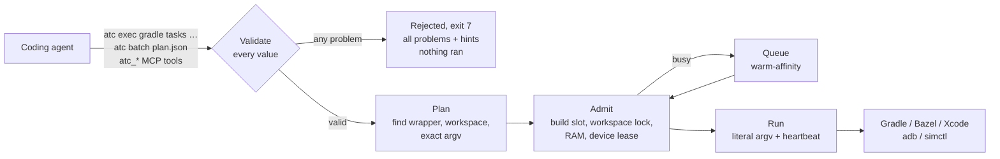
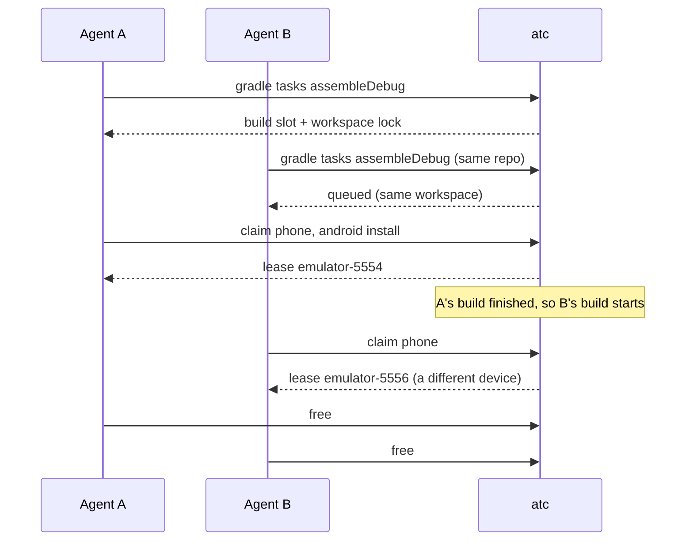
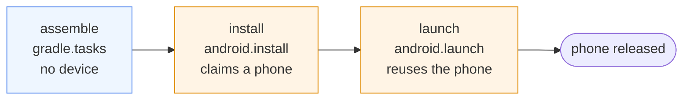

# Agent Traffic Control (`atc`)

Coordinate builds and exclusive Android and iOS device leases across concurrent coding agents, without a daemon and without ever running shell commands.

- **User Guide (with diagrams & Q&A):** [`docs/user-guide.md`](./docs/user-guide.md)
- **Architecture:** [`docs/architecture.md`](./docs/architecture.md)
- **Scope & design decisions for 3.0:** [`docs/scope.md`](./docs/scope.md)
- **Migrating from 2.x:** [`docs/migration-3.0.md`](./docs/migration-3.0.md) · **3.0 release notes:** [`docs/releases/v3.0.0.md`](./docs/releases/v3.0.0.md)
- **Design Specification:** [https://specs.sebastiano.dev/atc/](https://specs.sebastiano.dev/atc/) ([`DESIGN.md`](./DESIGN.md))
- **License:** Apache-2.0

## Overview

When several coding agents share a machine, they collide on Android emulators, iOS Simulators, USB phones, and heavy builds. `atc` serializes access through a user-private `state.json` file under an atomic directory lock (`atc.lock`) with `<20 ms` in-memory critical sections and zero npm dependencies.

`atc` handles exactly two domains: **devices** (emulators, simulators, physical devices) and **builds** (Gradle, Bazel, Xcode). Agents never hand `atc` a shell command. They ask for an **allowlisted, typed operation**, and `atc` validates every value, builds the literal argv itself, and runs it under the right lease, build slot, and workspace lock.

| Entry point | Use it for |
|---|---|
| `atc exec <system> <op> …` | One simple operation, e.g. `atc exec gradle tasks :app:assembleDebug` or `atc exec android install app.apk`. |
| `atc batch` | Multi-step workflows, dependencies, per-step `cwd`/`env`, scoped claims, or timeouts. Runs a validated JSON plan (DAG) of typed ops. |
| `atc mcp` | The same ops as MCP tools (`atc_gradle`, `atc_bazel`, `atc_xcode`, `atc_android`, `atc_ios`, `atc_batch`, plus `atc_claim`, `atc_free`, `atc_renew`, `atc_snapshot`, `atc_status`, `atc_guide`). |

Invalid requests are rejected before anything runs, with **all** problems listed at once (`{path, code, message, hint}`). Unsupported operations or flags are refused with the closest supported alternative and a link to request them: <https://github.com/rock3r/atc/issues>.



When two agents on one machine build the same app and test on devices:



## Requirements and install

Requires Node.js >= 20 on macOS, Linux, or Windows, plus the Android SDK (`adb`, `emulator`, `android` CLI) and/or Xcode (`xcrun simctl`, `xcodebuild`) on macOS.

```bash
npm install -g @rock3r/atc
atc status
```

| Agent host | Optional plugin / hook setup |
|---|---|
| Claude Code | `/plugin marketplace add rock3r/atc` then `/plugin install atc@atc` |
| Codex | `codex plugin marketplace add rock3r/atc && codex plugin add atc@atc` |
| GitHub Copilot CLI / app | `copilot plugin marketplace add rock3r/atc && copilot plugin install atc@atc` |
| Antigravity | Symlink or copy package root into `~/.gemini/config/plugins/atc` (loads `plugin.json`, `skills/atc`, `hooks.json`, and `mcp_config.json`) |
| Gemini CLI | Copy `skills/atc` into `~/.gemini/skills/atc` and wire `atc hook pre-tool-use` + `atc hook stop` |
| Cursor | Copy `.cursor/hooks.json` into `.cursor/hooks.json` (and optional `.mcp.json`) |
| Pi | Load `extensions/atc/index.ts` (releases leases on session end) |

The hooks only record your agent's session identity, inject it into `atc_*` MCP calls, and free leases when a session ends. They never read, block, or rewrite shell commands.

## Quick start

```bash
atc status                                                   # RAM/disk, emu/sim/build slots, fleet
atc guide                                                    # workflow guide and rules
atc exec --help                                              # the full operation catalog

# Pure build (build slot + per-workspace lock, no device held)
atc exec gradle tasks :app:assembleDebug :app:assembleDebugAndroidTest --brief

# Android emulator
atc claim --type phone --api ">=35" --play --wait 300
atc exec android install app/build/outputs/apk/debug/app-debug.apk --replace
atc exec android launch --package com.example.app --activity .MainActivity
atc exec gradle tasks :app:connectedDebugAndroidTest         # device-coupled build under your lease
atc exec android screenshot out/home.png
atc free

# iOS Simulator (macOS)
atc claim --ios --type phone --os ">=18.0" --wait 300
atc exec xcode build-for-testing --scheme App --project App.xcodeproj
atc exec xcode test-without-building --scheme App --project App.xcodeproj
atc exec snapshot save clean_state
atc free
```

For multi-step flows, write a plan and let `atc` run it (validate first with `--validate`):

```json
{
  "version": 1,
  "steps": [
    { "id": "assemble", "op": "gradle.tasks", "tasks": [":app:assembleDebug"] },
    { "id": "install", "op": "android.install", "apk": "app/build/outputs/apk/debug/app-debug.apk",
      "dependsOn": ["assemble"], "claim": { "platform": "android", "type": "phone", "api": ">=35" } },
    { "id": "launch", "op": "android.launch", "package": "com.example.app", "activity": ".MainActivity",
      "dependsOn": ["install"], "claim": { "reuse": "install" } }
  ]
}
```

```bash
atc batch --file plan.json --validate   # prints the exact argv of every step, runs nothing
atc batch --file plan.json
```

The phone is claimed only when the first step that needs it starts, and released right after the last step that reuses it:



If a step fails, the steps that depend on it are skipped and any claim it made is released. The batch stops there unless that step set `continueOnError: true`, in which case independent steps keep running. Nothing in the plan runs at all if the plan is invalid.

## Commands

| Command | What it does |
|---|---|
| `atc guide [topic]` | Built-in guides: `workflow` (default), `profiles`, `snapshots`, `multi-agent`, `traps` (`--json` supported). |
| `atc status [--ios\|--android] [--type <type>] [--api\|--os <spec>] [--forced] [--json]` | Host RAM/disk, emulator/simulator/build slots, devices, leases, queues; `--forced` lists audited `--force` runs. |
| `atc claim [flags]` | Claim a lease by `--ios`/`--android`, `--type`, `--api`/`--os`, `--play`/`--no-play`, `--avd`, `--udid`, or `--serial`. |
| `atc exec <system> <op> [args] [--options]` | Run one typed operation. Systems: `gradle`, `bazel`, `xcode`, `android`, `ios`, `snapshot`. `atc exec --help` lists every op and option. |
| `atc batch [--file <plan.json> \| -] [--validate] [--json]` | Run a JSON plan (DAG) of typed ops sequentially in dependency order. |
| `atc renew [<target>] [--ios\|--android] [--ttl <sec>]` | Extend an active lease's TTL. |
| `atc snapshot <list\|save\|load\|delete> [<name>] [--ios\|--android]` | QEMU snapshots (Android) or APFS copy-on-write snapshots (iOS Simulator). Same as `atc exec snapshot …`. |
| `atc free [<target>] [--ios\|--android] [--snapshot-save <name>] [--snapshot-load <name>] [--stop]` | Release one or all leases held by the caller session. |
| `atc config <get\|set> [key] [val]` | Read or update settings (`maxRunningEmulators`, `maxConcurrentBuilds`, `allowPhysicalDevices`, `allowPhysicalPropSet`, …). |
| `atc gc` | Prune expired leases, dead anchor/worker PIDs, and stale queue tickets. |
| `atc hook <pre-tool-use\|stop>` | Session bookkeeping hook for Claude Code, Codex, GitHub Copilot CLI, Gemini CLI, Antigravity, and Cursor. |
| `atc mcp` | Start the stdio MCP server. |

## Development

```bash
npm test
npm run check
```
