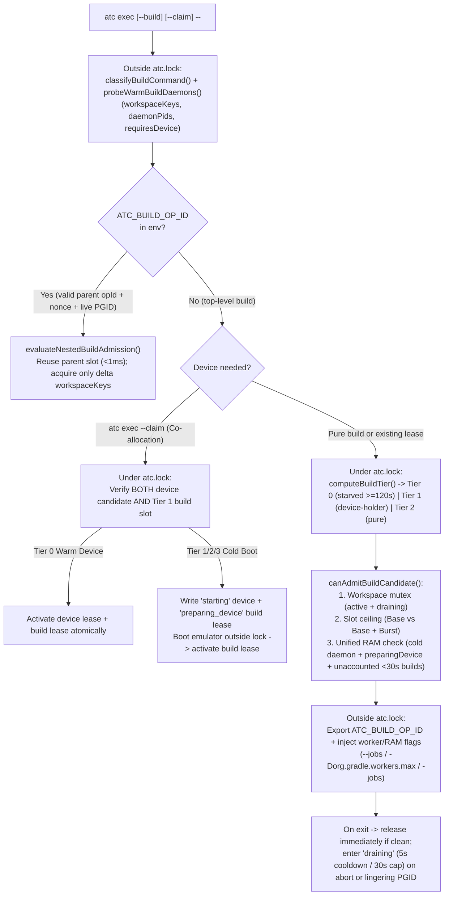

# atc architecture

How the `atc` CLI, the lock-serialized state file, the 3-tier Android and iOS fleet discovery, the warm-affinity queue, the 3-tier build + device co-scheduler, the JSONL audit logger, and the multi-agent hooks fit together.

Status: `v2.1.0` · Updated `2026-10-15` · Node.js >= 20 on macOS, Linux, and Windows.

## Executive summary

An agent claims exclusive access to an Android emulator (AVD), an iOS Simulator, or a physical USB/Wi-Fi device, runs commands and heavy builds under `atc exec -- <cmd>`, and frees the lease when done. All coordination runs through a user-private `state.json` file guarded by an atomic directory lock (`atc.lock`) with no daemon and zero npm dependencies.

The CLI carries its own documentation (`atc guide`), enforces lease and build boundaries (`atc guard` and `atc hook pre-tool-use`), co-schedules Gradle/Bazel/Xcode builds alongside device leases (`src/build.mjs`), records structured JSONL audit logs (`src/logger.mjs`), and frees leases when a turn ends (`atc hook stop`) or when an agent PID dies. An optional stdio MCP server (`atc mcp`) exposes the same operations over JSON-RPC 2.0.

| Invariant | Guarantee | Where enforced |
|---|---|---|
| Zero subprocesses under `atc.lock` | Fleet discovery and daemon RAM probes run before acquiring `atc.lock`; boot, wipe, snapshot, stop, build execution, and JSONL audit disk I/O run after releasing `atc.lock`. Lock hold time stays under `20 ms`. | `src/cli.mjs`, `src/lock.mjs`, `src/build.mjs`, `src/logger.mjs` |
| No personal-phone hijack | Default claims set `--kind emulator`. Physical Android and iOS devices require `--serial`, `--udid`, or `--kind physical\|any` and use `0` virtual slots. | `src/cli.mjs`, `src/state.mjs` |
| Warm-affinity fairness ceiling | Warm `Tier 0` matches can jump ahead of cold-boot tickets within `reorderWindowSec` (`120 s`). At `120 s`, waiting tickets freeze at Priority #0. | `src/state.mjs` (`canJumpAhead`) |
| Build + device cross-starvation freedom | Active device holders and `atc exec --claim` co-allocations receive Tier 1 priority + burst build slots (`maxDeviceHolderBurstBuilds`), while cold-boot co-allocations reserve a `"preparing_device"` build slot before booting so the device never sits idle post-boot. | `src/build.mjs`, `src/cli.mjs`, `src/state.mjs` |
| Virtual crash recovery vs. physical fail-fast | Crashed virtual devices hold a `45 s` reservation for in-place reboot (`expiresAtMs` preserved). Disconnected physical devices fail fast after `15 s` with a tombstone. | `src/state.mjs` (`reconcileOfflineLeases`), `src/cli.mjs` |

## Every critical section under `atc.lock` finishes in under 20 ms

`cmdClaim`, `cmdFree`, `cmdSnapshot`, and `cmdExec` split every operation into lock-free subprocess probes and `<20 ms` in-memory state transactions.

```text
~ cmdClaim(stateDir, flags, options)                  @ src/cli.mjs:1395
  + resolveTargetPlatform(flags, cwd)                 @ src/ios.mjs:62
  + discoverTargetFleet({ targetPlatform, ... })      @ src/cli.mjs:276
    ~ discoverFleetAndHost(runner, avdHome, ...)      @ src/android.mjs:785
    + discoverIosFleetAndHost(runner, cfg, ...)       @ src/ios.mjs:531
  ~ withStateTransaction(stateDir, fn)                @ src/state.mjs:908
    ~ runGarbageCollection(state, stateDir, now)      @ src/state.mjs:770
    ~ reconcileOfflineLeases(state, inventory, ...)   @ src/state.mjs:1161
    ~ matchesProfile(candidate, req)                  @ src/state.mjs:1423
  + bootIosSimulator(udid, runner, timeoutMs)         @ src/ios.mjs:643
  + loadIosSimulatorSnapshot(udid, name, runner)      @ src/ios.mjs:746
```

1. **Resolve platform and session identity:** `resolveTargetPlatform()` (`src/ios.mjs:62`) picks `"android"` or `"ios"` from flags (`--ios`, `--android`, `--udid`, `--os`) or project markers (`.xcodeproj`, `.xcworkspace`, `Package.swift`). `resolveSessionIdentity()` (`src/state.mjs:2079`) resolves `{ sessionId, anchorPid }` via the 6-step ladder.
2. **Probe fleet outside `atc.lock`:** `discoverTargetFleet()` (`src/cli.mjs:276`) runs `android emulator list --long`, `adb devices -l`, `xcrun simctl list --json`, and `xcrun devicectl list devices --json-output`, then reads `.avd/config.ini`, snapshots, and host RAM/disk.
3. **Select candidate under `atc.lock` (`<20 ms`):** `runGarbageCollection()` and `reconcileOfflineLeases()` prune expired or dead-PID leases, mark offline virtual leases (`45 s` recovery window), and record `disconnectedPhysicalLeases` tombstones (`15 s` grace). `cmdClaim` then evaluates `Tier 0` (idempotent re-claim, in-place virtual crash recovery, or warm idle match), `Tier 1` (offline boot under slot/resource caps), `Tier 2` (idle eviction), and `Tier 3` (`--create-if-missing`).
4. **Run slow transitions outside `atc.lock`:** A 15-second worker heartbeat (`startWorkerHeartbeat()`) extends `lease.deadlineMs` while `atc` boots the AVD or iOS Simulator, loads a QEMU or APFS (`cp -cR`) snapshot, or clears app state.
5. **Activate or roll back under `atc.lock`:** `cmdClaim` transitions `"starting" -> "active"` with the bound `serial` / `udid` and `expiresAtMs`, or deletes the `"starting"` record on failure so the slot reopens immediately.

## `atc exec` and `atc guard` route Android, iOS, and dual-lease KMP commands

When a session holds one Android lease and one iOS lease (Kotlin Multiplatform / KMP), `cmdExec` (`src/cli.mjs:4973`) and `evaluateCommandGuard` (`src/guard.mjs:1309`) match each command segment to its target platform automatically.

| Command family | Target platform | Environment & argument injection in `buildChildInvocation` (`src/spawn.mjs:96`) |
|---|---|---|
| `adb ...` | `android` | Sets `ANDROID_SERIAL=<serial>`; injects `-s <serial>` after global `adb` flags when omitted. |
| `android run\|install\|layout\|screen ...` | `android` | Sets `ANDROID_SERIAL=<serial>`; injects `--device=<serial>` when omitted. |
| `./gradlew connected*` | `android` | Sets `ANDROID_SERIAL=<serial>`, `ATC_LEASE_ID`, `ATC_SESSION_ID`, `ATC_AVD`. |
| `xcrun simctl ...` | `ios` | Sets `ATC_IOS_UDID=<udid>`, `SIMCTL_CHILD_ATC_LEASE_ID=<leaseId>`; rewrites `booted` to `<udid>`. |
| `xcrun devicectl device\|manage ...` | `ios` | Sets `ATC_IOS_UDID=<udid>`; injects `--device <udid>` when omitted and validates `--device` against `serial` and `coreDeviceId`. |
| `xcodebuild test ...` | `ios` | Sets `ATC_IOS_UDID=<udid>` and validates `-destination id=<udid>,name=<name>`. |
| Generic (`sh -c ...`) in KMP session | `android` + `ios` | Exports both `ANDROID_SERIAL` and `ATC_IOS_UDID` into the child environment. |

`evaluateCommandGuard()` fast-paths commands that do not mention `adb`, `emulator`, `android`, `gradlew`, `simctl`, `devicectl`, or `xcodebuild` in under `2 ms` without reading `state.json`. Direct lifecycle commands (`emulator -avd`, `adb emu kill`, `xcrun simctl boot|shutdown|erase|delete`) are blocked with exit code `2`. Compound commands (`adb ... && xcrun simctl ...`) are rewritten segment by segment using `execSerialByPlatform`.

## Build + device co-scheduling architecture (`src/build.mjs`)

To prevent forward starvation (holding a compiler slot while waiting for a device) and reverse starvation (holding a scarce emulator while waiting behind pure CPU builds), `cmdExec` and `src/build.mjs` coordinate `state.buildLeases` and `state.buildQueue` inside the same `<20 ms` `atc.lock` transactions as device leases.



### Unified RAM accounting across emulators and builds

Because host `availableRamMb` already reflects the resident memory (RSS) of warm Gradle/Bazel daemons and running emulators that faulted in their pages more than `30 s` ago, naive subtraction would double-count memory. `atc` prevents both double-counting and transient race windows:
- **Cold vs. Warm Build Daemons (`probeWarmBuildDaemons`):** Outside `atc.lock`, `ps -ax -o pid=,command=` identifies whether a warm `GradleDaemon` or `bazel(<workspace>)` server already exists for the target workspace. Warm daemons require `0 MB` additional RAM; cold daemons require `config.buildRamEstimateMb` (`3072 MB` default).
- **Unaccounted `<30 s` Window (`computeUnaccountedBuildRamMb`):** Active builds in their first `30,000 ms` (`buildRamReservationWindowSec = 30`) of execution—plus any `"preparing_device"` build reservations waiting for a cold emulator boot—are subtracted from `availableRamMb` during both `cmdClaim` emulator boot admission (`src/android.mjs`) and `checkUnifiedRamAdmission` (`src/build.mjs`).

## Structured JSONL audit logging (`src/logger.mjs`)

To keep `atc.lock` hold times under `20 ms`, audit logging is decoupled into two stages:
1. **In-Memory Staging (`auditEvents`):** Inside `withStateTransaction(stateDir, fn)`, state transitions (`device_claim`, `device_free`, `build_admit`, `build_draining`, `build_release`, `build_queue_enter`, `guard_deny`, `gc_prune_*`) append lightweight objects to the transaction's `auditEvents` list.
2. **Post-Lock Append & Rotation (`flushAuditEvents`):** Inside the `finally` block of `withStateTransaction`—**after** `atc.lock` is released—`flushAuditEvents` serializes each event as a single JSON line (`fs.appendFileSync(..., { mode: 0o600 })`) to the OS log directory (`~/Library/Logs/atc/atc-audit.jsonl` on macOS, `$XDG_STATE_HOME/atc/logs/atc-audit.jsonl` on Linux, `%LOCALAPPDATA%\atc\logs\atc-audit.jsonl` on Windows) and rotates `.1`..`.3` archives when `size >= 10 MB`.

## Code map and on-disk state

| Module | Path | Responsibility |
|---|---|---|
| CLI entrypoint | `bin/atc.mjs`, `src/cli.mjs` | Flag parsing and command handlers (`guide`, `claim`, `free`, `renew`, `snapshot`, `exec`, `batch`/`plan`, `status`, `config`, `gc`, `guard`, `hook`, `mcp`). |
| Built-in guides | `src/guide.mjs`, `src/guides/*.md` | Markdown topics (`workflow`, `profiles`, `snapshots`, `multi-agent`, `traps`) served by `atc guide` and `atc_guide`. |
| Atomic lock | `src/lock.mjs` | Directory mutex (`mkdir <stateDir>/atc.lock`), `owner.json` nonce check, stale-lock breaking, and atomic `state.json` write + `fsync` + `rename`. |
| State & scheduler | `src/state.mjs` | Schema validation, corruption quarantine, dead-PID GC, 6-step session identity ladder, `watch`/`wear` profile matching, and warm-affinity queue selection. |
| Build co-scheduler | `src/build.mjs`, `src/parsers.mjs` | Gradle/Bazel/`xcodebuild` classifier, vendored `shell-quote` fail-closed unparseable-shell gate (`detectUnparseableShellConstructs`), workspace key extraction, 3-tier priority scheduler, `"draining"` daemon reconciliation, re-entrant sub-build admission, and CPU/RAM flag shaping. |
| System audit logger | `src/logger.mjs` | OS-native log directory resolution, lock-free JSONL event staging (`recordAuditEvent`), post-lock disk flushing (`flushAuditEvents`), and size-bounded rotation. |
| Android probes | `src/android.mjs` | Android 3-tier discovery, `.avd/config.ini` + dead-PID `.lock` cleanup, RAM/disk admission, and QEMU boot/stop/snapshot helpers. |
| iOS probes | `src/ios.mjs` | iOS/watchOS/tvOS/visionOS discovery (`simctl` + `devicectl`), simulator boot/shutdown/erase/create, privacy/container app reset, and APFS `cp -cR` snapshots. |
| Worker liveness | `src/heartbeat.mjs` | Cross-platform process-group tracking (`workerPgids`, POSIX start tokens, Windows CIM `CreationDate` trees) and orphan process-tree reaping. |
| Spawner | `src/spawn.mjs` | Subprocess runner, Windows `.exe`/`.cmd` resolution, and Android/iOS/build target flag injection. |
| Command guard | `src/guard.mjs` | Shell tokenizer, per-platform + build daemon command classifier, and loop/compound command rewriter. |
| Host hooks & MCP | `src/hook.mjs`, `src/mcp.mjs` | `PreToolUse` and `Stop` adapters for Claude Code, Codex, Cursor, Antigravity, and Gemini CLI, plus the stdio JSON-RPC 2.0 MCP server. |

| On-disk path | Written by | Contents |
|---|---|---|
| `<stateDir>/state.json` | `src/lock.mjs` | Active/transitional device leases, wait queue tickets, `buildLeases`, `buildQueue`, `disconnectedPhysicalLeases` tombstones, config overrides, and hook PID breadcrumbs (`mode 0600`). |
| `<stateDir>/atc.lock/owner.json` | `src/lock.mjs` | Lock holder `{ pid, createdAtMs, nonce }` checked before every atomic rename. |
| `~/Library/Logs/atc/atc-audit.jsonl` (macOS) | `src/logger.mjs` | Append-only JSONL audit log of lease, build, queue, guard, and GC events (`mode 0600`, rotated at `10 MB`). |
| `~/.android/avd/<Name>.avd/snapshots/<snap>/` | QEMU / `adb` | QEMU snapshots discovered by `src/android.mjs` and restored via `atc snapshot`. |
| `~/.atc-snapshots/<udid>/<snap>/data/` | `src/ios.mjs` | APFS copy-on-write (`cp -cR`) clones of `~/Library/Developer/CoreSimulator/Devices/<udid>/data`. |

## Verification commands

| Command | Coverage |
|---|---|
| `npm test` (`node --test test/*.test.mjs`) | 33 integration suites covering lock serialization, corruption quarantine, dead-PID GC, `45 s` virtual crash recovery, `15 s` physical disconnect fail-fast, warm-affinity scheduling, 3-tier build + device co-scheduling, re-entrant builds, `"draining"` daemon locks, JSONL audit logging, RAM/disk admission, shell guard rewriting, hooks, Android & iOS `atc exec` injection, APFS snapshots, KMP dual-lease routing, `atc guide`, and `atc mcp`. |
| `npm run check` | Syntax check (`node --check`) across all `.mjs` files plus the full integration test suite. |
| `npm run release:verify` | Version parity check across `package.json`, `plugin.json`, `.claude-plugin/plugin.json`, `.codex-plugin/plugin.json`, `skills/atc/SKILL.md`, and `skills/atc/skill-source.json`. |
