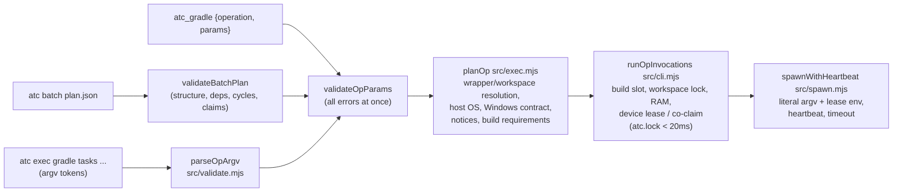

# atc architecture

How the `atc` CLI, the typed-op catalog and validator, the lock-serialized state file, the 3-tier Android and iOS fleet discovery, the build scheduler, the warm-affinity queues, and the host hooks fit together.

Status: `v3.0.0` · Updated `2026-10-16` · Node.js >= 20 on macOS, Linux, and Windows.

## Executive summary

An agent claims exclusive access to an Android emulator (AVD), an iOS Simulator, or a physical USB/Wi-Fi device, asks `atc` for typed operations (`atc exec <system> <op>`, `atc batch`, or the `atc_*` MCP tools), and frees the lease when done. `atc` validates each request against a closed catalog, generates literal argv itself, admits it against build slots, workspace locks, host RAM and device leases, and runs it with a heartbeat. All coordination runs through a user-private `state.json` file guarded by an atomic directory lock (`atc.lock`) with no daemon and zero npm dependencies.

`atc` never receives, inspects, parses or runs shell commands. The CLI carries its own documentation (`atc guide`, `atc exec --help`), records host session identity (`atc hook pre-tool-use`), and frees leases when a turn ends (`atc hook stop`) or when an agent PID dies.

| Invariant | Guarantee | Where enforced |
|---|---|---|
| No shell | Requests are typed ops validated against allowlist patterns; invocations are literal argv spawned with `shell: false` (Windows `.bat` wrappers go through `cmd.exe /d /s /c` only with charset-checked args and paths). | `src/ops/*`, `src/validate.mjs`, `src/exec.mjs`, `src/spawn.mjs` |
| Zero subprocesses under `atc.lock` | Discovery, wrapper resolution and warm-daemon probes run before acquiring `atc.lock`; boots, builds and device ops run after releasing it. `withLock` tracks the held depth and `spawnWithHeartbeat` refuses to spawn while `atc.lock` is held. | `src/cli.mjs`, `src/lock.mjs`, `src/spawn.mjs` |
| No personal-phone hijack | Default claims set `--kind emulator`. Physical devices require `--serial`, `--udid`, or `--kind physical\|any`. Device ops only target the caller's own lease. | `src/cli.mjs`, `src/state.mjs` |
| Builds don't trample each other | Builds on the same workspace key are serialized; heavy builds share a slot pool with RAM admission and a burst slot for device holders. | `src/build.mjs`, `src/cli.mjs` (`runOpInvocations`) |
| Warm-affinity fairness ceiling | Warm `Tier 0` matches can jump ahead of cold-boot tickets within `reorderWindowSec` (`120 s`). | `src/state.mjs` (`canJumpAhead`) |
| Virtual crash recovery vs. physical fail-fast | Crashed virtual devices hold a `45 s` reservation for in-place reboot. Disconnected physical devices fail fast after `15 s`. | `src/state.mjs` (`reconcileOfflineLeases`), `src/cli.mjs` |

## A request flows parse → validate → plan → admit → run

1. **Parse.** `parseOpArgv` maps `atc exec <system> <verb> …` to an op name and typed params. Raw commands (`-- <cmd>`), `--cwd` and `--env` are refused with the supported alternative.
2. **Validate.** `validateOpParams` checks unknown fields, types, closed enums, ranges and value patterns (`src/ops/patterns.mjs`), collecting every problem as `{path, code, message, hint}`. `--force --reason` overrides only forceable build-value patterns, and never a leading `-`.
3. **Plan.** `planOp` resolves the build executable (Gradle wrapper walking up from `workspace`/cwd; `./bazelw` → `bazelisk` → `bazel`; `xcodebuild`), checks the host OS and the Windows batch contract, collects efficiency notices, and derives build requirements (`src/ops/requirements.mjs`: workspace resource keys, Gradle heap/daemon properties, Bazel output base) by calling `resolveBuildResources` on the generated argv.
4. **Admit.** `runOpInvocations` (the salvaged build/device admission engine) reserves a build slot and workspace lock, checks RAM, finds or co-allocates the device lease, and queues when busy, all in short `withStateTransaction` critical sections.
5. **Run.** Invocations are generated against the admitted lease (`adb -s <serial>`, `xcrun simctl <verb> <udid>`, `-destination id=<udid>`), resource caps are appended (`-Dorg.gradle.workers.max`, `--jobs`/`--local_ram_resources`, `-jobs`), and each invocation is spawned in order with lease/session env vars, a heartbeat, optional `timeoutSec`, and stop-at-first-failure. Build leases enter a short `"draining"` cooldown when aborted.

`atc batch` runs the same pipeline per step, sequentially in topological order, with per-step `cwd`/`env`, claims that are held for downstream `claim: {reuse}` consumers and renewed while held, and dependents skipped on failure.

## Device-side transport

Android ops that need a remote shell (`launch`, `clear-data`, `permission`, `prop`, `screenshot`) use fixed templates such as ``am start -n '<pkg>/<activity>'``. Every interpolated value matches a pattern that is a subset of `^[A-Za-z0-9_.:/@+=,-]+$` and is single-quoted, so the remote shell sees exactly one literal word. These checks cannot be forced.

## Every critical section under `atc.lock` finishes in under 20 ms

`cmdClaim`, `cmdFree`, `cmdSnapshot`, and `runOpInvocations` split every operation into lock-free subprocess probes and `<20 ms` in-memory state transactions.

1. **Resolve platform and session identity:** `resolveTargetPlatform()` picks `"android"` or `"ios"` from flags or project markers. `resolveSessionIdentity()` resolves `{ sessionId, anchorPid }` via the 6-step ladder.
2. **Probe fleet outside `atc.lock`:** `discoverTargetFleet()` runs `android emulator list --long`, `adb devices -l`, `xcrun simctl list --json`, and `xcrun devicectl list devices --json-output`, then reads `.avd/config.ini`, snapshots, and host RAM/disk.
3. **Select candidate under `atc.lock` (`<20 ms`):** GC prunes expired or dead-PID leases and evaluates `Tier 0` (idempotent re-claim, crash recovery, warm idle match), `Tier 1` (offline boot under slot/resource caps), `Tier 2` (idle eviction), and `Tier 3` (`--create-if-missing`).
4. **Run slow transitions outside `atc.lock`:** a worker heartbeat extends the lease while `atc` boots, loads snapshots, clears app state, or runs builds and device ops.
5. **Activate or roll back under `atc.lock`:** `"starting" -> "active"`, or the record is deleted on failure so the slot reopens immediately.

## Code map and on-disk state

| Module | Path | Responsibility |
|---|---|---|
| CLI entrypoint | `bin/atc.mjs`, `src/cli.mjs` | Flag parsing and command handlers (`guide`, `claim`, `free`, `renew`, `snapshot`, `exec`, `batch`, `status`, `config`, `gc`, `hook`, `mcp`), and the internal runner `runOpInvocations`. |
| Op catalog | `src/ops/catalog.mjs`, `src/ops/patterns.mjs` | Closed list of typed ops, their params, value patterns, invocation templates and notices. |
| Validation | `src/validate.mjs` | CLI op parsing, param validation, batch plan validation (structure, deps, cycles, claims). |
| Exec front-end | `src/exec.mjs` | `planOp`, `execOp`, Windows contract, `--brief` logs, forced-run attribution, `atc exec --help`. |
| Batch executor | `src/batch.mjs` | Sequential DAG execution, claim reuse and release, `--validate` dry runs. |
| Build requirements & scheduler | `src/ops/requirements.mjs`, `src/build.mjs` | Workspace keys, Gradle/Bazel/Xcode resource resolution on literal argv, build pool, queue selection, RAM admission, warm daemon probes, draining. |
| Config parsers | `src/parsers.mjs` | `gradle.properties` and `.bazelrc` parsing. |
| Built-in guides | `src/guide.mjs`, `src/guides/*.md` | Markdown topics served by `atc guide` and `atc_guide`. |
| Atomic lock | `src/lock.mjs` | Directory mutex, `owner.json` nonce check, stale-lock breaking, atomic writes, lock-depth tracking. |
| State & scheduler | `src/state.mjs` | Schema validation, corruption quarantine, dead-PID GC, session identity ladder, profile matching, warm-affinity queue, forced-run records. |
| Android / iOS probes | `src/android.mjs`, `src/ios.mjs` | Discovery, boot/stop/snapshot helpers, RAM/disk admission. |
| Worker liveness | `src/heartbeat.mjs` | Cross-platform process-group tracking and orphan reaping. |
| Spawner | `src/spawn.mjs` | Executable resolution (incl. Windows), `prepareOpChildInvocation`, `spawnWithHeartbeat`. |
| Host hooks & MCP | `src/hook.mjs`, `src/mcp.mjs` | Session recording and MCP session injection for Claude Code, Codex, Cursor, Copilot, Antigravity, and Gemini CLI; Stop-hook release; stdio JSON-RPC 2.0 MCP server. |

| On-disk path | Written by | Contents |
|---|---|---|
| `<stateDir>/state.json` | `src/lock.mjs` | Leases, queue tickets, build leases and queue, tombstones, config overrides, hook session breadcrumbs, forced runs (`mode 0600`). |
| `<stateDir>/atc.lock/owner.json` | `src/lock.mjs` | Lock holder `{ pid, createdAtMs, nonce }`. |
| `<stateDir>/logs/<op>-<time>-<pid>.log` | `src/exec.mjs` | Full output of `--brief` build runs. |
| `~/.android/avd/<Name>.avd/snapshots/<snap>/` | QEMU / `adb` | QEMU snapshots. |
| `~/.atc-snapshots/<udid>/<snap>/data/` | `src/ios.mjs` | APFS copy-on-write clones of simulator data. |

## Verification commands

| Command | Coverage |
|---|---|
| `npm test` | Lock serialization, state GC, crash recovery, queueing, RAM/disk admission, build scheduling, the op catalog and validator, exec/batch/MCP flows with fake tools, Windows and transport contracts, the lock-boundary assertion, hooks, iOS, guides and packaging. |
| `npm run check` | Syntax check (`node --check`) across all `.mjs` files plus the full test suite. |
| `npm run release:verify` | Version parity across `package.json`, `plugin.json`, `.claude-plugin/plugin.json`, `.codex-plugin/plugin.json`, `skills/atc/SKILL.md`, and `skills/atc/skill-source.json`. |
