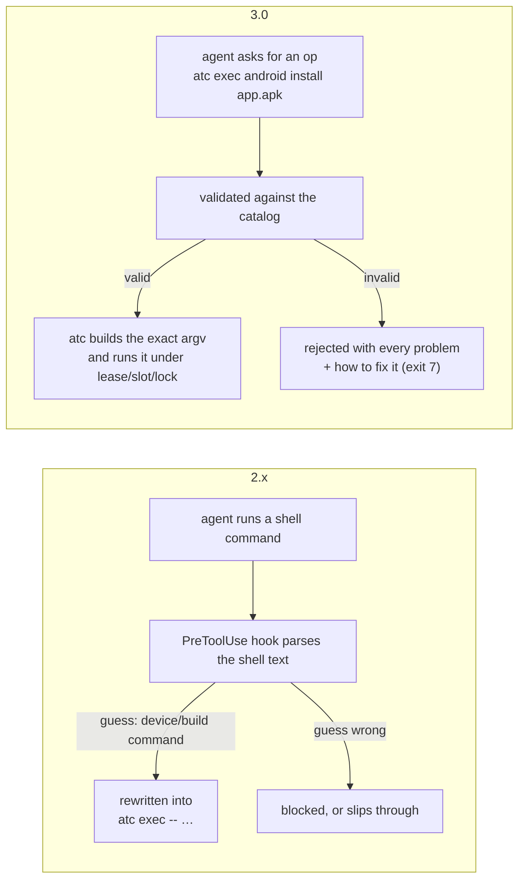

# Migrating from ATC 2.x to 3.0

ATC 3.0 is a breaking release. ATC no longer accepts, inspects, rewrites or runs shell commands. Agents ask for **allowlisted typed operations** instead, and ATC builds every invocation itself. See [`scope.md`](./scope.md) for the full catalog and rules.

## Upgrade checklist

1. Upgrade the CLI: `npm install -g @rock3r/atc@3`.
2. Update the agent plugin or hooks (Claude Code, Codex, Copilot, Cursor, Antigravity, Gemini CLI, Pi) so the 3.0 hooks replace the 2.x ones. The 2.x PreToolUse hook keeps blocking shell commands that mention `adb`, `gradle`, `xcodebuild`, … until it is replaced.
3. Replace `atc exec -- <command>` calls in prompts, scripts, and skills with typed ops (table below), and multi-step shell sequences with an `atc batch` plan.
4. Remove `atc guard` calls and the `coordinateBuilds` config (both are gone).
5. Run `atc exec --help` and `atc guide` to check what's available.

## What changed

| 2.x | 3.0 |
|---|---|
| `atc exec -- <any command>` | `atc exec <system> <op> …` for one typed op, `atc batch` for multi-step plans. `atc exec -- …` is refused with exit `7`. |
| `atc exec --build -- ./gradlew assembleDebug` | `atc exec gradle tasks assembleDebug` (ATC knows it is a pure build). |
| `atc exec --claim "--type phone" -- ./gradlew connectedDebugAndroidTest` | `atc exec gradle tasks connectedDebugAndroidTest --claim --type phone` |
| `--phase`, `--build`, `--workspace` exec flags | Derived from the op. `workspace` is a build-op param (`--workspace <dir>`). |
| `atc guard <command>` | Removed (exit `7`). |
| PreToolUse hook blocking/rewriting shell commands | Hooks only record the session id and inject it into `atc_*` MCP calls; shell tool calls are always allowed and never read. |
| `coordinateBuilds` config | Removed. Builds requested through ATC are always coordinated. |
| Batch steps with `command` arrays and `phase` | Steps are typed ops: `{ "id", "op", …params, "dependsOn", "claim", "cwd", "env", "timeoutSec", "continueOnError", "force" }`. |
| `build-brief` wrapper | Built in: `--brief` on build ops writes the full log to `<stateDir>/logs/` and prints a short summary. |
| Exit `2` for guard blocks | Exit `7` for any rejected request (nothing ran). Exit `2` still means busy. |

## Command translations

| 2.x command | 3.0 equivalent |
|---|---|
| `atc exec -- ./gradlew :app:assembleDebug --offline` | `atc exec gradle tasks :app:assembleDebug --offline` |
| `atc exec -- ./gradlew test -Pflavor=free` | `atc exec gradle tasks test --property flavor=free` |
| `atc exec -- ./gradlew clean` | `atc exec gradle tasks clean` |
| `atc exec -- bazel build //app:main --config=ci` | `atc exec bazel build //app:main --config ci` |
| `atc exec -- bazel clean --expunge` | `atc exec bazel clean --expunge` |
| `atc exec -- bazel run //tools:gen -- --out=x` | `atc exec bazel run //tools:gen --run-arg=--out=x --timeout-sec 300` |
| `atc exec -- xcodebuild -scheme App test` | `atc exec xcode test --scheme App` |
| `atc exec -- adb install -r app.apk` | `atc exec android install app.apk --replace` |
| `atc exec -- adb shell am start -n com.ex/.Main` | `atc exec android launch --package com.ex --activity .Main` |
| `atc exec -- adb shell pm clear com.ex` | `atc exec android clear-data com.ex` |
| `atc exec -- adb shell pm grant com.ex android.permission.CAMERA` | `atc exec android permission --package com.ex --permission android.permission.CAMERA --action grant` |
| `atc exec -- adb shell getprop ro.product.model` | `atc exec android prop get ro.product.model` |
| `atc exec -- adb logcat -d -t 200` | `atc exec android logcat --lines 200` |
| `atc exec -- xcrun simctl launch booted com.ex.App` | `atc exec ios launch com.ex.App` |
| `atc exec -- xcrun simctl privacy booted grant camera com.ex.App` | `atc exec ios privacy --bundle-id com.ex.App --service camera --action grant` |
| `atc snapshot save clean` | unchanged, or `atc exec snapshot save clean` |

When passing program arguments that start with `--` to `bazel run` or `ios launch` on the CLI, use `=` (`--run-arg=--out=x` or `--launch-arg=--uitesting`) so the parser treats the value as an argument rather than an `atc exec` flag.

Operations that are not in the catalog (for example `adb shell input`, `screenrecord`, `devicectl`) are refused with a link to request them at <https://github.com/rock3r/atc/issues>. Until they exist, keep the lease and run the tool yourself against the leased serial/UDID (shown by `atc claim` and `atc status --json`); ATC will not intercept it, but it also cannot coordinate it.

## Escape hatch: `--force`

If validation rejects a legitimate build value (an unusual Gradle task name, a Bazel target, an Xcode scheme), re-run with `--force --reason "<why>"`. You take responsibility: the run is recorded (`atc status --forced`) and later failures in that workspace point back to it. `--force` never unlocks shell, unknown ops or params, values starting with `-`, the device transport charset, Windows batch rules, claims, locks or slots.

## Efficiency notices

ATC never splits or merges what you asked for. When a request could coordinate better, it says so, for example: "split the assemble and device phases next time so the device is only held while it is needed".
