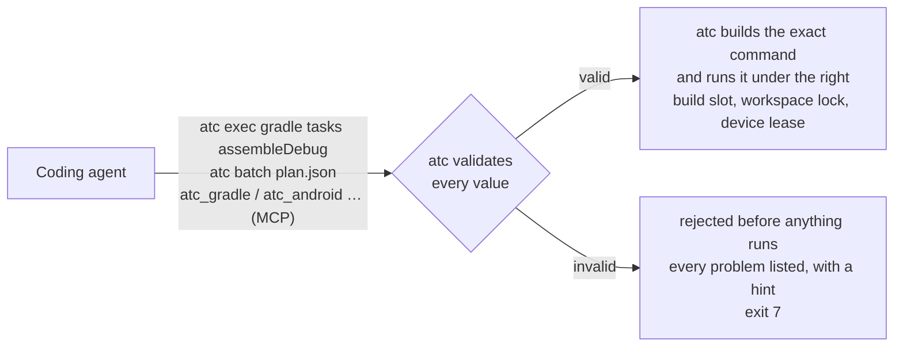
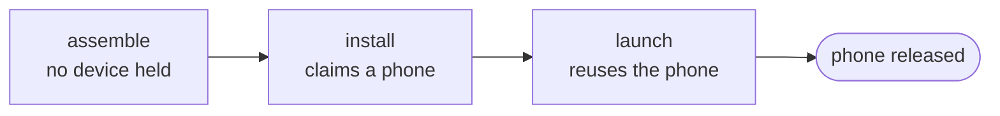

# ATC 3.0.0

**ATC 3.0 changes how agents use ATC: they ask for typed operations, and ATC never runs shell commands.** If your agents used `atc exec -- <command>` or relied on the hook rewriting their shell commands, read the upgrade steps below before updating.



## What this means for you

| You are… | What changes |
|---|---|
| **Using ATC through an agent plugin** (Claude Code, Codex, Copilot, Cursor, Antigravity, Gemini CLI, Pi) | Update the plugin. The hooks no longer block or rewrite shell commands; agents use the `atc` skill, `atc guide`, `atc exec --help`, or the new MCP tools to request work. |
| **Writing prompts, skills or scripts that call `atc exec -- …`** | Replace each call with a typed op (see the table below). Multi-step sequences become one `atc batch` plan. |
| **Running builds on a shared machine** | Builds requested through ATC are always coordinated now: one build per workspace at a time, a shared slot pool, and RAM checks. You don't need `--build` or `coordinateBuilds`. |
| **Using `build-brief`** | Use `--brief` on any build op. The full log goes to `<stateDir>/logs/`, and you get a one-line success message or a condensed failure summary. |

## Upgrade steps

1. `npm install -g @rock3r/atc@3`
2. Update the ATC agent plugin/hooks wherever you installed them. **Until you do, the 2.x hook keeps blocking shell commands that mention `adb`, `gradle`, `xcodebuild`, `atc`, and so on.**
3. Swap `atc exec -- …` calls for typed ops ([migration guide](https://github.com/rock3r/atc/blob/main/docs/migration-3.0.md)).
4. Remove `atc guard` calls and the `coordinateBuilds` config.

## Before and after

| 2.x | 3.0 |
|---|---|
| `atc exec --build -- ./gradlew assembleDebug` | `atc exec gradle tasks assembleDebug` |
| `atc exec --claim "--type phone" -- ./gradlew connectedDebugAndroidTest` | `atc exec gradle tasks connectedDebugAndroidTest --claim --type phone` |
| `atc exec -- bazel test //app:tests --config=ci` | `atc exec bazel test //app:tests --config ci` |
| `atc exec -- xcodebuild -scheme App test` | `atc exec xcode test --scheme App` |
| `atc exec -- adb install -r app.apk` | `atc exec android install app.apk --replace` |
| `atc exec -- adb shell pm grant com.ex android.permission.CAMERA` | `atc exec android permission --package com.ex --permission android.permission.CAMERA --action grant` |
| `atc exec -- adb shell getprop ro.product.model` | `atc exec android prop get ro.product.model` |
| `atc exec -- xcrun simctl launch booted com.ex.App` | `atc exec ios launch com.ex.App` |

`atc exec --help` lists every operation and option.

## Multi-step work: `atc batch`

Describe the whole flow once, check it with `--validate` (which prints the exact command for every step and runs nothing), then run it. The device is claimed only for the steps that need it:

```json
{
  "version": 1,
  "steps": [
    { "id": "assemble", "op": "gradle.tasks", "tasks": [":app:assembleDebug"], "brief": true },
    { "id": "install", "op": "android.install", "apk": "app/build/outputs/apk/debug/app-debug.apk",
      "dependsOn": ["assemble"], "claim": { "platform": "android", "type": "phone", "api": ">=35" } },
    { "id": "launch", "op": "android.launch", "package": "com.example.app", "activity": ".MainActivity",
      "dependsOn": ["install"], "claim": { "reuse": "install" } }
  ]
}
```



## What you can do (v1 catalog)

- **Gradle:** `tasks` (any task names, run as one wrapper call; clean is just `tasks clean`).
- **Bazel:** `build`, `test`, `coverage`, `run` (with a required `--timeout-sec` / `timeoutSec`), `series` (batch/MCP), `clean` (incl. `--expunge`).
- **Xcode:** `build`, `test`, `build-for-testing`, `test-without-building`, `archive`, `clean`, `actions`.
- **Android:** `install`, `uninstall`, `launch`, `clear-data`, `permission`, `logcat` (dump), `screenshot`, `prop get`, `prop set`.
- **iOS Simulator:** `install`, `uninstall`, `launch`, `terminate`, `open-url`, `screenshot`, `privacy`.
- **Snapshots:** `list`, `save`, `load`, `delete` on emulators and simulators.

If you need something that isn't here, ATC refuses it, points to the closest alternative, and links to [request it](https://github.com/rock3r/atc/issues). Until it is added, keep your lease and run the tool yourself against the leased serial/UDID; ATC won't intercept it, but it can't coordinate it either.

## When a request is rejected

ATC checks every value before running anything and returns every problem at once:

```text
$ atc exec gradle tasks "bad;name" -x --cwd app
[atc] Request rejected (3 problems):
  /cwd: --cwd is not available on "atc exec"; it needs ceremony.
      → Use an "atc batch" plan, which supports cwd and env per step.
  /tasks/0: "bad;name" is not a Gradle task name or path (e.g. assembleDebug, :app:test).
      → If this value is legitimate, re-run with --force --reason "<why>" (you take responsibility) …
  /tasks/1: "-x" is not a Gradle task name or path (e.g. assembleDebug, :app:test).
      → This value cannot be overridden. Request support at https://github.com/rock3r/atc/issues if you need it.
```

- **`--force --reason "<why>"`** accepts a legitimate but unusual build value (task name, Bazel label, Xcode scheme). The run is recorded (`atc status --forced`), and if something later fails in that workspace, ATC points back to it.
- `--force` never unlocks shell, unknown operations or options, values that start with `-`, device-side or Windows safety rules, claims, locks, or RAM checks.
- Stopping shared Gradle daemons or the Bazel server, `adb kill-server`, reboots and `emu kill` are never available through ATC.

## Things ATC now tells you

ATC never changes what you asked for, but it flags requests that could coordinate better:

```text
[atc] notice: Tasks connectedDebugAndroidTest need a device; the others are pure build tasks.
        consequence: The device is held for the whole invocation, including compilation.
        next time:   Split into an assemble step and a device step (batch dependsOn) so the device is only claimed when needed.
```

## New exit codes

| Code | Meaning |
|---|---|
| `7` | Request rejected by validation; nothing ran. Read the listed problems and hints. |
| `124` | An operation's `timeoutSec` elapsed and ATC stopped it. |

The existing codes are unchanged (`0` success, `1` usage/internal/tool error, `2` busy, `3` no matching lease or policy refusal, `4` timeout waiting, `5` low RAM/disk, `6` physical device policy).

## Removed

- `atc exec -- <command>` (now refused with exit `7` and a pointer to the catalog)
- `atc guard`
- the hook-based shell command checks and rewriting (including the Cursor deny path and the Pi `tool_call` interceptor)
- the `--build`, `--phase` and `--workspace` exec flags (`workspace` is now a build-op option)
- the `coordinateBuilds` config
- the old batch format with `command` steps

## Known follow-ups

Tracked in [#12](https://github.com/rock3r/atc/issues/12): whether a step's `timeoutSec` should also cover time spent queued, accepting `--run-arg --verbose` as well as `--run-arg=--verbose`, and two flaky legacy Windows tests.

## Docs

[README](https://github.com/rock3r/atc/blob/main/README.md) · [User guide](https://github.com/rock3r/atc/blob/main/docs/user-guide.md) · [Migration guide](https://github.com/rock3r/atc/blob/main/docs/migration-3.0.md) · [Scope & rules](https://github.com/rock3r/atc/blob/main/docs/scope.md) · [Architecture](https://github.com/rock3r/atc/blob/main/docs/architecture.md)

**Pull requests:** #9, #10, #11 · **Full changelog:** https://github.com/rock3r/atc/compare/v2.1.0...v3.0.0
