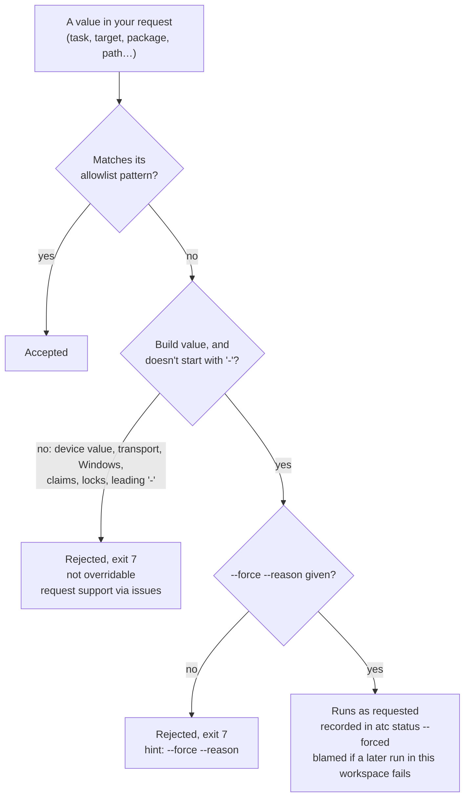
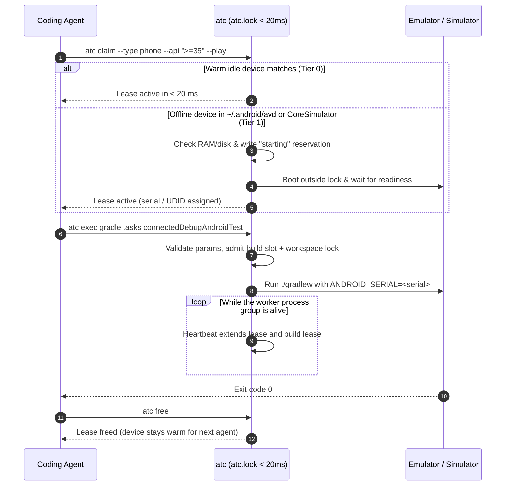
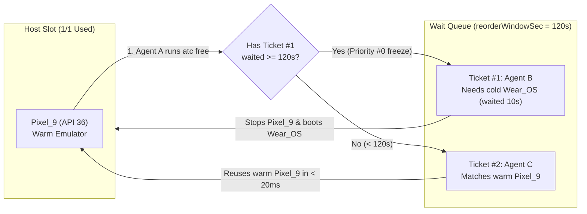
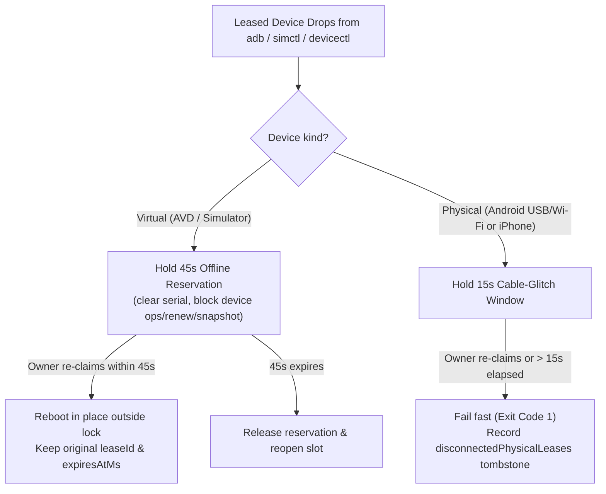
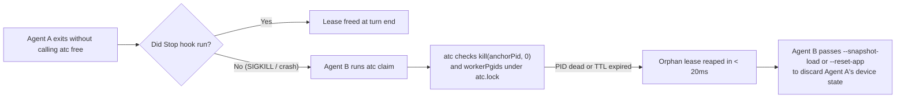

# `atc` user guide

Coordinate builds and exclusive Android and iOS device leases across concurrent coding agents without a daemon.

Status: `v3.0.0` · Updated `2026-10-16` · Node.js >= 20 on macOS, Linux, and Windows.

## Executive summary

When two coding agents share a machine, they collide on emulators, iOS Simulators, USB phones, and heavy builds. One agent installs an APK or shuts down a simulator while another agent inspects the screen. Unscoped `adb` and `xcrun simctl` commands fail once a second device boots, two Gradle builds in the same repo trample each other, and crashed turns leave orphan locks.

`atc` (Agent Traffic Control) serializes device access and builds through a user-private `state.json` file under an atomic directory lock (`atc.lock`). Agents claim a device by hardware/OS profile, then ask `atc` for **typed operations** (`atc exec gradle tasks …`, `atc exec android install …`, or a JSON `atc batch` plan). `atc` validates every value, builds the literal argv itself, runs it under the right lease, build slot, and workspace lock with a heartbeat, and frees what it took.

`atc` never runs shell commands. It is also a cooperative coordinator, not a kernel sandbox: any local process that skips `atc` can still talk to `adb` (`localhost:5037`) or `CoreSimulatorService`. The `atc` skill, guides, and MCP tools steer agents to request their device and build work through `atc`.

| Topic | Section |
|---|---|
| Setup & fleet check | [Install the CLI and inspect your fleet](#install-the-cli-and-inspect-your-fleet-in-one-command) |
| Typed operations | [Agents ask for typed operations, never shell commands](#agents-ask-for-typed-operations-never-shell-commands) |
| Single-agent flow | [One agent claims by profile and runs with a heartbeat](#one-agent-claims-by-profile-and-runs-with-a-heartbeat) |
| Multi-step plans | [Batch plans describe multi-step work as a validated DAG](#batch-plans-describe-multi-step-work-as-a-validated-dag) |
| Multi-agent contention | [Warm jobs jump ahead within 120 seconds without starving cold boots](#warm-jobs-jump-ahead-within-120-seconds-without-starving-cold-boots) |
| Kotlin Multiplatform (KMP) | [One KMP session holds an Android lease and an iOS lease at once](#one-kmp-session-holds-an-android-lease-and-an-ios-lease-at-once) |
| Crashes & disconnects | [Crashed virtual devices reboot in place; unplugged phones fail in 15 seconds](#crashed-virtual-devices-reboot-in-place-unplugged-phones-fail-in-15-seconds) |
| Snapshots & clean resets | [Snapshots reset emulator and simulator state in under two seconds](#snapshots-reset-emulator-and-simulator-state-in-under-two-seconds) |
| Coordination Q&A | [Questions on how coordination works](#questions-on-how-coordination-works) |
| CLI & exit codes | [Commands and exit codes map every failure to one action](#commands-and-exit-codes-map-every-failure-to-one-action) |

## Install the CLI and inspect your fleet in one command

Install `@rock3r/atc` globally with npm, then run `atc status` to inspect host memory, disk space, build slots, and discovered devices. On macOS, `atc status` probes both Android (`adb`, `~/.android/avd`) and iOS (`simctl`, `devicectl`) outside `atc.lock`.

```bash
npm install -g @rock3r/atc
atc status
```

```text
Host Capacity: 16735 MB RAM avail · 29989 MB disk free · emu slots: 0/2 · sim slots: 0/4 · build slots: 0/2
  Running (2): Pixel_9 (emulator-5554), adb-2A191FDH3007B7 (adb-2A191FDH3007B7)
  Offline (40): Opus_API37, Wear_OS_Small_Round, iPhone 16 Pro, ...
  Leases  (0): none
  Queue   (0): none
  Builds  (0): none
  BQueue  (0): none
```

Install the optional agent plugin so your coding agent loads the `atc` skill, the MCP server, and the session hooks automatically. The hooks only record your agent's session identity and free your leases when the session ends; they never read or block shell commands.

| Agent host | Install command or path |
|---|---|
| Claude Code | `/plugin marketplace add rock3r/atc` then `/plugin install atc@atc` |
| Codex | `codex plugin marketplace add rock3r/atc && codex plugin add atc@atc` |
| GitHub Copilot CLI / app | `copilot plugin marketplace add rock3r/atc && copilot plugin install atc@atc` |
| Antigravity | Symlink or copy package root to `~/.gemini/config/plugins/atc` (`plugin.json`, `skills/atc`, `hooks.json`, `mcp_config.json`) |
| Gemini CLI | Copy `skills/atc` to `~/.gemini/skills/atc` and wire `atc hook pre-tool-use` + `atc hook stop` |
| Cursor | Copy `.cursor/hooks.json` into `.cursor/hooks.json` (and optional `.mcp.json`) |
| Pi | Load `extensions/atc/index.ts` |

## Agents ask for typed operations, never shell commands

`atc` covers two domains, devices and builds, through a closed catalog of operations (`atc exec --help` prints it). Each build system keeps its natural commands; all of them can run a task, run a series of tasks, and clean.

| System | Operations |
|---|---|
| `gradle` | `tasks` (any task names/paths, one wrapper invocation; clean is just `tasks clean`) |
| `bazel` | `build`, `test`, `coverage`, `run` (needs `--timeout-sec` / `timeoutSec`), `series` (batch/MCP), `clean` (`--expunge`) |
| `xcode` | `build`, `test`, `build-for-testing`, `test-without-building`, `archive`, `clean`, `actions` |
| `android` | `install`, `uninstall`, `launch`, `clear-data`, `permission`, `logcat` (dump), `screenshot`, `prop get`, `prop set` |
| `ios` | `install`, `uninstall`, `launch`, `terminate`, `open-url`, `screenshot`, `privacy` (simulators only) |
| `snapshot` | `list`, `save`, `load`, `delete` (emulators and simulators) |

```bash
atc exec gradle tasks :app:assembleDebug --offline --brief
atc exec bazel test //app:tests --config ci --keep-going
atc exec xcode test --scheme App --project App.xcodeproj --only-testing AppTests/LoginTests
atc exec android permission --package com.example.app --permission android.permission.CAMERA --action grant
atc exec android prop set debug.layout true
atc exec ios open-url myapp://settings
```

Every value is checked against a strict pattern before anything runs, and every problem is reported at once:

```text
$ atc exec gradle tasks "bad;name" -x --cwd app
[atc] Request rejected (3 problems):
  /cwd: --cwd is not available on "atc exec"; it needs ceremony.
      → Use an "atc batch" plan, which supports cwd and env per step.
  /tasks/0: "bad;name" is not a Gradle task name or path (e.g. assembleDebug, :app:test).
      → If this value is legitimate, re-run with --force --reason "<why>" (you take responsibility), and request support at https://github.com/rock3r/atc/issues.
  /tasks/1: "-x" is not a Gradle task name or path (e.g. assembleDebug, :app:test).
      → This value cannot be overridden. Request support at https://github.com/rock3r/atc/issues if you need it.
```

`atc` never changes what you asked for. When a request could coordinate better, it prints a notice for next time:

```text
[atc] notice: Tasks connectedDebugAndroidTest need a device; the others are pure build tasks.
        consequence: The device is held for the whole invocation, including compilation.
        next time:   Split into an assemble step and a device step (batch dependsOn) so the device is only claimed when needed.
```

`--brief` on build ops writes the full output to `<stateDir>/logs/` and prints a one-line success or a condensed failure summary with the log path. `--json` returns a structured result (`steps` with exact argv and exit codes, `notices`, captured output).

If validation is too strict for a legitimate build value, `--force --reason "<why>"` overrides pattern checks for build values only. You take responsibility: the run is recorded (`atc status --forced`), and later failures in that workspace point back to it. `--force` never unlocks shell, unknown ops, values starting with `-`, device transport rules, claims, or locks.



## One agent claims by profile and runs with a heartbeat

An agent claims a virtual device by form factor and OS version rather than a hardcoded AVD name or UDID. Device operations run against the leased serial or UDID, and `atc` renews the lease while they run.



Notice that `atc.lock` is never held while an emulator boots, a build compiles, or a test runs; slow work happens outside the lock under `"starting"` or `"active"` states.

```bash
# Android emulator loop
atc claim --type phone --api ">=35" --play --wait 300
atc exec android install app/build/outputs/apk/debug/app-debug.apk --replace
atc exec gradle tasks connectedDebugAndroidTest
atc free

# iOS Simulator loop (macOS)
atc claim --ios --type phone --os ">=18.0" --wait 300
atc exec ios install build/App.app
atc exec ios launch com.example.app
atc free
```

## Batch plans describe multi-step work as a validated DAG

Multi-step workflows, dependencies, per-step `cwd` or `env`, scoped claims, and timeouts go into a JSON plan. `atc batch` validates the whole plan first and runs nothing if any step is invalid. Steps run sequentially in dependency order; a failed step skips its dependents.

```json
{
  "version": 1,
  "steps": [
    { "id": "assemble", "op": "gradle.tasks", "cwd": "app",
      "tasks": ["assembleDebug", "assembleDebugAndroidTest"], "buildOnly": true, "brief": true },
    { "id": "install", "op": "android.install", "dependsOn": ["assemble"],
      "apk": "app/build/outputs/apk/debug/app-debug.apk", "replace": true,
      "claim": { "platform": "android", "type": "phone", "api": "36" } },
    { "id": "test", "op": "gradle.tasks", "dependsOn": ["install"], "cwd": "app",
      "tasks": ["connectedDebugAndroidTest"], "claim": { "reuse": "install" }, "timeoutSec": 1800 }
  ]
}
```

```bash
atc batch --file plan.json --validate   # order + exact argv per step, runs nothing
atc batch --file plan.json --json
```

The compile step holds no device. The `install` step claims a phone, and `test` reuses that same lease (`claim: { "reuse": "install" }`); `atc` keeps the lease renewed until the last consumer finishes and then releases it. Leases you held before the batch are never released by it.

```mermaid
gantt
    title Who holds what during the example batch
    dateFormat X
    axisFormat %s
    section Build slot
    assemble (gradle)           :a, 0, 4
    test (gradle, device build) :t, 6, 10
    section Phone lease
    claimed by install          :crit, c, 4, 6
    reused by test              :crit, r, 6, 10
    released                    :milestone, m, 10, 10
```



| If… | then `atc`… |
|---|---|
| the plan has any invalid field, cycle, unknown op, or a device step with no claim | rejects the whole plan with every problem listed (exit `7`); nothing runs |
| a step fails | skips the steps that depend on it, stops the batch, and releases claims nobody else needs |
| a step fails with `continueOnError: true` | still skips its dependents but keeps running independent steps; the batch doesn't fail because of it |
| a step's `timeoutSec` elapses | stops that step (exit `124`); multi-command ops share one deadline |

## Warm jobs jump ahead within 120 seconds without starving cold boots

When all device slots are busy, `atc claim --wait 300` places the caller into `state.queue` and updates its ticket heartbeat once per second. A strict FIFO queue would force back-to-back 45-second cold boots whenever two agents alternate between different device profiles.

`atc` prevents cold-boot thrashing with a 120-second warm-affinity window (`reorderWindowSec = 120`). If a queued ticket matches a warm device (`Tier 0`) and the earlier cold-boot ticket has waited under 120 seconds, the warm ticket jumps ahead. At 120 seconds, any waiting ticket freezes at Priority #0. Builds follow the same idea in `state.buildQueue`: device holders get priority for build slots so leased devices don't idle, and starved pure builds are protected after `buildReorderWindowSec`.



| Time | Event | Queue decision |
|---|---|---|
| `t = 0s` | Agent A holds warm `Pixel_9` (`API 36`). Agent B requests offline `Wear_OS` (`--type watch`). | Agent B enters queue as Ticket #1 (`starvationDeadline = 120s`). |
| `t = 10s` | Agent C requests `--type phone --api ">=35"`. Agent A frees `Pixel_9`. | Ticket #1 has waited 10 s (`< 120s`). Agent C jumps ahead and claims warm `Pixel_9` in `< 20 ms`. |
| `t = 125s` | Agent C frees `Pixel_9`. Agent D requests `--type phone --api 36`. | Ticket #1 is past 120 s (frozen at Priority #0). `atc` blocks Agent D, stops `Pixel_9`, and boots `Wear_OS` for Agent B. |

## One KMP session holds an Android lease and an iOS lease at once

Kotlin Multiplatform (KMP), Flutter, and React Native tasks on macOS often test Android and iOS side by side in the same agent session. A session can hold one Android lease and one iOS lease at the same time.

Every typed op knows its platform (`android.*` and Gradle device tasks use the Android lease; `ios.*` and Xcode test actions use the iOS lease), so you do not pass `--serial` or `--android`/`--ios` on `atc exec`.

```bash
# Claim 1 Android device and 1 iOS Simulator in the same session
atc claim --android --type phone --api ">=35"
atc claim --ios --type phone --os ">=18.0"

# Each op picks its matching lease
atc exec android launch --package org.example.kmp --activity .MainActivity
atc exec ios launch org.example.kmpApp

# Scope renew, snapshot, and free with --android or --ios
atc snapshot save kmp_ready --ios
atc renew --android --ttl 600
atc free --android
atc free --ios --stop
```

## Crashed virtual devices reboot in place; unplugged phones fail in 15 seconds

Virtual devices and physical USB/Wi-Fi phones fail for different reasons. If QEMU or `Simulator.app` crashes, `atc` can reboot the virtual device automatically; if a developer unplugs a USB phone, only a human can plug the cable back in.

When a leased virtual device drops from `adb` or `simctl`, `atc` holds an offline reservation for 45 seconds so the owner can reboot it in place (`expiresAtMs` preserved). When a physical phone disconnects for over 15 seconds, `atc` writes a tombstone and fails fast (`exit 1`).



| Failure mode | Grace window | What device ops do | What `atc claim` does |
|---|---|---|---|
| Emulator or iOS Simulator crash | `45 s` | Fail immediately (`exit 3`) with a message to run `atc claim`. | Reboots the crashed virtual device in place and preserves `expiresAtMs`. |
| Physical Android or iPhone unplugged | `15 s` | Fail immediately once offline is detected. | Fails fast (`exit 1`) telling the agent to ask the user to reconnect the cable. |

## Snapshots reset emulator and simulator state in under two seconds

Tests often leave dirty login tokens, permissions, or database rows on a device. `atc` supports instant checkpoints on both Android emulators (via QEMU snapshots) and iOS Simulators (via APFS copy-on-write `cp -cR` clones in `<stateDir>/ios-snapshots/<udid>/<name>`).

| Operation | Command | Android emulator action | iOS Simulator action |
|---|---|---|---|
| Save checkpoint | `atc snapshot save <name>` (or `atc exec snapshot save <name>`) | `adb emu avd snapshot save <name>` | Shuts down simulator, runs `cp -cR` on `data/`, and reboots |
| Restore checkpoint | `atc snapshot load <name>` | `adb emu avd snapshot load <name>` + boot check | Shuts down simulator, swaps APFS `data/` clone, and boots |
| Clear one app | `atc exec android clear-data <pkg>` / `atc claim ... --reset-app <id>` | `pm clear <pkg>` | Stops `<bundleId>`, resets privacy permissions, and wipes app container |
| Factory wipe | `atc claim ... --wipe-data` | Deletes `userdata-qemu.img*` and cold-boots | Runs `xcrun simctl erase <udid>` and boots clean |

```bash
# Restore a known snapshot on claim and clear app storage before starting
atc claim --type phone --api 36 --snapshot-load default_boot --reset-app com.example.app

# Save a checkpoint mid-session, run destructive steps, then rewind
atc snapshot save logged_in
atc exec gradle tasks connectedDebugAndroidTest
atc snapshot load logged_in
```

## Questions on how coordination works

### Can `atc` stop a rogue agent from talking to `adb` or `simctl` directly?

No. `atc` is a cooperative system, like real air traffic control ([context thread](https://bsky.app/profile/sebastiano.dev/post/3mxm4nh77yc2f)). Air traffic control directs pilots over the radio and sequences the runway, but it cannot physically grab the yoke inside the cockpit.

At the OS level, `adb` (port `5037`) and `CoreSimulatorService` are shared user-space buses. Code cannot stop a process on the same user account from invoking `adb` or `xcrun simctl` outside `atc`. ATC 2.x tried to inspect and rewrite shell commands in a pre-tool hook; ATC 3.0 dropped that entirely, because shell is not a language anyone can safely parse. Instead, the skill, `atc guide`, and the MCP tools steer agents to request their work through typed operations, and the guarantees apply to work requested through `atc`.

Operations that are deliberately not offered (stopping shared Gradle daemons or the Bazel server, `adb kill-server`, reboots, `emu kill`, booting or erasing simulators outside `atc claim`/`atc free`) are refused even with `--force`.

### What if I need an operation that isn't in the catalog?

`atc` refuses it, names the closest supported operation, and links to <https://github.com/rock3r/atc/issues>. Until it is added, keep your lease and run the tool yourself against the leased serial/UDID (from `atc claim` or `atc status --json`). `atc` won't intercept it, but it can't coordinate it either.

### Can an agent recover access after another agent exits without releasing the device?

Yes, on two levels: reclaiming the lease lock and discarding dirty device state.

For the **lease lock**, `atc` never relies on an agent remembering to call `atc free`:

| Exit scenario | How `atc` reclaims the lease |
|---|---|
| Normal turn end (`Stop` / `SessionEnd` hook) | `atc hook stop` frees the session's leases immediately (or sets `releaseOnWorkerExit` if a worker is still finishing). |
| Agent crash or closed terminal (`SIGKILL`) | The next `atc` command checks `kill(anchorPid, 0)` and `workerPgids` and reaps the dead-PID lease in `< 20 ms`. |
| Idle hang with no active worker | The lease expires when its TTL (`defaultTtlSec = 600`) runs out. |

For **device state**, "releasing" has no single definition across tasks—the previous agent may have left a dialog open or modified app storage. On emulators and iOS Simulators, `--snapshot-load <name>`, `--reset-app <id>`, or `--wipe-data` discards those changes. Physical phones only support app-level resets (`--reset-app <pkg>`).



### Why does `atc` run without a background daemon?

Background daemons drift out of sync on `npm` upgrades, hold stale `ANDROID_HOME` or `DEVELOPER_DIR` variables, and become single points of failure.

`atc` stores all state in `<stateDir>/state.json` protected by an atomic `mkdir <stateDir>/atc.lock` mutex (`< 20 ms` hold time):

| Phase | Runs under `atc.lock`? | What happens |
|---|---|---|
| 1. Discovery & planning | No (before lock) | Validates the request, resolves wrappers, probes `adb`, `android`, `simctl`, `devicectl`, warm build daemons, and host RAM/disk. |
| 2. Admission, selection & GC | Yes (`< 20 ms`) | Reaps dead-PID leases, admits builds and devices, and writes `"starting"`, `"active"` or build-lease state. |
| 3. Boot, build, device op, snapshot | No (after lock) | Runs the external tools while a heartbeat extends the leases. |

### Can an agent install a test build onto my charging personal phone?

No, unless you opt in explicitly. `atc claim` defaults to `--kind emulator`, which ignores physical USB and Wi-Fi devices on both Android and iOS, and device ops only ever target the device leased to the caller's session. `android prop set` is additionally refused on physical devices unless you enable `allowPhysicalPropSet`.

To target a physical phone on purpose, pass its identifier or `--kind physical`:

```bash
# Physical Android phone
atc claim --serial adb-2A191FDH3007B7-SAhkP3._adb-tls-connect._tcp

# Physical iPhone (via Xcode CoreDevice / devicectl; ios.* and xcode test ops are simulator-only)
atc claim --ios --kind physical --udid 00008120-000464CE2E44C01E

# Optional: forbid all physical device claims on this machine
atc config set allowPhysicalDevices never
```

### How do Android emulator slots and iOS Simulator slots share a Mac?

Android emulators boot full QEMU virtual machines with dedicated guest RAM, while iOS Simulators run as lightweight user-space containers sharing the macOS kernel. `atc` tracks them in separate pools, plus a pool of build slots:

| Pool | Config key & default | Admission check |
|---|---|---|
| Android QEMU emulators | `maxRunningEmulators = 2` | Available host RAM must cover `ramSizeMb + 1024 MB overhead + minFreeRamMb (2048 MB)`, plus `2048 MB` free disk. |
| iOS Simulators (macOS) | `maxRunningSimulators = 4` | Available host RAM must cover `simOverheadRamMb (1280 MB) + minFreeRamMb (2048 MB)`, and the target volume must have the boot/clone footprint plus `minFreeDiskMb (2048 MB)` free disk. |
| Physical devices | Unlimited (`0` virtual slots) | Must be online in `adb devices` or `xcrun devicectl list devices`. |
| Builds | `maxConcurrentBuilds = "auto"` (+1 burst slot for device holders) | One build per workspace key at a time; RAM reservation (`buildRamEstimateMb`, or the project's Gradle heap / `ramMb`) must fit. |

## Commands and exit codes map every failure to one action

Run `atc guide [workflow|profiles|snapshots|multi-agent|traps]` at any time to read the built-in CLI guides, and `atc exec --help` for the operation catalog.

| Command | What it does |
|---|---|
| `atc status [--ios\|--android] [--type <t>] [--api\|--os <spec>] [--forced] [--json]` | Show host RAM/disk, emulator/simulator/build slots, devices, leases, queues, and (with `--forced`) recorded forced runs. |
| `atc claim [--ios\|--android] [--type <t>] [--api\|--os <spec>] [flags]` | Claim a lease (`--play`, `--no-play`, `--avd`, `--udid`, `--serial`, `--kind`, `--snapshot-load`, `--wipe-data`, `--cold`, `--reset-app`, `--create-if-missing`, `--ttl`, `--wait`). |
| `atc exec <system> <op> [args] [--options] [--json]` | Run one typed operation under the right lease, build slot and workspace lock. |
| `atc batch [--file <plan.json> \| -] [--validate] [--json]` | Validate and run a JSON plan of typed operations. |
| `atc snapshot <list\|save\|load\|delete> [<name>] [--ios\|--android]` | Manage QEMU snapshots (Android) or APFS copy-on-write clones (iOS Simulator). |
| `atc renew [<target>] [--ios\|--android] [--ttl <sec>] [--json]` | Extend an active lease's TTL. |
| `atc free [<target>] [--ios\|--android] [--snapshot-save <n>] [--stop]` | Release one or all leases held by the caller session. |
| `atc guide [workflow\|profiles\|snapshots\|multi-agent\|traps] [--json]` | Print built-in documentation topics. |
| `atc config <get\|set> [key] [val]` | Read or update config (`maxRunningEmulators`, `maxRunningSimulators`, `maxConcurrentBuilds`, `minFreeRamMb`, `allowPhysicalDevices`, `allowPhysicalPropSet`). |
| `atc gc` | Prune expired leases, dead anchor/worker PIDs, and stale queue tickets. |
| `atc hook <pre-tool-use\|stop>` | Session bookkeeping hook entrypoint for Claude Code, Codex, Gemini CLI, Antigravity, Copilot, and Cursor. |
| `atc mcp` | Start the stdio MCP server (`atc_gradle`, `atc_bazel`, `atc_xcode`, `atc_android`, `atc_ios`, `atc_batch`, `atc_status`, `atc_claim`, `atc_renew`, `atc_snapshot`, `atc_free`, `atc_guide`). |

| Exit code | Name | Meaning and next action |
|---|---|---|
| `0` | `OK` | Command succeeded. |
| `1` | `EUSAGE / EINTERNAL` | Invalid CLI flag, unknown subcommand, physical device disconnected while leased, or tool error (a failing tool's own exit code is passed through). |
| `2` | `EBUSY` | All matching devices or slots busy (`--wait 0`). |
| `3` | `ENOTFOUND / EFORBIDDEN` | Caller session holds no matching online lease, the lease belongs to another session, or a policy refused the op. |
| `4` | `ETIMEDOUT` | Queue wait (`--wait`) or device boot (`bootTimeoutSec`) timed out. |
| `5` | `ERESOURCE_EXCEEDED` | Host available RAM or free disk space is below safety reserves. Free idle devices; only device boots and snapshot saves can be forced (ask the user first), never build RAM admission. |
| `6` | `EPHYSICAL_FORBIDDEN` | Physical device claim rejected by `allowPhysicalDevices` policy. |
| `7` | `EINVALID_OP` | Request rejected by validation (unsupported op, param or value); nothing ran. Read the listed problems and hints. |
| `124` | `ETIMEOUT_OP` | An op's `timeoutSec` elapsed and `atc` stopped it. |
