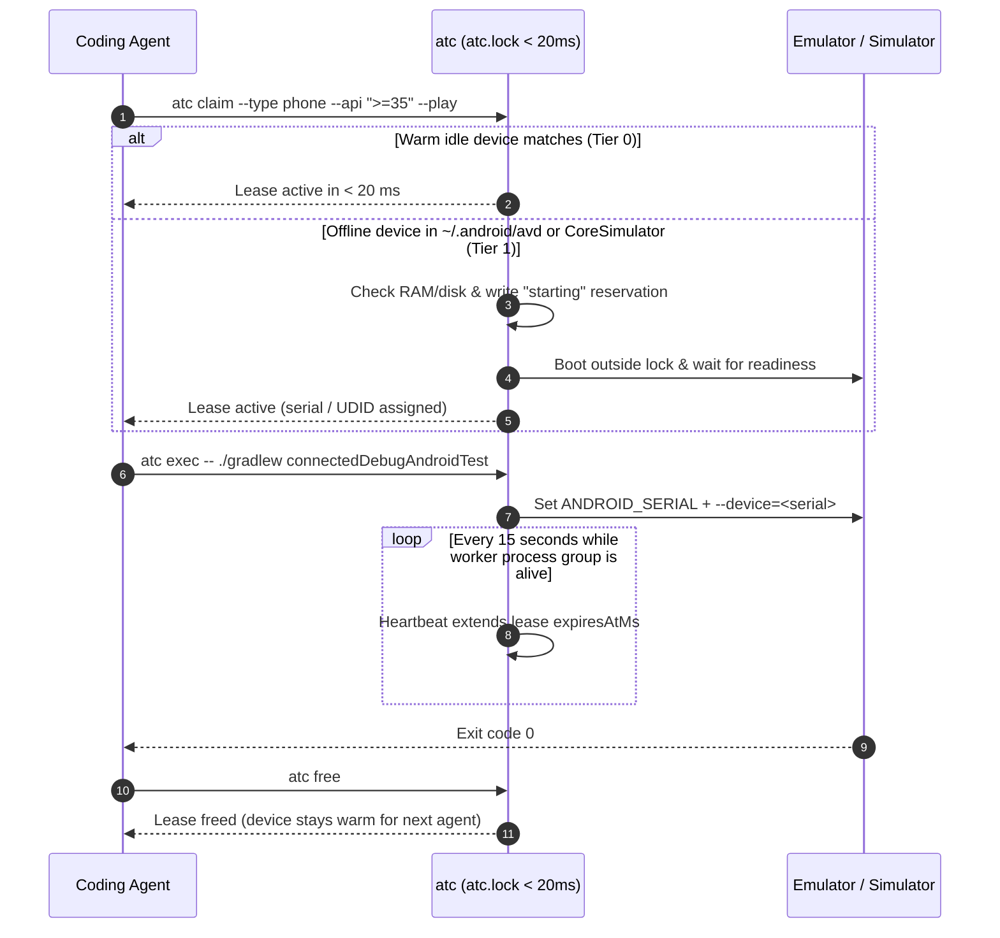
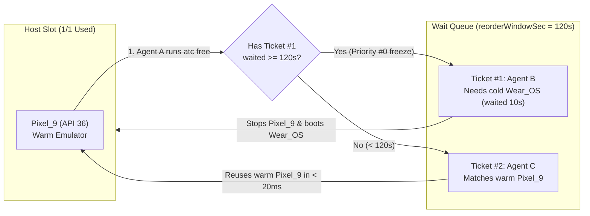
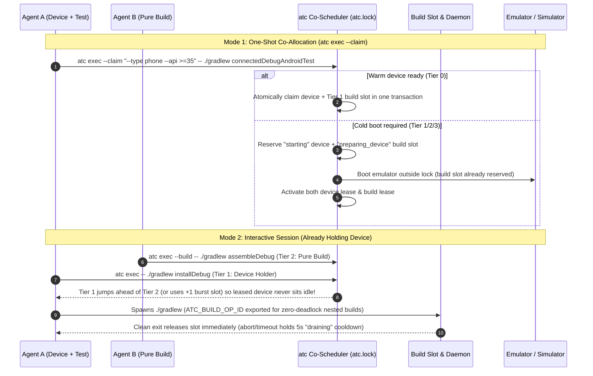
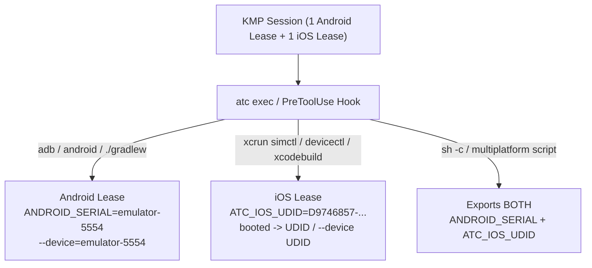
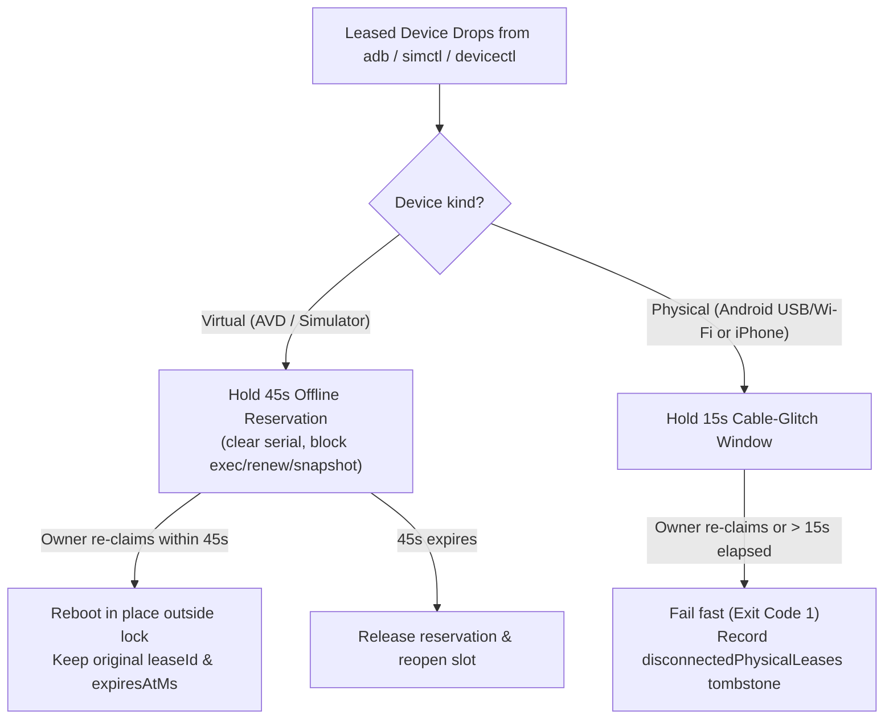
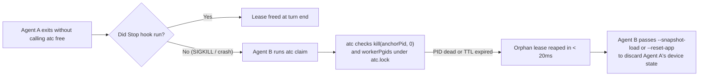

# `atc` user guide

Coordinate exclusive Android and iOS device leases across concurrent coding agents without a daemon.

Status: `v2.1.0` · Updated `2026-10-15` · Node.js >= 20 on macOS, Linux, and Windows.

## Executive summary

When two coding agents share a machine, they collide on emulators, iOS Simulators, USB phones, and heavy Gradle/Bazel/Xcode builds. One agent installs an APK or shuts down a simulator while another agent inspects the screen, or two concurrent `./gradlew` / `bazel` builds saturate RAM and thrash shared project workspaces while holding an emulator hostage. Unscoped `adb` and `xcrun simctl` commands fail once a second device boots, and crashed turns leave orphan locks.

`atc` (Agent Traffic Control) serializes device access and heavy build slots through a user-private `state.json` file under an atomic directory lock (`atc.lock`). Agents claim a device by hardware/OS profile, run commands inside `atc exec` with a 15-second heartbeat, co-schedule Gradle/Bazel/`xcodebuild` builds via `atc exec --build` or `atc exec --claim "..."` without cross-starvation, restore QEMU or APFS snapshots, and free the lease when done. Every state transition is recorded to an OS-native structured JSONL audit log (`atc-audit.jsonl`).

`atc` is a cooperative coordinator, not a kernel sandbox. Any local process that skips `atc` can still open a socket to `adb` (`localhost:5037`) or `CoreSimulatorService`. Installing the `atc` host plugin closes that gap for coding agents by checking and rewriting shell commands before they run.

| Topic | Section |
|---|---|
| Setup & fleet check | [Install the CLI and inspect your fleet](#install-the-cli-and-inspect-your-fleet-in-one-command) |
| Single-agent flow | [One agent claims by profile and runs with a 15-second heartbeat](#one-agent-claims-by-profile-and-runs-with-a-15-second-heartbeat) |
| Multi-agent contention | [Warm jobs jump ahead within 120 seconds without starving cold boots](#warm-jobs-jump-ahead-within-120-seconds-without-starving-cold-boots) |
| Build + device co-scheduling | [Co-schedule Gradle, Bazel, and Xcode builds without cross-starvation](#co-schedule-gradle-bazel-and-xcode-builds-without-cross-starvation) |
| Kotlin Multiplatform (KMP) | [One KMP session holds an Android lease and an iOS lease at once](#one-kmp-session-holds-an-android-lease-and-an-ios-lease-at-once) |
| Crashes & disconnects | [Crashed virtual devices reboot in place; unplugged phones fail in 15 seconds](#crashed-virtual-devices-reboot-in-place-unplugged-phones-fail-in-15-seconds) |
| Snapshots & clean resets | [Snapshots reset emulator and simulator state in under two seconds](#snapshots-reset-emulator-and-simulator-state-in-under-two-seconds) |
| System audit logging | [Inspect structured JSONL audit logs for debugging and bug reports](#inspect-structured-jsonl-audit-logs-for-debugging-and-bug-reports) |
| Coordination Q&A | [Questions on how coordination works](#questions-on-how-coordination-works) |
| CLI & exit codes | [Commands and exit codes map every failure to one action](#commands-and-exit-codes-map-every-failure-to-one-action) |

## Install the CLI and inspect your fleet in one command

Install `@rock3r/atc` globally with npm, then run `atc status` to inspect host memory, disk space, and discovered devices. On macOS, `atc status` probes both Android (`adb`, `~/.android/avd`) and iOS (`simctl`, `devicectl`) outside `atc.lock`.

```bash
npm install -g @rock3r/atc
atc status
```

```text
Host Capacity: 16735 MB RAM avail · 29989 MB disk free
  emu slots: 0/2 · sim slots: 0/4 · build slots: 0/2 (+1 burst)
  Running (2): adb-2A191FDH3007B7, 00008120-000464CE2E44C01E
  Offline (40): Opus_API37, Pixel_9, Wear_OS_Small_Round,
                iPhone 16 Pro, Apple Watch Series 10 (46mm)
  Leases  (0): none
  Builds  (0): none
  Queue   (0): none
```

Install the optional agent plugin so your coding agent loads the `atc` skill and runs `PreToolUse` / `Stop` guardrail hooks automatically.

| Agent host | Install command or path |
|---|---|
| Claude Code | `/plugin marketplace add rock3r/atc` then `/plugin install atc@atc` |
| Codex | `codex plugin marketplace add rock3r/atc && codex plugin add atc@atc` |
| GitHub Copilot CLI / app | `copilot plugin marketplace add rock3r/atc && copilot plugin install atc@atc` |
| Antigravity | Symlink or copy package root to `~/.gemini/config/plugins/atc` (`plugin.json`, `skills/atc`, `hooks.json`, `mcp_config.json`) |
| Gemini CLI | Copy `skills/atc` to `~/.gemini/skills/atc` and wire `atc hook pre-tool-use` + `atc hook stop` |
| Cursor | Copy `.cursor/hooks.json` into `.cursor/hooks.json` (and optional `.mcp.json`) |
| Pi | Load `extensions/atc/index.ts` |

## One agent claims by profile and runs with a 15-second heartbeat

An agent claims a virtual device by form factor and OS version rather than a hardcoded AVD name or UDID. `atc exec` injects the leased target into child commands and renews the lease every 15 seconds while the command runs.



Notice that `atc.lock` is never held while an emulator boots or a test runs; slow work happens outside the lock under `"starting"` or `"active"` states.

```bash
# Android emulator loop
atc claim --type phone --api ">=35" --play --wait 300
atc exec -- adb shell getprop ro.product.model
atc exec -- android layout --pretty
atc exec -- ./gradlew connectedDebugAndroidTest
atc free

# iOS Simulator loop (macOS)
atc claim --ios --type phone --os ">=18.0" --wait 300
atc exec -- xcrun simctl launch booted com.example.app
atc free
```

## Warm jobs jump ahead within 120 seconds without starving cold boots

When all device slots are busy, `atc claim --wait 300` places the caller into `state.queue` and updates its ticket heartbeat once per second. A strict FIFO queue would force back-to-back 45-second cold boots whenever two agents alternate between different device profiles.

`atc` prevents cold-boot thrashing with a 120-second warm-affinity window (`reorderWindowSec = 120`). If a queued ticket matches a warm device (`Tier 0`) and the earlier cold-boot ticket has waited under 120 seconds, the warm ticket jumps ahead. At 120 seconds, any waiting ticket freezes at Priority #0.



| Time | Event | Queue decision |
|---|---|---|
| `t = 0s` | Agent A holds warm `Pixel_9` (`API 36`). Agent B requests offline `Wear_OS` (`--type watch`). | Agent B enters queue as Ticket #1 (`starvationDeadline = 120s`). |
| `t = 10s` | Agent C requests `--type phone --api ">=35"`. Agent A frees `Pixel_9`. | Ticket #1 has waited 10 s (`< 120s`). Agent C jumps ahead and claims warm `Pixel_9` in `< 20 ms`. |
| `t = 125s` | Agent C frees `Pixel_9`. Agent D requests `--type phone --api 36`. | Ticket #1 is past 120 s (frozen at Priority #0). `atc` blocks Agent D, stops `Pixel_9`, and boots `Wear_OS` for Agent B. |

## Co-schedule Gradle, Bazel, and Xcode builds without cross-starvation

When multiple coding agents run `./gradlew`, `bazel`, or `xcodebuild` concurrently on one machine, two cross-starvation deadlocks happen without co-scheduling:

1. **Device-Wait-While-Holding-Build (Forward Starvation):** An agent starts `./gradlew connectedDebugAndroidTest` or `xcodebuild test`, consuming a build slot and 4+ GB of daemon RAM while blocking inside the build waiting for a busy emulator/simulator.
2. **Build-Wait-While-Holding-Device (Reverse Starvation):** An agent claims an emulator first, then tries to compile its test APK, but gets stuck behind three pure `./gradlew assembleDebug` builds—holding the scarce emulator idle while waiting for a compiler slot.

`atc` eliminates both hazards by coupling build slots and device leases under `atc.lock` using a **3-tier priority build scheduler**, **per-workspace locks**, and **burst build slots for active device holders**.



### Three-tier build priority and workspace mutual exclusion

| Priority Tier | Who qualifies | Slot ceiling | Why it exists |
|---|---|---|---|
| **Tier 0 (`starved`)** | Any queued build ticket waiting `>= 120 s` (`buildReorderWindowSec`) | Base + Burst (`maxConcurrentBuilds + maxDeviceHolderBurstBuilds`) | Guarantees strict upper bound on wait time so pure builds never starve indefinitely. |
| **Tier 1 (`device-holder`)** | Session holds an online `"active"` device lease, or is co-allocating via `atc exec --claim` | Base + Burst (`maxConcurrentBuilds = "auto"` `[1..4]` + `1` burst) | Prevents **Reverse Starvation**: an agent holding a scarce emulator/phone never waits behind pure CPU builds to compile and install its APK/IPA. |
| **Tier 2 (`pure-build`)** | Pure CPU build (`./gradlew assembleDebug`, `bazel build`, `xcodebuild build`) with no device lease | Base (`maxConcurrentBuilds = "auto"`, `[1..4]`) | Throttles background compilation so the host retains enough RAM and CPU for active emulators and simulators. |

Even when global build slots are free, two builds targeting the **same workspace root or output base** cannot run concurrently without corrupting incremental caches or blocking on internal tool mutexes. `atc` extracts canonical workspace keys and serializes colliding builds in `state.buildQueue`:

| Build tool | Extracted `workspaceKeys` | Daemon & re-entrancy protections |
|---|---|---|
| `gradle` / `./gradlew` | `gradle:<canonicalProjectRoot>` + `gradle:dir:<--project-dir>` | Blocks `--stop` (`exit 2`); injects `-Dorg.gradle.workers.max=<N>`; enters `"draining"` (`5 s` abort cooldown / `30 s` max horizon) if aborted or while client-group processes remain alive. |
| `bazel` / `bazelisk` / `./bazelw` | `bazel:ws:<workspaceRoot>` + `bazel:out:<--output_base>` | Blocks `shutdown` and `clean --expunge` (`exit 2`); injects `--jobs=<N>` and `--local_ram_resources=<MB>`; enters `"draining"` if aborted or while client-group processes remain alive. |
| `xcodebuild` | `xcode:<projectOrWorkspaceDir>` + `xcode:dd:<derivedDataPath>` | Injects `-jobs <N>` unless already passed; coordinates `-derivedDataPath` access across concurrent iOS/macOS sessions. |

### Re-entrant sub-builds (zero nested deadlocks)

Real-world builds frequently invoke nested builds—for example, `xcodebuild` Run Script phases invoking `./gradlew :shared:embedAndSignAppleFrameworkForXcode` in KMP projects, or Bazel `genrule` steps invoking Gradle.

When `atc exec` starts a top-level build, it exports `ATC_BUILD_OP_ID=<opId>` and `ATC_BUILD_OP_NONCE=<nonce>`. If a child process inside that tree invokes `atc exec --build` (or is intercepted by `atc hook pre-tool-use`), `atc` verifies the parent build lease's `opId`, `nonce`, and live worker process group:
- **Same workspace keys:** Admitted immediately (`reentrantReuse`) in `< 1 ms` without consuming a second build slot or deadlocking on the parent's workspace lock.
- **Additional workspace keys:** Acquires only the delta workspace keys without charging an extra global concurrency slot.

```bash
# 1. Pure build (no device needed) — coordinates RAM, CPU jobs, and workspace lock
atc exec --build -- ./gradlew assembleDebug
atc exec --build -- bazel build //app:main

# 2. One-shot atomic device + build co-allocation (claims device, runs build+test, frees both)
atc exec --claim "--type phone --api >=35" -- ./gradlew connectedDebugAndroidTest
atc exec --claim "--ios --type phone --os >=18.0" -- xcodebuild test -scheme App

# 3. Interactive device session — Tier 1 priority + burst slot assigned automatically
atc claim --type phone --api ">=35"
atc exec -- ./gradlew installDebug
atc exec -- adb shell am start -n com.example/.MainActivity
atc free
```

## One KMP session holds an Android lease and an iOS lease at once

Kotlin Multiplatform (KMP), Flutter, and React Native tasks on macOS often test Android and iOS side by side in the same agent session. A session can hold one Android lease and one iOS lease at the same time.

When a session holds one lease on each platform, `atc exec` and `atc hook pre-tool-use` inspect the command and pick the matching platform lease automatically. You do not need to pass `--serial` or `--android`/`--ios` on `atc exec`.



```bash
# Claim 1 Android device and 1 iOS Simulator in the same session
atc claim --android --type phone --api ">=35"
atc claim --ios --type phone --os ">=18.0"

# Platform tools auto-select their matching lease
atc exec -- adb shell getprop ro.product.model
atc exec -- xcrun simctl launch booted org.example.kmpApp

# Scope renew, snapshot, and free with --android or --ios
atc snapshot save kmp_ready --ios
atc renew --android --ttl 600
atc free --android
atc free --ios --stop
```

## Crashed virtual devices reboot in place; unplugged phones fail in 15 seconds

Virtual devices and physical USB/Wi-Fi phones fail for different reasons. If QEMU or `Simulator.app` crashes, `atc` can reboot the virtual device automatically; if a developer unplugs a USB phone, only a human can plug the cable back in.

When a leased virtual device drops from `adb` or `simctl`, `atc` holds an offline reservation for 45 seconds so the owner can reboot it in place (`expiresAtMs` preserved). When a physical phone disconnects for over 15 seconds, `atc` writes a tombstone and fails fast (`exit 1`).



| Failure mode | Grace window | What `atc exec` / `atc guard` does | What `atc claim` does |
|---|---|---|---|
| Emulator or iOS Simulator crash | `45 s` | Blocks immediately (`exit 2`/`3`) with a message to run `atc claim`. | Reboots the crashed virtual device in place and preserves `expiresAtMs`. |
| Physical Android or iPhone unplugged | `15 s` | Blocks immediately (`exit 2`/`3`) once offline is detected. | Fails fast (`exit 1`) telling the agent to ask the user to reconnect the cable. |

## Snapshots reset emulator and simulator state in under two seconds

Tests often leave dirty login tokens, permissions, or database rows on a device. `atc` supports instant checkpoints on both Android emulators (via QEMU snapshots) and iOS Simulators (via APFS copy-on-write `cp -cR` clones in `~/.atc-snapshots/<udid>/<name>`).

| Operation | Command | Android emulator action | iOS Simulator action |
|---|---|---|---|
| Save checkpoint | `atc snapshot save <name>` | `adb emu avd snapshot save <name>` | Shuts down simulator, runs `cp -cR` on `data/`, and reboots |
| Restore checkpoint | `atc snapshot load <name>` | `adb emu avd snapshot load <name>` + boot check | Shuts down simulator, swaps APFS `data/` clone, and boots |
| Clear one app | `atc claim ... --reset-app <id>` | `adb shell pm clear <pkg>` | Stops `<bundleId>`, resets privacy permissions, and wipes app container |
| Factory wipe | `atc claim ... --wipe-data` | Deletes `userdata-qemu.img*` and cold-boots | Runs `xcrun simctl erase <udid>` and boots clean |

```bash
# Restore a known snapshot on claim and clear app storage before starting
atc claim --type phone --api 36 --snapshot-load default_boot --reset-app com.example.app

# Save a checkpoint mid-session, run destructive steps, then rewind
atc snapshot save logged_in
atc exec -- ./gradlew connectedDebugAndroidTest
atc snapshot load logged_in
```

## Inspect structured JSONL audit logs for debugging and bug reports

Every device claim, release, queue wait, build slot admission, `"draining"` daemon reconciliation, command guard block, and garbage-collection sweep is appended to a structured JSONL audit log (`atc-audit.jsonl`) outside `atc.lock`.

| OS | Default audit log location (`resolveSystemLogDir()`) | Override |
|---|---|---|
| **macOS** | `~/Library/Logs/atc/atc-audit.jsonl` | `ATC_LOG_DIR=/path/to/dir` or `atc config set auditLogging false` |
| **Linux** | `$XDG_STATE_HOME/atc/logs/atc-audit.jsonl` (default `~/.local/state/atc/logs/atc-audit.jsonl`) | `ATC_LOG_DIR=/path/to/dir` or `atc config set auditLogging false` |
| **Windows** | `%LOCALAPPDATA%\atc\logs\atc-audit.jsonl` | `ATC_LOG_DIR=/path/to/dir` or `atc config set auditLogging false` |

Each line is a self-contained JSON object (`schemaVersion: 1`) with `ts` (ISO-8601), `epochMs`, `pid`, `sessionId`, `category` (`"lease"`, `"build"`, `"queue"`, `"guard"`, `"gc"`), `event`, and structured metadata (`opId`, `leaseId`, `deviceKey`, `tool`, `tier`, `workspaceKeys`, `durationMs`, `exitCode`). When `atc-audit.jsonl` exceeds `10 MB`, `atc` automatically rotates up to `3` rotated `.1`, `.2`, `.3` archives.

```bash
# Watch live lease, build, and guard events across all agents on your Mac
tail -f ~/Library/Logs/atc/atc-audit.jsonl | jq .

# Filter for build co-scheduling and workspace contention events
grep '"category":"build"' ~/Library/Logs/atc/atc-audit.jsonl | tail -n 20
```

## Questions on how coordination works

### Can `atc` stop a rogue agent from talking to `adb` or `simctl` directly?

`atc` is a cooperative system, like real air traffic control ([context thread](https://bsky.app/profile/sebastiano.dev/post/3mxm4nh77yc2f)). Air traffic control directs pilots over the radio and sequences the runway, but it cannot physically grab the yoke inside the cockpit.

At the OS level, `adb` (port `5037`) and `CoreSimulatorService` are shared user-space buses. Code cannot stop a process on the same user account from invoking `adb` or `xcrun simctl` outside `atc`.

In practice, coding agents follow rules when given a clear protocol (`atc guide`), and the `atc` host plugin adds a gate in front of the shell tool (`atc hook pre-tool-use` / `atc guard`):

| Command type | Example | `atc guard` / `PreToolUse` action |
|---|---|---|
| Raw lifecycle mutation | `emulator -avd`, `adb emu kill`, `xcrun simctl boot\|shutdown\|erase` | Blocked (`exit 2`); instructs agent to use `atc claim` / `atc free`. |
| Unleased or cross-session command | `adb shell`, `xcrun simctl launch`, `xcodebuild test` without matching lease | Blocked (`exit 2`). |
| Leased command in Claude Code, Gemini CLI, Antigravity, or Pi | `adb install app.apk` | Rewritten to `ATC_SESSION_ID=<id> atc exec --serial <id> -- ...`. |

### Can an agent recover access after another agent exits without releasing the device?

Yes, on two levels: reclaiming the lease lock and discarding dirty device state.

For the **lease lock**, `atc` never relies on an agent remembering to call `atc free`:

| Exit scenario | How `atc` reclaims the lease |
|---|---|
| Normal turn end (`Stop` / `SessionEnd` hook) | `atc hook stop` frees the session's leases immediately (or sets `releaseOnWorkerExit` if a worker is still finishing). |
| Agent crash or closed terminal (`SIGKILL`) | The next `atc` command checks `kill(anchorPid, 0)` and `workerPgids` and reaps the dead-PID lease in `< 20 ms`. |
| Idle hang with no active `atc exec` worker | The lease expires when its TTL (`defaultTtlSec = 600`) runs out. |

For **device state**, "releasing" has no single definition across tasks—the previous agent may have left a dialog open or modified app storage. On emulators and iOS Simulators, `--snapshot-load <name>`, `--reset-app <id>`, or `--wipe-data` discards those changes. Physical phones only support app-level resets (`--reset-app <pkg>`).



### Why does `atc` run without a background daemon?

Background daemons drift out of sync on `npm` upgrades, hold stale `ANDROID_HOME` or `DEVELOPER_DIR` variables, and become single points of failure.

`atc` stores all state in `<stateDir>/state.json` protected by an atomic `mkdir <stateDir>/atc.lock` mutex (`< 20 ms` hold time):

| Phase | Runs under `atc.lock`? | What happens |
|---|---|---|
| 1. Fleet discovery | No (before lock) | Probes `adb`, `android`, `simctl`, `devicectl`, and host RAM/disk. |
| 2. Candidate selection & GC | Yes (`< 20 ms`) | Reaps dead-PID leases, checks `atc.lock/owner.json`, and writes `"starting"` or `"active"` state. |
| 3. Boot, snapshot, or wipe | No (after lock) | Runs external tools while a 15-second worker heartbeat extends `lease.deadlineMs`. |

### Can an agent install a test build onto my charging personal phone?

No, unless you opt in explicitly. `atc claim` defaults to `--kind emulator`, which ignores physical USB and Wi-Fi devices on both Android and iOS. `atc guard` also blocks unscoped `adb install` and `./gradlew connectedCheck` commands whenever a physical device is attached.

To target a physical phone on purpose, pass its identifier or `--kind physical`:

```bash
# Physical Android phone
atc claim --serial adb-2A191FDH3007B7-SAhkP3._adb-tls-connect._tcp

# Physical iPhone (via Xcode CoreDevice / devicectl)
atc claim --ios --kind physical --udid 00008120-000464CE2E44C01E

# Optional: forbid all physical device claims on this machine
atc config set allowPhysicalDevices never
```

### How do Android emulator slots and iOS Simulator slots share a Mac?

Android emulators boot full QEMU virtual machines with dedicated guest RAM, while iOS Simulators run as lightweight user-space containers sharing the macOS kernel. `atc` tracks them in separate pools:

| Pool | Config key & default | Admission check before boot / start |
|---|---|---|
| Android QEMU emulators | `maxRunningEmulators = 2` | Available host RAM must cover `ramSizeMb + 1024 MB overhead + minFreeRamMb (2048 MB)` plus unaccounted `<10 s` starting builds, and `2048 MB` free disk. |
| iOS Simulators (macOS) | `maxRunningSimulators = 4` | Target volume must have at least `minFreeDiskMb (2048 MB)` free disk space. |
| Heavy builds (`gradle` / `bazel` / `xcodebuild`) | `maxConcurrentBuilds = 2` (`+1` burst for device holders) | Per-workspace key lock + RAM check (`buildRamEstimateMb = 4096 MB` for cold daemons + `preparingDevice` reservations + `minFreeRamMb`). |
| Physical devices | Unlimited (`0` virtual slots) | Must be online in `adb devices` or `xcrun devicectl list devices`. |

## Commands and exit codes map every failure to one action

Run `atc guide [workflow|profiles|snapshots|multi-agent|traps]` at any time to read the built-in CLI guides.

| Command | What it does |
|---|---|
| `atc status [--ios\|--android] [--type <t>] [--api\|--os <spec>] [--json]` | Show host RAM/disk, `emu slots`, `sim slots`, `build slots`, `running`/`offline`/`creatable` devices, `leases`, `builds`, and `queue`. |
| `atc claim [--ios\|--android] [--type <t>] [--api\|--os <spec>] [flags]` | Claim a lease (`--play`, `--no-play`, `--avd`, `--udid`, `--serial`, `--kind`, `--snapshot-load`, `--wipe-data`, `--cold`, `--reset-app`, `--create-if-missing`, `--ttl`, `--wait`). |
| `atc exec [--build] [--claim "<flags>"] [--ios\|--android] [--serial <id>] -- <cmd>` | Run a device and/or build command with target env/flags injected, 3-tier build slot coordination, worker process-group tracking, and a 15 s heartbeat. |
| `atc snapshot <list\|save\|load\|delete> [<name>] [--ios\|--android]` | Manage QEMU snapshots (Android) or APFS copy-on-write clones (iOS Simulator). |
| `atc renew [<target>] [--ios\|--android] [--ttl <sec>] [--json]` | Extend an active lease's TTL. |
| `atc free [<target>] [--ios\|--android] [--snapshot-save <n>] [--stop]` | Release one or all leases held by the caller session. |
| `atc guide [workflow\|profiles\|snapshots\|multi-agent\|traps] [--json]` | Print built-in documentation topics (aliases `build`, `builds`, `coscheduling`, `audit`, `logs` supported). |
| `atc config <get\|set> [key] [val]` | Read or update config (`maxRunningEmulators`, `maxRunningSimulators`, `coordinateBuilds`, `maxConcurrentBuilds`, `maxDeviceHolderBurstBuilds`, `buildRamEstimateMb`, `minFreeRamMb`, `allowPhysicalDevices`, `auditLogging`). |
| `atc gc` | Prune expired leases, dead anchor/worker PIDs, drained build leases, and stale queue tickets. |
| `atc guard [--format=json] <command>` | Check whether a shell command is allowed, blocked, or rewritten under `atc`. |
| `atc hook <pre-tool-use\|stop>` | Host hook entrypoint for Claude Code, Codex, Gemini CLI, Antigravity, and Cursor. |
| `atc mcp` | Start the stdio MCP server (`atc_status`, `atc_claim`, `atc_renew`, `atc_snapshot`, `atc_free`, `atc_guide`). |

| Exit code | Name | Meaning and next action |
|---|---|---|
| `0` | `OK` | Command succeeded. |
| `1` | `EUSAGE / EINTERNAL` | Invalid flag, unknown subcommand, physical device disconnected while leased, or tool error. |
| `2` | `EBUSY / EGUARD_BLOCKED` | All matching devices busy (`--wait 0`) or `atc guard` blocked an unsafe command. |
| `3` | `ENOTFOUND / EFORBIDDEN` | Caller session holds no matching online lease, or lease belongs to another session. |
| `4` | `ETIMEDOUT` | Queue wait (`--wait`) or device boot (`bootTimeoutSec`) timed out. |
| `5` | `ERESOURCE_EXCEEDED` | Host available RAM or free disk space is below safety reserves (ask user before `--force`). |
| `6` | `EPHYSICAL_FORBIDDEN` | Physical device claim rejected by `allowPhysicalDevices` policy. |
